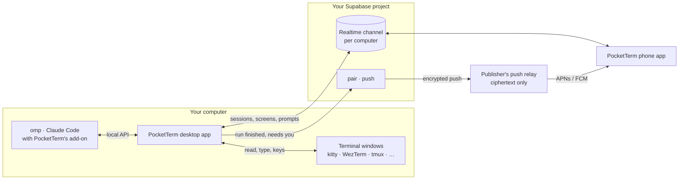

<div align="center">


# PocketTerm

**Control the coding agents running on your computer from your phone.**

[](https://github.com/danyzmaj-apps/pocketterm/actions/workflows/ci.yml)
[](https://github.com/danyzmaj-apps/pocketterm/releases/latest)
[](LICENSE)


<br>


&nbsp;

&nbsp;


</div>

---

PocketTerm is a desktop app (macOS menu bar, Windows tray) and a phone app (iPhone, Android). Leave [omp](https://github.com/can1357/oh-my-pi) or [Claude Code](https://github.com/anthropics/claude-code) working in a terminal, walk away, and keep driving it from your phone. The phone reaches your computer through a [Supabase](https://supabase.com) project that you own; there is no PocketTerm cloud.

## What it does

- **Conversations.** omp and Claude Code sessions show as conversations, grouped by project: streamed Markdown answers, tool calls as cards. Prompt (with images), steer or queue, stop a run, and type `/` for slash commands.
- **Screens.** Every other terminal window is a live screen you can type and press keys in.
- **Approvals and questions.** Answer the agent's questions, approve tool calls and review plans with a tap.
- **Pushes.** A notification when a run finishes or the agent needs you. A Live Activity on iPhone and an ongoing notification on Android for the sessions you follow.
- **Switch to conversation.** A session opened before PocketTerm was installed shows only its screen; **Switch to conversation** restarts omp on the same conversation (`omp -c`), and picks up what it was doing if you ask, or reloads Claude Code's plugins (nothing restarts).
- **New sessions.** Start your agent or a shell in any project without taking the computer's focus.
- **Tips on first use.** Each control gets a one-time spotlight and a line on what it does.
- **Several computers.** One account, several Macs and Windows PCs; pick one on the phone.

## How it works



- **The desktop app** finds your coding sessions (the omp extension and Claude Code plugin it installs report to it over `127.0.0.1`) and your terminal windows (through each terminal's own API), and relays them to your phone.
- **Your Supabase project** is the only server: it signs you in, pairs your phones, carries a private Realtime channel per computer and sends pushes. The free plan is enough for one person. The setup wizard creates it for you.
- **Pushes** leave your server encrypted with a key only your phone has, and reach Apple or Google through the publisher's relay, which can't read them.

The sessions live on the computer: it has to be awake, with PocketTerm running and **Terminal from phone** on. While that switch is on, PocketTerm keeps the computer from idle sleep; a closed lid (without an external display) or a shut-down computer ends it. A push goes out only when nobody has touched the computer for 60 seconds.

## Supported platforms

| Device | Requires |
| --- | --- |
| Mac | macOS 13 or later |
| Windows PC | Windows 10 (1809 or later) or 11, x64 |
| iPhone | iOS 17 or later |
| Android | Android 8.0 or later |

**Coding agents:** [omp](https://github.com/can1357/oh-my-pi) and [Claude Code](https://github.com/anthropics/claude-code) 2.1.287 or later. Any other program in a supported terminal shows as a live screen.

**Terminals:** what the phone can do depends on the terminal.

| Terminal | Platform | Sessions and screens | Colors | Keys and answers from the phone |
| --- | --- | --- | --- | --- |
| kitty | macOS | Yes | Yes | Yes |
| WezTerm | macOS, Windows | Yes | Yes | Yes |
| tmux (in any terminal) | macOS | Yes | Yes | Yes |
| iTerm2 | macOS | Yes | No | Yes |
| Ghostty | macOS | Sessions, no screen | No | Keys; answer on the computer |
| Terminal | macOS | Yes, whole lines only | No | Answer on the computer |

- **macOS:** with tmux installed (`brew install tmux`), sessions the phone starts in Terminal or Ghostty run inside tmux and get full control. kitty needs one click in **Settings → Terminals → Set up** (then restart kitty); iTerm2, Terminal and Ghostty need macOS's Automation permission (**Allow…**).
- **Windows:** only [WezTerm](https://wezterm.org) windows are listed: it is the only Windows terminal another program can read and type into. The setup checklist and **Settings → Terminals** install it for you (or run `winget install --id wez.wezterm --exact`). Windows Terminal, conhost and WSL windows don't show up. Images sent from the phone must be PNG or JPEG (the phone apps send JPEG).

## Getting started

### 1. Install

| Device | Get it |
| --- | --- |
| Mac | [PocketTerm-0.1.0.dmg](https://github.com/danyzmaj-apps/pocketterm/releases/download/v0.1.0/PocketTerm-0.1.0.dmg). Notarized; updates itself. |
| Windows | [PocketTerm-0.1.0-setup.exe](https://github.com/danyzmaj-apps/pocketterm/releases/download/v0.1.0/PocketTerm-0.1.0-setup.exe). Installs for your user only. Not code-signed yet, so SmartScreen warns: **More info → Run anyway**. Settings shows a link when a new version is out. |
| iPhone | TestFlight, for invited testers only. |
| Android | Google Play internal testing, for invited testers only. |

All downloads are on the [releases page](https://github.com/danyzmaj-apps/pocketterm/releases/latest). The phone apps aren't on the App Store or Google Play; without an invitation, [build the phone app from source](docs/BUILDING.md).

### 2. Set up your server

Open PocketTerm on your computer and click **Set up my server**. The wizard takes about five minutes and needs a free [Supabase](https://supabase.com) account (it hosts your server) and a [GitHub](https://github.com) account (you sign in with it). Already have a server? Choose **I already have one: connect it**. Prefer a script? See [Self-hosting](#self-hosting).

### 3. Get the computer ready

After you sign in with GitHub, a checklist installs PocketTerm into omp and Claude Code, sets up your terminals and adds your project folders. Sessions that were already open show only their screen until they pick PocketTerm up: tap **Switch to conversation** on the phone, or do it on the computer (`/reload-plugins` in Claude Code; quit omp and run `omp -c`).

### 4. Pair your phone

In the phone app, tap **Scan the code from your computer** and scan the QR code the checklist shows (later: **Settings → Add a phone…**). The code works once, for 10 minutes. One phone pairing covers every computer on your account.

<p align="center">
  
  
  
</p>

Settings then shows a status bar (**All set**, or what needs attention and the button that fixes it) over four tabs: **Phone**, **Coding agents**, **Terminals** and **Account**. Problems? See [Troubleshooting](docs/SELF_HOSTING.md#troubleshooting).

## Self-hosting

Every user runs their own server; nothing is shared between users. [docs/SELF_HOSTING.md](docs/SELF_HOSTING.md) covers the wizard in detail, setting up a server by script (`apps/pocketterm-desktop/tool/setup-backend.sh`), sharing a server, updating it, running your own push relay and troubleshooting.

## Security and privacy

- **Your server.** Sign-in, pairing, the terminal channel and push registrations live in your Supabase project, behind row-level security. The apps hold only its publishable key. Sign-up is private: after the first account, nobody gets in unless you allow their email.
- **Nothing stored.** Sessions and screens travel over a Realtime channel per computer that only your account can join; nothing on it is stored. Images you send pass through a private storage bucket in your project.
- **Encrypted push.** The relay sees only ciphertext and stores nothing. iPhone Live Activity updates can't be encrypted, so they carry only a session's state, never text.
- **Local only.** The desktop app's API listens on `127.0.0.1` behind a random token.
- **Delete account** in Settings (computer or phone) removes everything.

Details are in [SECURITY.md](SECURITY.md) and the [privacy policy](https://www.danyzmaj.com/pocketterm/privacy/). Report vulnerabilities privately as described in [SECURITY.md](SECURITY.md#reporting).

## Development

PocketTerm is one Dart pub workspace, with Flutter pinned in `.fvmrc`:

| Path | What |
| --- | --- |
| [`apps/pocketterm-desktop`](apps/pocketterm-desktop) | The desktop app for macOS and Windows, the backend it deploys (`supabase/`), the omp extension and Claude Code plugin (`integrations/`), and the setup and release scripts (`tool/`) |
| [`apps/pocketterm-mobile`](apps/pocketterm-mobile) | The phone app for iPhone and Android |
| [`packages/pocketterm_core`](packages/pocketterm_core) | Code both apps share: sign-in, the terminal protocol, the terminal hosts |
| [`config`](config) | The Xcode signing identity (team, bundle id, App Group) |
| [`docs`](docs) | Architecture, building, releasing, self-hosting |

```sh
# at the repo root: Flutter and the whole workspace's packages
fvm install && fvm flutter pub get

# in apps/pocketterm-desktop
fvm flutter run -d macos        # or -d windows on a Windows PC

# in apps/pocketterm-mobile
fvm flutter run -d <device>

# in each of packages/pocketterm_core, apps/pocketterm-desktop, apps/pocketterm-mobile
fvm dart format -l 120 lib test && fvm flutter analyze && fvm flutter test
```

| Doc | What |
| --- | --- |
| [ARCHITECTURE.md](docs/ARCHITECTURE.md) | How the pieces fit: layout, backend, terminals, local API |
| [BUILDING.md](docs/BUILDING.md) | Building every app with your own signing identity, and a local backend |
| [CONTRIBUTING.md](CONTRIBUTING.md) | Every check CI runs, and what a pull request needs |
| [RELEASING.md](docs/RELEASING.md) | How releases are made (maintainer notes) |
| [CHANGELOG.md](CHANGELOG.md) | What changed in each version |

## License

[MIT](LICENSE) © 2026 Danijel Lovric
