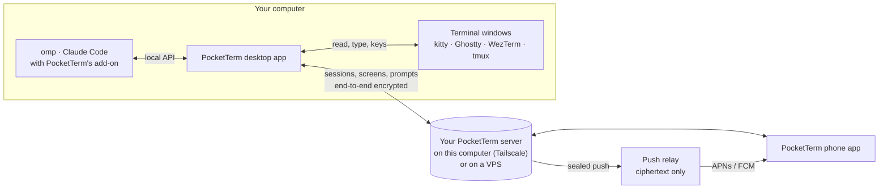
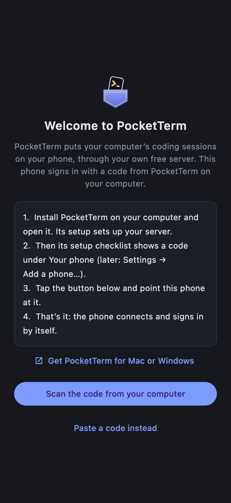
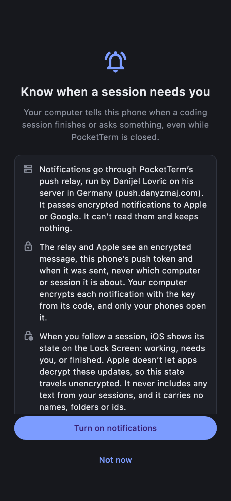

<div align="center">


# PocketTerm

**Control the coding agents running on your computer from your phone.**

[](https://github.com/danyzmaj-apps/pocketterm/actions/workflows/ci.yml)
[](https://github.com/danyzmaj-apps/pocketterm/releases/latest)
[](LICENSE)


<br>


&nbsp;

&nbsp;


</div>

---

PocketTerm is a desktop app (macOS menu bar, Windows tray) and a phone app (iPhone, Android). Leave [omp](https://github.com/can1357/oh-my-pi) or [Claude Code](https://github.com/anthropics/claude-code) working in a terminal, walk away, and keep driving it from your phone. Your computer and your phone meet in a PocketTerm server that you run, on your computer or on a VPS. Everything between them is end-to-end encrypted. There is no PocketTerm cloud.

## What it does

- **Your sessions, by project.** omp and Claude Code sessions grouped by project, then every other terminal window. Sort projects by name or recent activity, tap a project's heading to fold it, long-press it for a new session there or to fold the others.
- **Conversations.** Each session reads as a conversation: streamed Markdown answers, tool calls as cards. Prompt (with images), steer or queue, stop a run, and type `/` for slash commands.
- **Screens.** Every other terminal window is a live screen you can type and press keys in.
- **Approvals and questions.** Answer the agent's questions, approve tool calls and review plans with a tap.
- **Notifications, if you want them.** A push when a run finishes or the agent needs you. A Live Activity on iPhone and an ongoing notification on Android for the sessions you follow.
- **Switch to conversation.** A session opened before PocketTerm was installed in its agent shows only its screen. **Switch to conversation** restarts omp on the same conversation (`omp -c`); if it was working, **Restart and continue** has it carry on and **Just restart** leaves it stopped. In Claude Code it reloads the plugins and nothing restarts.
- **New and ended sessions.** Start your agent or a shell in any project without taking the computer's focus. Swipe a row left to **End session** (or **Close window**).
- **Several computers.** One server, several Macs and Windows PCs; pick one on the phone.
- **A demo.** **Try the demo** on the phone shows made-up sessions without a computer.

## How it works

The sessions run on your computer. The desktop app finds your coding sessions (the omp extension and Claude Code plugin it installs report to it over `127.0.0.1`) and your terminal windows (through each terminal's own API), and passes them to your phone through your PocketTerm server. The server runs in one of two places:

| | **On this computer** | **On my own server** |
| --- | --- | --- |
| What | The server built into the desktop app | A VPS you rent, running the server in Docker with Caddy for HTTPS |
| Cost | Free | The VPS (a small one is enough) |
| How the phone gets there | [Tailscale](https://tailscale.com) on the computer and the phone, signed in to the same account | The internet, over HTTPS |
| Good to know | This computer must stay awake for your phone to connect | Several computers share one server |

Tailscale's Personal plan is free (up to 3 users, 100 devices). Sign in with a personal Google, Apple, GitHub or Microsoft account; a work email domain may start a paid business trial instead.

Interactive diagrams of both setups: [docs/how-it-works.html](docs/how-it-works.html)



- **The PocketTerm server** pairs your phones, keeps the list of your computers, passes the live channel between a computer and its phones and sends pushes. It only ever sees ciphertext.
- **End-to-end encryption.** Each computer has its own key, which reaches a phone only in that computer's QR code. Sessions, screens, prompts, images and notification text are sealed with it on one end and opened on the other.
- **Pushes** are sealed by the computer and reach Apple or Google through PocketTerm's push relay, which can't read them.

The computer has to be awake, with PocketTerm running and **Terminal from phone** on. While that switch is on, PocketTerm keeps the computer from idle sleep; a closed lid (without an external display) or a shut-down computer ends it. A push goes out only when nobody has touched the computer for 60 seconds.

## Supported platforms

| Device | Requires |
| --- | --- |
| Mac | macOS 13 or later |
| Windows PC | Windows 10 (1809 or later) or 11, x64 |
| iPhone | iOS 17 or later |
| Android | Android 8.0 or later |

**Coding agents:** [omp](https://github.com/can1357/oh-my-pi), and [Claude Code](https://github.com/anthropics/claude-code) 2.1.287 or later. Any other program in a supported terminal shows as a live screen.

**Terminals:** what the phone can do depends on the terminal.

| Terminal | Platform | Sessions and screens | Colors | Keys and answers from the phone |
| --- | --- | --- | --- | --- |
| kitty | macOS | Yes | Yes | Yes |
| Ghostty 1.3 or later, with tmux | macOS | Yes | Yes | Yes |
| Ghostty 1.3 or later, without tmux | macOS | Sessions, no screen | No | Keys; answer on the computer |
| WezTerm 20230326 or later | macOS, Windows | Yes | Yes | Yes |
| tmux (in any of these) | macOS | Yes | Yes | Yes |

- **macOS:** Ghostty doesn't let other apps read its windows, so sessions the phone starts in Ghostty run inside tmux. For Ghostty windows you open yourself, **Settings → Terminals → Start new windows in tmux** does the same (it adds two marked lines to your Ghostty config; **Remove** takes them out). **Install tmux** runs `brew install tmux` once you confirm. kitty needs one click in **Settings → Terminals → Set up** (then restart kitty); Ghostty needs macOS's Automation permission (**Allow…**).
- **Windows:** only [WezTerm](https://wezterm.org) windows are listed: it is the Windows terminal another program can read and type into. The setup checklist and **Settings → Terminals** install it for you (or run `winget install --id wez.wezterm --exact`). Images sent from the phone must be PNG or JPEG (the phone apps send JPEG).

## Getting started

### 1. Install

| Device | Get it |
| --- | --- |
| Mac | [PocketTerm-0.1.0.dmg](https://github.com/danyzmaj-apps/pocketterm/releases/download/v0.1.0/PocketTerm-0.1.0.dmg). Notarized; updates itself. |
| Windows | [PocketTerm-0.1.0-setup.exe](https://github.com/danyzmaj-apps/pocketterm/releases/download/v0.1.0/PocketTerm-0.1.0-setup.exe). Installs for your user only. Not code-signed yet, so SmartScreen warns: **More info → Run anyway**. Settings shows a link when a new version is out. |
| iPhone | TestFlight, for invited testers. |
| Android | Google Play internal testing, for invited testers. |

All downloads are on the [releases page](https://github.com/danyzmaj-apps/pocketterm/releases/latest). The phone apps aren't on the App Store or Google Play; without an invitation, [build the phone app from source](docs/BUILDING.md).

### 2. Set up your server

Open PocketTerm on your computer. Its setup wizard asks where the server should run:

- **On this computer:** a checklist installs and signs in to Tailscale, turns on its HTTPS certificates and starts the server. Install the Tailscale app on your phone too and sign in to the same account.
- **On my own server:** paste the setup link of a server you already have, or give the wizard your VPS's address and run the four commands it shows (install Docker, get the compose file, start it, print the setup link). The wizard checks each step as you go.

PocketTerm never runs anything on your computer without asking: where it can install something for you, the button shows the exact command and runs it only after you press **Run**. Every step, with screenshots: [docs/SELF_HOSTING.md](docs/SELF_HOSTING.md).

<p align="center">
  
  
</p>

### 3. Get the computer ready

Once the computer is signed in, **Get this computer ready** installs PocketTerm into omp and Claude Code, then lists your terminals with their one-click fixes, offers your usual project folders and shows the code for your phone. Each step checks itself off; **Done** opens Settings. Sessions that were already open show only their screen until they pick PocketTerm up: tap **Switch to conversation** on the phone, or do it on the computer (`/reload-plugins` in Claude Code; quit omp and run `omp -c`).

### 4. Scan the code with your phone

In the phone app, tap **Scan the code from your computer** and scan the QR code the checklist shows (later: **Add a phone…** in Settings). The code signs the phone in once, within 10 minutes, and carries that computer's encryption key, so only show it to your own phone. With several computers, scan each computer's code once (the phone shows a computer it can't read yet as locked, with a **Scan** button).

<p align="center">
  
  
</p>

### 5. Settings

After the checklist, the window is Settings. At the top, a status bar says **All set**, or how many things need attention: **Show** lists each with the button that fixes it, a dot marks the tab it's on, and **Open setup checklist** brings the checklist back. Four tabs:

- **Phone:** the **Terminal from phone** switch, **Add a phone…**, **Reset key** and your project folders.
- **Coding agents:** a card per agent with **Install** or **Update**, sessions opened before PocketTerm with the command that picks it up, and **Make default** (what a new session from the phone starts).
- **Terminals:** where new sessions open (**Auto** picks the terminal app you used last), and a card per terminal with how it stands and its one-click fix.
- **Account:** your server, Tailscale when this computer runs the server, **Add a computer…**, **Launch at login**, **How your data is protected**, **Sign out**, the version and **Quit PocketTerm**.

<p align="center">
  
  
</p>

Closing the window keeps PocketTerm running in the menu bar (Mac) or tray (Windows). Problems? See [Troubleshooting](docs/SELF_HOSTING.md#troubleshooting).

## Push notifications

Notifications are off until you turn them on in the phone app, which says who sees what before it asks; **Account → Notifications** changes it later. They go from your server through PocketTerm's push relay, `push.danyzmaj.com`, run by Danijel Lovric on his server in Germany, to Apple or Google:

- The computer encrypts each notification with its key; only your phone opens it. The relay and Apple or Google see the phone's push token, which computer it's from and when it comes, never what it says.
- Your server seals every request to the relay's own key, so nothing in between reads it. The relay stores nothing.
- Live Activities on iPhone (and their Android ongoing notifications) carry only a session's state (working, needs you, finished), never its title or text: Apple delivers those to the system directly, so they can't be encrypted.

<p align="center">
  
</p>

Who can see what in detail: [apps/pocketterm-relay/SECURITY.md](apps/pocketterm-relay/SECURITY.md).

## Security and privacy

- **Your server.** Every user runs their own PocketTerm server; nothing is shared between users. It keeps your devices (only the SHA-256 of each one's token), your computers' names, pairing codes for 10 minutes and your phones' push tokens.
- **End-to-end encrypted.** Sessions, screens, prompts, images and notification text are sealed (AES-256-GCM) with a key per computer that never goes to a server: a phone gets it only by scanning that computer's QR code, so treat the QR as a secret. **Reset key** (Settings → Phone) locks out every phone, a lost one included; the others scan again.
- **Nothing stored in the clear.** Sessions and screens pass through the server as ciphertext and aren't kept. Images you send wait sealed on the server until the computer downloads them, at most an hour.
- **Tailscale** (On this computer) sees which of your devices connect and when, not what they send.
- **Local only.** The desktop app's API listens on `127.0.0.1` behind a random token.
- **Leaving.** **Sign out** on a computer and **Leave this server** on a phone end that device's sign-in and remove its keys. **Erase this server's data** on a computer that runs the server signs every device out and deletes what the server keeps.

Details are in [SECURITY.md](SECURITY.md) and the [privacy policy](https://www.danyzmaj.com/pocketterm/privacy/). Report vulnerabilities privately as described in [SECURITY.md](SECURITY.md#reporting).

## Self-hosting

Both setups are self-hosted: [docs/SELF_HOSTING.md](docs/SELF_HOSTING.md) covers the wizard step by step, the VPS commands, adding computers and phones, updating, running your own push relay, troubleshooting and removing it. Already run your own servers? [What the PocketTerm server needs](apps/pocketterm-server/README.md#what-it-needs): one process, port 47900 behind your HTTPS, a WebSocket at `/v1/ws`, and one data folder to back up.

## Development

PocketTerm is one Dart pub workspace, with Flutter pinned in `.fvmrc`:

| Path | What |
| --- | --- |
| [`apps/pocketterm-desktop`](apps/pocketterm-desktop) | The desktop app for macOS and Windows, with the built-in server and Tailscale setup (`lib/hosting/`), the omp extension and Claude Code plugin (`integrations/`), and the release script (`tool/`) |
| [`apps/pocketterm-mobile`](apps/pocketterm-mobile) | The phone app for iPhone and Android |
| [`packages/pocketterm_core`](packages/pocketterm_core) | Code both apps share: the server client, end-to-end encryption, the terminal protocol, the terminal hosts |
| [`packages/pocketterm_server`](packages/pocketterm_server) | The PocketTerm server: HTTP and WebSocket API ([PROTOCOL.md](packages/pocketterm_server/PROTOCOL.md)), storage, the push relay client |
| [`apps/pocketterm-server`](apps/pocketterm-server) | The server's command (`pocketterm-server`), Docker image and compose file for a VPS |
| [`apps/pocketterm-relay`](apps/pocketterm-relay) | The push relay (Deno) that passes sealed pushes to APNs and FCM |
| [`tool/e2e`](tool/e2e) | The end-to-end harness: a real server, the desktop app, real terminals and the phone in the Simulator or an emulator |
| [`config`](config) | The Xcode signing identity (team, bundle id, App Group) |
| [`docs`](docs) | Architecture, building, releasing, self-hosting |

```sh
# at the repo root: Flutter and the whole workspace's packages
fvm install && fvm flutter pub get

# in apps/pocketterm-desktop
fvm flutter run -d macos        # or -d windows on a Windows PC

# in apps/pocketterm-mobile
fvm flutter run -d <device>

# in each of packages/pocketterm_core, apps/pocketterm-desktop, apps/pocketterm-mobile
fvm dart format -l 120 lib test && fvm flutter analyze && fvm flutter test

# in packages/pocketterm_server
fvm dart format -l 120 lib test && fvm dart analyze --fatal-infos && fvm dart test

# in apps/pocketterm-relay
deno fmt --check && deno check main.ts tests/*.ts && deno task test
```

End to end on a Mac, with kitty, Ghostty and WezTerm windows and the phone in the iOS Simulator (pass/fail table, artifacts in `build/e2e/`):

```sh
tool/e2e/run.sh --terminal all
```

| Doc | What |
| --- | --- |
| [ARCHITECTURE.md](docs/ARCHITECTURE.md) | How the pieces fit: layout, server, encryption, terminals, local API |
| [BUILDING.md](docs/BUILDING.md) | Building every app with your own signing identity, and a local server |
| [CONTRIBUTING.md](CONTRIBUTING.md) | Every check CI runs, and what a pull request needs |
| [RELEASING.md](docs/RELEASING.md) | How releases are made (maintainer notes) |
| [CHANGELOG.md](CHANGELOG.md) | What each version brings |

## License

[MIT](LICENSE) © 2026 Danijel Lovric
