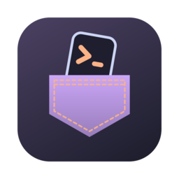
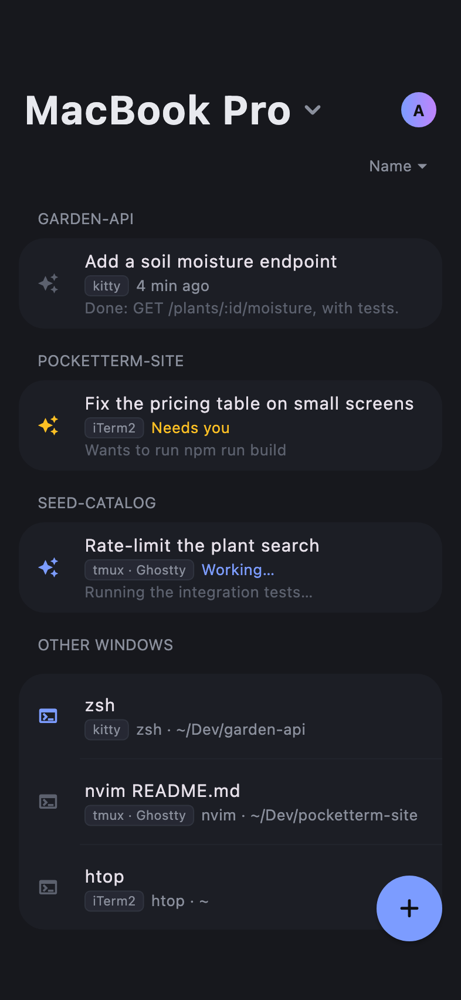
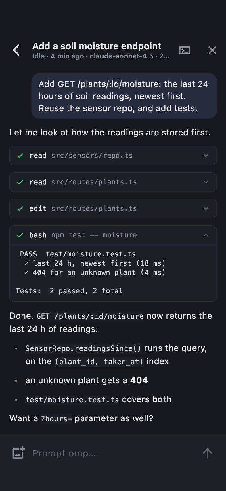
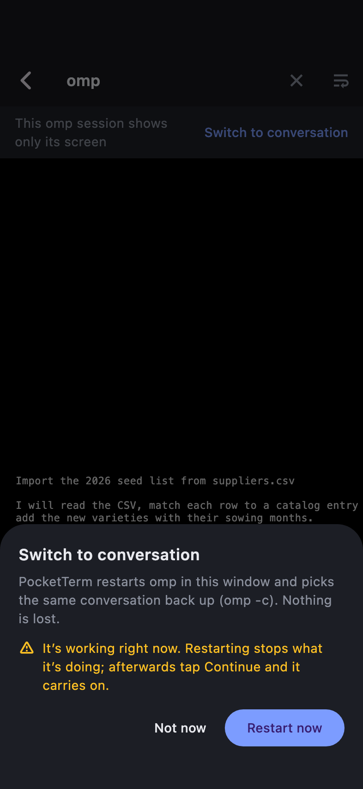

<div align="center">



# PocketTerm

**Control the coding agents running on your computer from your phone.**

[](https://github.com/danyzmaj-apps/pocketterm/releases/latest)
[](LICENSE)


<br>


&nbsp;

&nbsp;


</div>

---

PocketTerm is a desktop app (macOS menu bar, Windows tray) and a phone app (iPhone, Android). Leave [omp](https://github.com/can1357/oh-my-pi) or [Claude Code](https://github.com/anthropics/claude-code) working in a terminal and keep driving it from your phone. Computer and phone meet in a PocketTerm server that you run, on the computer itself or on a VPS, and everything between them is end-to-end encrypted. There is no PocketTerm cloud.

## What it does

- **Conversations.** Each coding session reads as a conversation: streamed Markdown answers, tool calls as cards. Prompt, steer or queue, stop a run, and type `/` for the agent's slash commands. Queued prompts wait on your computer, where you can edit, reorder, delete or pause them from the phone until each one's turn.
- **Images and files.** Up to 10 per message, from the camera roll, the clipboard or the phone's files, up to 20 MB each. The agent gets them the way you would give them at the computer: saved there and named in the prompt as `@path`.
- **Approvals and questions.** Answer the agent's questions, approve tool calls and review plans with a tap.
- **Screens and keys.** Every other terminal window is a live screen you can type and press keys in.
- **New and ended sessions.** Start your agent or a shell in any project folder without taking the computer's focus; swipe a row to end a session or close a window.
- **An orchestrator.** Ask one omp session about all the others from the bar beside the +: it lists them, reads their conversations, and prompts or stops one when you ask. It runs in PocketTerm's own folder on the computer, and only it gets those tools.
- **Switch to conversation.** A session opened before PocketTerm was installed shows only its screen. **Switch to conversation** restarts omp on the same conversation (`omp -c`), or reloads Claude Code's plugins.
- **Notifications and Live Activities.** Opt-in pushes when a run finishes or the agent needs you, and a Live Activity (iPhone) or ongoing notification (Android) for the sessions you follow.
- **Several computers.** One server, several Macs and Windows PCs; pick one on the phone.
- **A demo.** **Try the demo** on the phone shows made-up sessions, with no computer or server.

## How it works

The desktop app finds your coding sessions (through the omp extension and Claude Code plugin it installs) and your terminal windows (through each terminal's own API) and passes them to your phone through your PocketTerm server. The setup wizard offers three places for it:

| | **On this computer** | **On my own server** | **Supabase** |
| --- | --- | --- | --- |
| Who runs the server | This computer (built into the desktop app) | You, in Docker on a VPS you rent, with Caddy for HTTPS | Supabase, in a region you pick (a free project the wizard sets up) |
| Phone reaches it over | [Tailscale](https://tailscale.com), same account on computer and phone | Your domain, over HTTPS | supabase.co, over HTTPS |
| Extra apps | Tailscale on the computer and the phone | None | None |
| Cost | Free (Tailscale Personal plan) | The VPS (a small one is enough) | Free plan (pauses after about a week unused) |
| Several computers on one server | Yes, through Tailscale | Yes | Yes |
| This computer must be awake | Yes | Yes | Yes |
| Contents (sessions, prompts, images, files, notification text) | End-to-end encrypted | End-to-end encrypted | End-to-end encrypted |
| Who can see metadata (device list, computer names, push tokens, when devices talk) | Only you; Tailscale sees device names and IPs | You and your VPS host | Supabase (also sees connection IPs) |
| Reachable from the internet | No, only your own Tailscale devices | Yes, but every request needs a device token | Yes, but every request needs a device token |

Your sessions run on the computer in every option, so it has to be awake, with PocketTerm running and **Terminal from phone** on. While that switch is on, PocketTerm keeps the computer from idle sleep. Pushes go out only when nobody has touched the computer for 60 seconds.

Interactive diagrams of the setups and of pairing: [docs/how-it-works.html](docs/how-it-works.html).

## Security and privacy

- **End-to-end encryption.** Each computer makes its own 256-bit key. It reaches a phone only inside that computer's QR code, scanned with the in-app scanner, and never goes to any server. Sessions, screens, keystrokes, prompts, images, files and notification text are sealed with it (AES-256-GCM). Every live message carries a timestamp, a random id and a sequence number, so a recorded message can't be replayed.
- **Your server.** Every owner runs their own; nothing is shared between owners. It stores your device list (a SHA-256 of each device token), your computers' names, pairing codes for 10 minutes and your phones' push tokens. Images and files wait there sealed until the computer fetches them, at most an hour. Everything else passes through as ciphertext and isn't kept.
- **Supabase** (the Supabase option) holds that same metadata in the region you pick, and sees connection IP addresses. Contents stay end-to-end encrypted. The personal access token the wizard asks for covers your whole Supabase organization; PocketTerm uses it only during setup and never stores it.
- **Push relay (opt-in).** Notifications go through PocketTerm's relay at `push.danyzmaj.com`, run by Danijel Lovric in Germany, to Apple or Google. They see an encrypted message, a push token and a time; no computer or session ids. The relay stores nothing.
- **iPhone Lock Screen.** Apple delivers Live Activity updates unencrypted, so a followed session's state (working, needs you, finished) is visible to Apple, the relay and your server. It never carries text, names, folders or ids.
- **Tailscale** (On this computer) sees device metadata: which of your devices connect and when, not what they send.
- **No keys from links.** Only the in-app scanner adds a key; a link opened from outside the app never can.
- **Reset key.** **Settings → Phone → Reset key** makes a new key: a lost phone can no longer read your sessions, and your other phones scan again. **Settings → Account** lists the phones signed in to your server; **Sign out…** next to a lost one ends its sign-in, so it can no longer reach your server or get notifications.

Full model: [SECURITY.md](SECURITY.md). What the publisher collects: the [privacy policy](https://www.danyzmaj.com/pocketterm/privacy/).

## Requirements

| Device | Requires |
| --- | --- |
| Mac | macOS 13 or later |
| Windows PC | Windows 10 (1809 or later) or 11, x64 |
| iPhone | iOS 17 or later |
| Android | Android 8.0 or later |

**Coding agents:** [omp](https://github.com/can1357/oh-my-pi) and [Claude Code](https://github.com/anthropics/claude-code) 2.1.287 or later. Any other program in a supported terminal shows as a live screen.

**Terminals:**

| Terminal | Platform | Notes |
| --- | --- | --- |
| kitty | macOS | One click in **Settings → Terminals → Set up**, then restart kitty |
| iTerm2 | macOS | Needs macOS Automation permission. Screens show without colors |
| Ghostty 1.3 or later, with tmux | macOS | Needs macOS Automation permission. Without tmux, sessions show without a screen and answers happen on the computer |
| WezTerm 20230326 or later | macOS, Windows | The only supported terminal on Windows; PocketTerm offers to install it |
| tmux | macOS | Inside any of the above |

**Tailscale** (On this computer only): the free Personal plan is enough. Sign in with a personal Google, Apple, GitHub or Microsoft account; a work email domain may start a business trial instead.

## Getting started

1. **Install.**

   | Device | Get it |
   | --- | --- |
   | Mac | [PocketTerm-0.1.7.dmg](https://github.com/danyzmaj-apps/pocketterm/releases/download/v0.1.7/PocketTerm-0.1.7.dmg): notarized, updates itself |
   | Windows | [PocketTerm-0.1.7-setup.exe](https://github.com/danyzmaj-apps/pocketterm/releases/download/v0.1.7/PocketTerm-0.1.7-setup.exe): per-user install. Not code-signed yet: on the SmartScreen warning choose **More info → Run anyway** |
   | iPhone | TestFlight, for invited testers |
   | Android | Google Play internal testing, for invited testers |

   Without an invitation, [build the phone app from source](docs/BUILDING.md).

2. **Set up the server.** Open PocketTerm on the computer. The wizard asks where the server runs and walks you through it: installing and signing in to Tailscale, the four commands for a VPS, or a Supabase access token for a project it sets up itself. It shows every command before it runs anything.
3. **Get the computer ready.** The checklist offers to install PocketTerm into omp and Claude Code (one click each), fixes up your terminals and offers your project folders.
4. **Scan the code.** In the phone app, tap **Scan the code from your computer** and scan the QR code the checklist shows (later: **Settings → Phone → Add a phone…**). The code is single-use for sign-in, expires in 10 minutes and carries the computer's key: show it only to your own phone. With several computers, scan each one's code once.

<p align="center">
  
  
</p>

On first launch the phone offers a short tour of what you can tap. Problems: [Troubleshooting](docs/SELF_HOSTING.md#troubleshooting).

## Self-hosting

The first two setups are self-hosted; the third runs on your own Supabase project. [docs/SELF_HOSTING.md](docs/SELF_HOSTING.md) covers the wizard step by step, the VPS commands, [Supabase](docs/SELF_HOSTING.md#supabase), adding computers and phones, updating, running your own push relay and removing everything. For the server on its own: [what the PocketTerm server needs](apps/pocketterm-server/README.md#what-it-needs).

## Development

One Dart pub workspace, Flutter pinned in `.fvmrc`.

| Path | What |
| --- | --- |
| [`apps/pocketterm-desktop`](apps/pocketterm-desktop) | Desktop app for macOS and Windows, with the built-in server, the Supabase setup ([`supabase/`](apps/pocketterm-desktop/supabase)), the omp extension and Claude Code plugin |
| [`apps/pocketterm-mobile`](apps/pocketterm-mobile) | Phone app for iPhone and Android |
| [`packages/pocketterm_core`](packages/pocketterm_core) | Shared code: server client, end-to-end encryption, terminal protocol and hosts |
| [`packages/pocketterm_server`](packages/pocketterm_server) | The server: HTTP and WebSocket API ([PROTOCOL.md](packages/pocketterm_server/PROTOCOL.md)), storage, relay client |
| [`apps/pocketterm-server`](apps/pocketterm-server) | Server command, Docker image and compose file |
| [`apps/pocketterm-relay`](apps/pocketterm-relay) | Push relay (Deno) to APNs and FCM |
| [`tool/e2e`](tool/e2e), [`tool/smoke`](tool/smoke) | End-to-end harness; installed-app smoke |
| [`docs`](docs) | [Architecture](docs/ARCHITECTURE.md), [building](docs/BUILDING.md), [testing](docs/TESTING.md), [releasing](docs/RELEASING.md), [self-hosting](docs/SELF_HOSTING.md) |

```sh
fvm install && fvm flutter pub get                 # repo root

fvm flutter run -d macos                           # apps/pocketterm-desktop (-d windows on Windows)
fvm flutter run -d <device>                        # apps/pocketterm-mobile

# packages/pocketterm_core, apps/pocketterm-desktop, apps/pocketterm-mobile
fvm dart format -l 120 lib test && fvm flutter analyze && fvm flutter test
# packages/pocketterm_server
fvm dart format -l 120 lib test && fvm dart analyze --fatal-infos && fvm dart test
# apps/pocketterm-relay
deno fmt --check && deno check main.ts tests/*.ts && deno task test
```

End to end on a Mac (a server, the desktop app, kitty, Ghostty and WezTerm, the phone in the iOS Simulator or an Android emulator; results in `build/e2e/`). `--server` picks a local server (the default), the built-in one over Tailscale, Supabase (local or a new project on supabase.com) or a server elsewhere. Run only what covers your change and the features around it; how to pick and what each covers: [docs/TESTING.md](docs/TESTING.md#what-to-run-for-a-change).

```sh
tool/e2e/run.sh --terminal kitty --phone-only fresh,pair-accept,theme   # e.g. a change to the phone's theme picker
```

Contributions: [CONTRIBUTING.md](CONTRIBUTING.md). Changes per version: [CHANGELOG.md](CHANGELOG.md).

## License

[MIT](LICENSE) © 2026 Danijel Lovric
