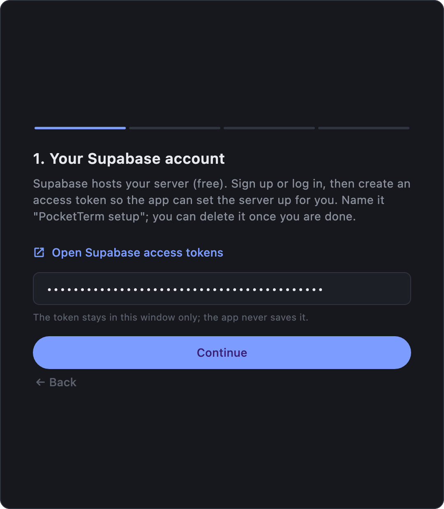
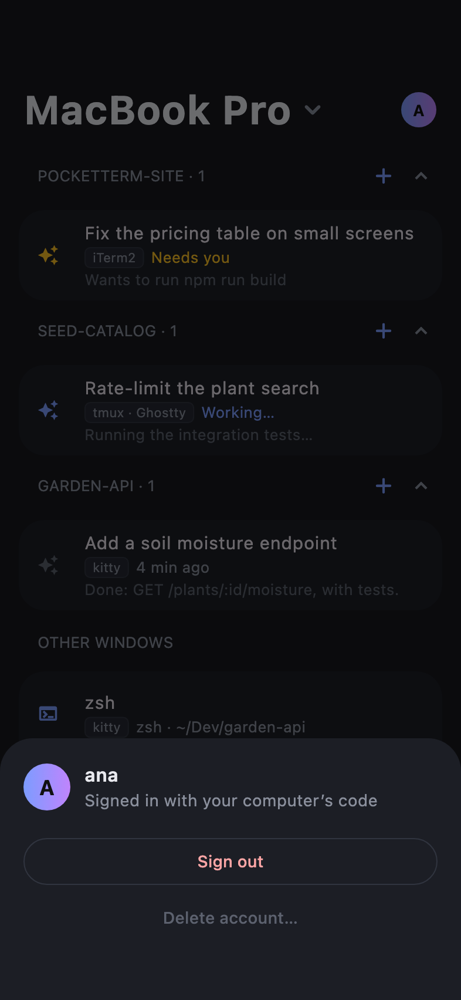
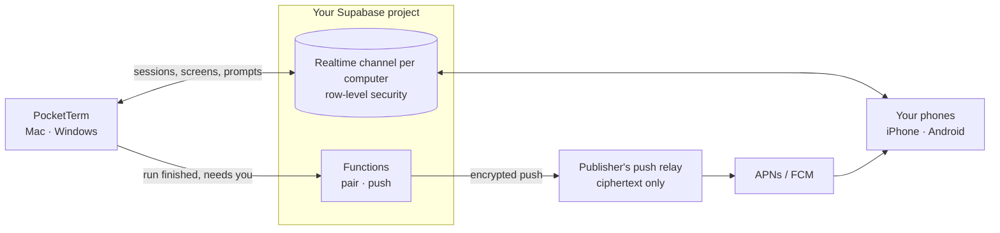

# PocketTerm

**Your computer's coding sessions on your phone: omp and Claude Code as a conversation you can prompt, steer and answer from anywhere, and your other terminal windows as live screens, through a server you own.**

PocketTerm is a desktop app (macOS menu bar, Windows tray) plus an iPhone and Android app. Leave a coding agent working on your computer, walk away, and keep driving it from your phone: a push when it finishes or needs you, its questions and approvals answered with a tap. The phone reaches your computer through a free [Supabase](https://supabase.com) project that **you** own: there is no PocketTerm cloud.

## What it does

- **Sessions as conversations:** your computer's [omp](https://github.com/can1357/oh-my-pi) and [Claude Code](https://github.com/anthropics/claude-code) sessions, grouped by project. Answers stream in as Markdown, tool calls show as cards. Prompt a session (with images), steer or queue while omp works, stop a run, answer questions, tool approvals and plan reviews, and type `/` for the agent's slash commands.
- **Any other window** is a live screen, colors included where the terminal gives them, that you can type into and press keys in.
- **New sessions:** start your coding agent, or a shell, in any of your projects without taking the computer's focus. **New project…** makes the folder first.
- **Never miss a finished run:** a push when the agent finishes or needs you, a Live Activity on the iPhone and an ongoing notification on Android for the session you follow.
- **Several computers:** one account can run PocketTerm on several Macs and Windows PCs. The phone lists them and you pick one; a push opens its session on the computer it came from.
- **Private by design:** everything goes through your own Supabase project, nothing the terminal carries is stored, and pushes reach your phone encrypted.

## Screenshots

**Desktop:** the setup wizard (Supabase token, then the finished server) and Settings.

  
  
  

**Phone:** signing in with the computer's code, and the account sheet.

  
  

## Install

| Device | Get it |
| --- | --- |
| **Mac** (macOS 13+) | `PocketTerm-x.y.z.dmg` from [GitHub Releases](https://github.com/danyzmaj-apps/pocketterm/releases/latest). Notarized; updates itself. |
| **Windows** (10 1809+ / 11, x64) | `PocketTerm-x.y.z-setup.exe` from [GitHub Releases](https://github.com/danyzmaj-apps/pocketterm/releases/latest). Not code-signed yet, so SmartScreen warns: **More info → Run anyway**. Installs for your user only; Settings shows a link when a new version is out. |
| **iPhone** (iOS 17+) | TestFlight, for invited testers only. |
| **Android** (8.0+) | Google Play internal testing, for invited testers only. |

PocketTerm is a personal project: the phone apps aren't on the App Store or Google Play. Not on the testers' list? [Build the phone app from source](docs/BUILDING.md).

## Get started

1. **Set up your server.** Open PocketTerm on your computer and click **Set up my server**. The wizard takes about five minutes and needs a free [Supabase](https://supabase.com) account (it hosts your server) and a [GitHub](https://github.com) account (you sign in with it). Rather use a script? See [SELF_HOSTING.md](docs/SELF_HOSTING.md). Already have a server? **I already have one: connect it**.
2. **Sign in with GitHub.** The window then becomes Settings. The first time you sign in on a computer, PocketTerm turns on **Terminal from phone** and **Launch at login** for you; both are switches in Settings.
3. **Add your phone.** In Settings, **Set up phone…**, then tap **Scan the code from your computer** in the phone app. The code works once, for 10 minutes.
4. **Install the agent integration.** In **Settings → Coding agent**, pick omp or Claude Code and click **Install** on the row under it. Restart running sessions. They show up in the phone's Terminal tab.

Closing the window keeps PocketTerm running in the menu bar (Mac) or the tray (Windows); **Quit PocketTerm** at the bottom of Settings stops it.

## Terminals

What works depends on the terminal:

| Terminal | Platform | Sessions & screens | Colors | Keys & answers from phone | Close |
| --- | --- | --- | --- | --- | --- |
| kitty | macOS | ✓ | ✓ | ✓ | ✓ |
| iTerm2 | macOS | ✓ | – | ✓ | ✓ |
| WezTerm | macOS, Windows | ✓ | ✓ | ✓ | ✓ |
| tmux (in any terminal) | macOS | ✓ | ✓ | ✓ | ✓ |
| Ghostty | macOS | Sessions, no screen | – | Keys; – (answer on the computer) | ✓ |
| Terminal (macOS's) | macOS | ✓, whole lines only | – | – (answer on the computer) | ✓ |

- **macOS:** with tmux installed (`brew install tmux`), sessions the phone starts in Terminal or Ghostty run inside tmux and get full control. kitty needs one click in **Settings → Terminals → Set up** (then restart kitty); iTerm2, Terminal and Ghostty need macOS's Automation permission (**Allow…**).
- **Windows:** only [WezTerm](https://wezterm.org) windows are listed (`winget install wez.wezterm`), because it is the only Windows terminal another program can read and type into; Windows Terminal has no API for either. Windows Terminal, conhost and WSL windows don't show up. Images sent from the phone must be PNG or JPEG (the iPhone and Android apps send JPEG).

Claude Code needs version 2.1.287 or later. Problems? See the [troubleshooting table](docs/SELF_HOSTING.md#troubleshooting).

> [!NOTE]
> **Your computer has to be awake, with PocketTerm running and Terminal from phone on.** The sessions live on the computer; the phone only shows and drives them. While Terminal from phone is on, PocketTerm keeps the computer from idle sleep, but a closed lid (without an external display), sleep you start yourself or a shut-down computer ends it: the phone then says the computer isn't answering. Pushes for a run that ends while you're away need it awake too. A push goes out only when nobody has touched the computer for 60 seconds.

## Privacy & security

- **Your server.** Sign-in, pairing, the terminal channel and push registrations live in your Supabase project, behind row-level security. The apps hold only its publishable key, and nobody else can sign up unless you allow their email.
- **Nothing stored.** Terminal from the phone runs over a Realtime channel per computer that only your account can join; nothing it carries is stored. Images you send pass through a private storage bucket in your project.
- **Encrypted push.** Your server sends pushes through the publisher's relay, encrypted with a key only your phone has. The relay sees ciphertext and stores nothing. iPhone Live Activity updates can't be encrypted, so they carry only a session's state and, when it needs you, whether for a question, an approval or a plan.
- **Delete account** in Settings (computer or phone) removes everything.

Report vulnerabilities privately as described in [SECURITY.md](SECURITY.md).

## Documentation

| | |
| --- | --- |
| [SELF_HOSTING.md](docs/SELF_HOSTING.md) | The server by script, connecting the apps, sharing, updating, troubleshooting |
| [ARCHITECTURE.md](docs/ARCHITECTURE.md) | How the pieces fit |
| [BUILDING.md](docs/BUILDING.md) | Building the apps with your own signing identity |
| [RELEASING.md](docs/RELEASING.md) | How releases are made |
| [CHANGELOG.md](CHANGELOG.md) | What changed in each version |
| [CONTRIBUTING.md](CONTRIBUTING.md) | Setting up the repo, and what a pull request needs |
| [SECURITY.md](SECURITY.md) | Reporting a vulnerability, and the security model |

## License

[MIT](LICENSE) © Danijel Lovric
