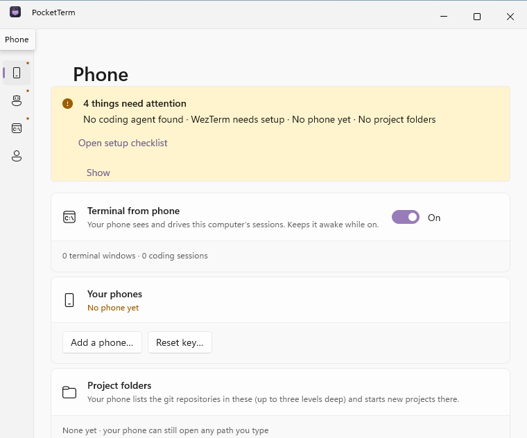

# PocketTerm for Windows

The native Windows app: C# 12 / .NET 8 and WinUI 3 (Windows App SDK 1.8), unpackaged and self-contained,
Windows 10 1809 or later. It replaces the Flutter desktop app on Windows and keeps its data, sign-in and
preferences (see `PocketTerm.Desktop.Core/Storage/FlutterMigration.cs`).

| Project | What | Builds on |
|---|---|---|
| `PocketTerm.Core` | the protocol core (crypto, server clients, sessions, live models, terminal types) | anywhere (`net8.0`) |
| `PocketTerm.Desktop.Core` | the desktop services without UI: controller, local API, live hub, terminal bridge, WezTerm, built-in server, setup, storage ([README](PocketTerm.Desktop.Core/README.md)) | anywhere (`net8.0`; Windows-only parts guarded) |
| `PocketTerm.Core.Tests`, `PocketTerm.Desktop.Core.Tests` | xUnit; Windows-only tests skip elsewhere | anywhere |
| `PocketTerm.App` | the WinUI app (`PocketTerm.exe`): window, tray, every screen | Windows; type-checks elsewhere |

`PocketTerm.sln` has them all; `PocketTerm.Libraries.slnf` only the libraries and tests (fast, no Windows App SDK
download).

<p align="center"></p>

## Building

On Windows (Visual Studio 2022 17.10+ with the .NET desktop workload, or the .NET 8 SDK alone):

```powershell
pwsh tool/server-sidecar.ps1                       # the built-in server: build\server-sidecar\windows-x64\pocketterm-server.exe
dotnet build apps/pocketterm-desktop/windows/PocketTerm.sln
dotnet test apps/pocketterm-desktop/windows/PocketTerm.sln
dotnet run --project apps/pocketterm-desktop/windows/PocketTerm.App -p:Platform=x64
```

A build without the sidecar runs, minus "On this computer". The release build and installer (what
`.github/workflows/release-windows.yml` does for a tag):

```powershell
dotnet publish apps/pocketterm-desktop/windows/PocketTerm.App -c Release -p:Platform=x64 -p:Version=0.2.0 `
  -p:PocketTermRelease=true -o apps/pocketterm-desktop/build/windows/publish
& "${env:ProgramFiles(x86)}\Inno Setup 6\ISCC.exe" /DMyAppVersion=0.2.0 apps/pocketterm-desktop/windows/installer.iss
# → apps/pocketterm-desktop/build/windows/installer/PocketTerm-0.2.0-setup.exe
```

`-p:PocketTermRelease=true` refuses to build without the sidecar. The publish folder holds `PocketTerm.exe`, the
.NET and Windows App SDK runtimes, `pocketterm-server.exe`, `integrations\` and `supabase\` (copied from
`apps/pocketterm-desktop`), and the theme icons in `assets\`. The installer is per-user
(`%LOCALAPPDATA%\Programs\PocketTerm`), keeps the Flutter installer's AppId so it updates a 0.1.x install in place
(removing the Flutter engine's leftovers), and registers `pocketterm://`.

On macOS or Linux the libraries build and test as usual (`~/.dotnet/dotnet test
apps/pocketterm-desktop/windows/PocketTerm.Libraries.slnf`). `PocketTerm.App` compiles there too, as a type check
only (`EnableWindowsTargeting`; the manifest and resource steps, which need Windows tools, are off): the WinUI app
itself is built, tested and run on Windows (CI's `dotnet-windows` job).

## The app

- **No XAML pages.** Every screen is C# (`Pages/`, `Components/`) on a small toolkit in `Views/`: `View` (a control
  built once whose bound properties refresh when the services it watches change), `Ui` (builders for text, settings
  cards, buttons, icons), `Dialogs` (ContentDialogs), `CodeBlock`. The one XAML file, `Views/Styles.xaml`, is loaded at
  run time for theme-following brushes. Without a XAML compiler the app compiles anywhere, and the type check above
  catches API mistakes before Windows CI does. `App` hands WinUI's control types to the XAML parser itself
  (`IXamlMetadataProvider`), which the XAML compiler would otherwise generate.
- **Launch** (`App.cs`): the services are wired in the order of the Flutter `main.dart` (Desktop.Core README, "What
  the app wires at launch"). `Program.cs` keeps one PocketTerm per user (`AppInstance` key
  `PocketTermSingleInstance`): a second start (a `pocketterm://` link, the Start menu, login) hands its activation to
  the running one, which shows its window and handles the link.
- **Window and tray** (`MainWindow.cs`, `WinUiDesktopHost.cs`): Mica, the system title bar extended into the
  content, 776 × 640, at least 480 × 360, centered; closing hides it. The tray item (H.NotifyIcon) opens it on click
  and has Open PocketTerm, Settings…, Update available… (while there's one) and Quit. Started `--hidden` (the Run key
  Launch at login writes), the window stays hidden. The window and tray icons follow the chosen theme.
- **Themes** color what is terminal-like (`CodeBlock`) and the accent; the rest follows Windows' light or dark mode.
  UX differences from the Flutter app: [UX-NOTES.md](UX-NOTES.md).

## Test hooks

Debug builds and `-p:PocketTermE2E=true` builds read, besides Desktop.Core's `POCKETTERM_TAILSCALE`,
`POCKETTERM_CLI_JSON`, `POCKETTERM_KITTY_DIR` and `POCKETTERM_PROFILE` (`TestHooks.cs`): `POCKETTERM_DATA` (a
throwaway support folder instead of `%APPDATA%\Danijel Lovric\PocketTerm`), `POCKETTERM_LOG` (a file the log lines
go to), and a second start with `--quit` (the tray's Quit). Such a build also puts the pairing code's link in its
image's UI Automation HelpText, so a test can "scan" it. A release build does none of this.

`tool/smoke.ps1 -App <publish dir> -Phone <PhoneStandIn.dll>` runs such a build:

1. starts it `--hidden`, waits for `cli.json` and `/v1/ping` (with the nonce proof);
2. closes the window it opens (nothing is set up yet) and checks it only hid; starts it again (the second start
   hands over and exits, the window comes back with the first-run setup);
3. starts the bundled `pocketterm-server.exe` on 127.0.0.1 and, through UI Automation by AutomationId, sets the app
   up with its setup link (On my own server), passes the setup checklist and visits each Settings section;
4. opens Add a phone…, and `tool/PhoneStandIn` (a phone on PocketTerm.Core) scans the code: it signs in, finds this
   computer in the account, joins its channel and receives the terminal bridge's sealed `state`;
5. signs that phone out (confirm dialog), signs this computer out, picks a different server (back to setup), quits
   it and checks `cli.json` is gone.

CI runs it on every pull request and keeps its screenshots and log as the `PocketTerm-windows-smoke` artifact.
