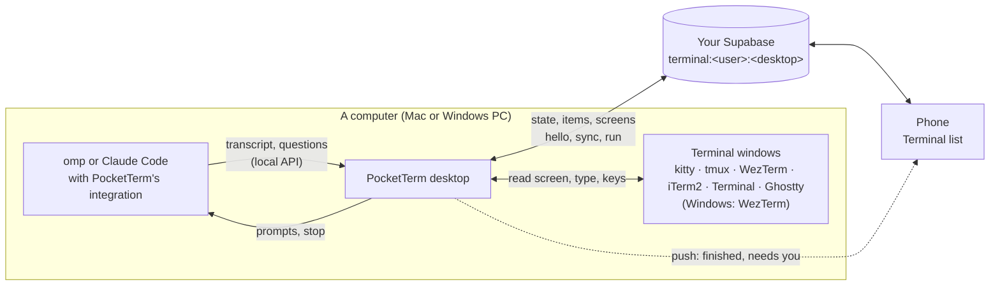

# Architecture

How PocketTerm is put together. For what it does and how to set it up, see the [README](../README.md) and [SELF_HOSTING.md](SELF_HOSTING.md).

One Dart pub workspace (root `pubspec.yaml`): the desktop app for macOS and Windows in `apps/pocketterm-desktop/` (with the backend it bundles), the phone app for iPhone and Android in `apps/pocketterm-mobile/`, and what both use in `packages/pocketterm_core/`. Below, `core/` stands for `packages/pocketterm_core/`, `desktop/` for `apps/pocketterm-desktop/` and `mobile/` for `apps/pocketterm-mobile/`.



## Layout

| Path | What |
| --- | --- |
| `core/lib/session.dart` | The connected backend and signing in (GitHub on a computer, a computer's code on a phone), pairing and reviewer codes (`functions/pair`), account deletion |
| `core/lib/backend.dart`, `connect.dart` | Which Supabase project to use: parsing and checking it, setup links, saving it (shared preferences on the desktop; the native side on phones, so the iPhone's push extension can read it from the App Group), the connect-an-existing-server form |
| `core/lib/account.dart` | Sign-in page and GitHub button (desktop), avatar |
| `core/lib/desktops.dart` | The account's computers (`desktops`): which ones the phone lists and which it picks |
| `core/lib/agent.dart` | The coding agents (omp, Claude Code): what a new session starts, how a session is named, whether a prompt steers, how an answer becomes keys |
| `core/lib/live.dart` | Terminal from the phone: the protocol (described at the top of the file), topics and routed session keys, transcript items and their seq/epoch log, questions, screen diffs |
| `core/lib/terminal_channel.dart` | The private Realtime topic, kept joined on both sides |
| `core/lib/terminal_remote.dart` | Phone: the remote for one computer and its disk cache |
| `core/lib/live_activity.dart` | Phone: followed sessions (Live Activities on iOS, ongoing notifications on Android) and their push tokens |
| `core/lib/terminal.dart`, `terminals.dart` | The terminal layer: `TerminalHost`, `TermWindow`, `TermCap`, `TermStatus`, keys, process snapshots, `windowOfTerm`; `Terminals`, every installed terminal as one |
| `core/lib/kitty.dart`, `tmux.dart`, `wezterm.dart`, `iterm.dart`, `apple_terminal.dart`, `ghostty.dart` | One `TerminalHost` per terminal |
| `core/lib/ansi.dart`, `chat_images.dart`, `ui.dart`, `logo.dart`, `native.dart` | Screen lines with ANSI colors; images for prompts; shared UI; the logo; the `pocketterm/native` platform channel |
| `desktop/lib/main.dart`, `controller.dart`, `main_window.dart` | The desktop app: one window that is the wizard, sign-in, the setup checklist or Settings (with its status card); `AppController` (account, this computer's id and its `desktops` row, the bridge, pushes, the coding agents found and whether a phone has signed in) |
| `desktop/lib/desktop_host.dart`, `windows_host.dart` | What differs per platform: window, menu-bar or tray item, launch at login, folder picker, idle time, keeping awake (`MacHost` over the native channel, `WindowsHost` in Dart) |
| `desktop/lib/update_check.dart` | Windows: the GitHub release check (the Mac uses Sparkle) |
| `desktop/lib/setup_page.dart`, `desktop/lib/onboarding/` | First-run setup: the wizard (`flow.dart`, `wizard.dart`), provisioning through the Supabase Management API (`supabase_admin.dart`, `provision.dart`); after the first sign-in, the setup checklist (`get_ready.dart`: coding agents, terminals, project folders, the phone) with its terminals (`terminals_card.dart`: the Mac's, WezTerm's install on Windows) and the pairing QR (`pair.dart`); reviewer codes (`reviewer.dart`) |
| `desktop/lib/terminal_fixes.dart`, `wezterm_setup.dart` | A Mac terminal's one-click fix for Settings and the setup checklist (kitty's lines in kitty.conf, System Settings' Automation page), and which terminals need one; on Windows, WezTerm's own installer, downloaded from its GitHub release, checked against its published SHA-256 and opened |
| `desktop/lib/local_api.dart`, `live_hub.dart` | The 127.0.0.1 API the agents report to, and their live sessions |
| `desktop/lib/terminal_bridge.dart` | The phone's way in: sessions and screens out on this computer's topic, its requests in |
| `desktop/lib/integrations.dart` | Finding omp and Claude Code on the computer, and installing and updating the bundled omp extension and Claude Code plugin (**Settings → Coding agent**, the setup checklist, Settings' status card) |
| `desktop/macos/Runner/` | The Mac's native side: the main window, the menu-bar item, activation policy, launch at login, idle time, Sparkle |
| `desktop/windows/` | The Windows runner (single instance, `pocketterm://` links handed to the running instance) and `installer.iss` |
| `desktop/integrations/omp/pocketterm-live.ts` | omp extension: the session, live, for the phone |
| `desktop/integrations/claude/` | Claude Code marketplace with the `pocketterm` plugin: `hooks/pocketterm.ts` (the session, live), `hooks/items.ts` (Claude's transcript as items, its dialogs as questions), `tests/` |
| `desktop/supabase/` | Migrations, pgTAP tests, and the `pair` and `push` functions (bundled as app assets for the wizard); `relay` is the publisher's push relay |
| `mobile/lib/main.dart`, `mobile.dart`, `links.dart` | Phone app: sign-in by code, the home page with the Terminal list (its sort and folded projects kept), the computer picker, the account sheet, push and link routing; links to the desktop downloads and GitHub |
| `mobile/lib/terminal_view.dart`, `session_view.dart` | The Terminal list (sessions by project, sorted by name or recent activity; a project's heading folds on tap and offers a new session and folding on long press), screens, new sessions; a coding session's transcript and composer |
| `mobile/lib/setup_page.dart`, `onboarding/scan.dart`, `chrome.dart` | Scanning or pasting a computer's code; the per-platform chrome (Cupertino on iPhone, Material 3 on Android) |
| `mobile/ios/Runner/AppDelegate.swift`, `mobile/ios/Shared/` | The iPhone half of `native.dart`: App Group, push registration, notification taps, Live Activities |
| `mobile/ios/PocketTermLive/`, `PocketTermPush/` | The Live Activity (WidgetKit); the notification service extension that decrypts pushes |
| `mobile/android/…/pocketterm/` | The Android half: `MainActivity.kt`, `PushService.kt` (FCM), `SessionActivities.kt` (ongoing notifications), `Notifications.kt`, `PocketTermShared.kt` |
| `config/PocketTerm.xcconfig` | Team, bundle id and App Group for every Xcode target (`Local.xcconfig` overrides them) |

## Backend

Every user runs their own Supabase project, built from `desktop/supabase/migrations` and `desktop/supabase/config.toml`; nothing is shared between users.

| Migration | Holds |
| --- | --- |
| `…_server.sql` | `allowed_signups` and the `before_user_created` hook (GitHub only; the first account owns the server); `pairing_codes`, `pairing_failures`, `redeem_pairing_code`; the reviewer demo account (`reviewer_access_active`, `end_idle_demo_sessions`, its pg_cron job); `delete_my_account` |
| `…_terminal.sql` | The Realtime policies for the terminal topic; the private `terminal` storage bucket images from the phone pass through |
| `…_push.sql` | `push_devices` and `activity_tokens` (service role only) |
| `…_desktops.sql` | `desktops`, the account's computers (own rows only); the topic policies per computer |

- **Auth.** A computer signs in with GitHub through each owner's OAuth app (`[auth.external.github]`, redirect `pocketterm://login-callback`). Phones never use GitHub: they redeem a code from a computer (`functions/pair`), which makes a fresh session of their own.
- **Computers.** Each desktop picks a random 8-character id per account (preference `desktop_id_<user id>`), upserts its `desktops` row (name, `macos` or `windows`) while its bridge runs and every 60 s, and deletes it on sign-out. A trigger stamps `seen_at` with the server's clock on every write, so a computer's wrong clock can't skew it. The phone lists rows seen in the last 30 days and calls one online when it was seen in the last 150 s.
- **Terminal topic.** Each computer talks to the phones on the private Realtime broadcast topic `terminal:<user id>:<desktop id>`. RLS on `realtime.messages` lets a user join only topics that start with `terminal:<their id>:`. Nothing on it is stored. The protocol is at the top of `core/lib/live.dart`; its `state` carries, per coding agent found on the computer, whether PocketTerm is installed, out of date or missing in it (`agents`, `AgentIntegration` in `core/lib/agent.dart`), so the phone can say why an agent's window shows only as a screen.
- **A phone signed in.** The setup checklist and Settings know a phone has signed in when one of the user's single-use pairing codes has been used (`pairing_codes.last_used_at`, which RLS lets its maker read) or a phone says hello on the terminal topic.
- **Push.** `functions/push` registers phones (`register`, with the phone's own AES key), takes `notify` and `activity` calls from computers and seals each notification for the phone (AES-256-GCM) before handing it to the publisher's relay (`PUSH_RELAY_URL`). Session keys in pushes, Live Activities and `pocketterm://session?key=` links are routed: `<desktop id>/<session key>`, so a tap selects that computer before opening the session.
- **Setup wizard.** With a Management API token, the desktop app does what `desktop/tool/setup-backend.sh` does. The migrations and function sources ship as app assets, so a downloaded app needs neither the repo nor the CLI. Migrations are recorded in `supabase_migrations.schema_migrations`, the CLI's own table, so the script and the wizard agree on what's applied.

## Terminals

Each terminal is a `TerminalHost` (`core/lib/terminal.dart`): list its windows (`TermWindow`: key, title, cwd, foreground program, `app`, `caps`, `via`), read a screen, type, press keys, open a window, close one, and a `TermStatus` (`ready`, `limited`, `setup`, `idle`, `missing`, with a note and a fix) for **Settings → Terminals** and the setup checklist. Capabilities (`TermCap`): `read`, `ansi`, `type`, `line`, `keys`, `close`; the phone shows only what a window can do, and answers questions with keys only where the window can be read and take keys.

| Terminal | How | Window key |
| --- | --- | --- |
| kitty | Remote control over its unix socket (`listen_on unix:/tmp/kitty`); only sockets the current user owns | `kitty-<pid>/<id>` |
| tmux | The `tmux` CLI on every server socket of the user | `tmux:<socket>/<pane n>` |
| WezTerm | `wezterm cli` per GUI socket (`~/.local/share/wezterm/gui-sock-<pid>`; on Windows under `%USERPROFILE%`) | `wezterm:<gui pid>/<pane>` |
| iTerm2 | AppleScript | `iterm:<session UUID>` |
| Terminal | AppleScript | `terminal:ttysNNN` |
| Ghostty | AppleScript | `ghostty:<UUID>` |

`Terminals` (`core/lib/terminals.dart`) puts the installed ones together: all six on macOS, WezTerm only on Windows (Settings and the setup checklist install it there: `desktop/lib/wezterm_setup.dart`). A tmux pane shown in a GUI window is listed once, as the pane. An app that can't both read and press keys (Terminal, Ghostty) launches a phone-started session inside tmux when tmux is installed. An agent's `hello` carries its terminal environment (`TERM_PROGRAM`, `KITTY_*`, `TMUX`, `WEZTERM_PANE`, …), which `windowOfTerm` turns into its window's key.

## Local API

On launch the desktop app listens on a random 127.0.0.1 port and writes `{port, token, pid}` to `~/.config/pocketterm/cli.json` (on Windows under `%USERPROFILE%`), or to the file `POCKETTERM_CLI_JSON` names. The extensions ask `/v1/ping?nonce=<fresh>` without the token and send it only if `proof` is the HMAC-SHA256 of `pocketterm-ping\n<port>\n<nonce>` under the token, so whatever listens on a port a stale `cli.json` names gets neither the token nor any commands.

```
GET   /v1/ping?nonce=N   → {"app": "pocketterm", "proof"}   no token
GET   /v1/ping           → {"app": "pocketterm", "pid"}   with the token: this PocketTerm is up
GET   /v1/live           WebSocket: a coding session reporting itself (omp)
POST  /v1/live/http      {conn?, frames, wait?, close?} → {conn, frames}   the same over HTTP long polls (Claude Code)
Authorization: Bearer <token>   (everything but /v1/ping?nonce=)
```

## Building and testing

See [BUILDING.md](BUILDING.md) and [CONTRIBUTING.md](../CONTRIBUTING.md#pull-requests).
