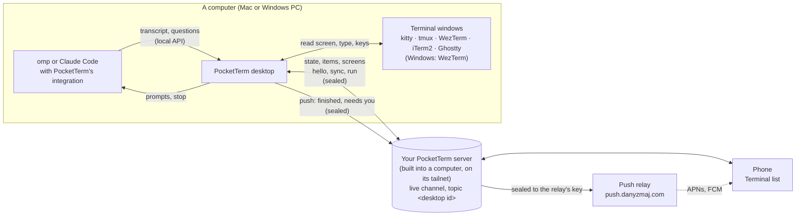

# Architecture

How PocketTerm is put together. For what it does and how to set it up, see the [README](../README.md) and [SELF_HOSTING.md](SELF_HOSTING.md).

The repo holds four native apps and what they share: the Mac app in `apps/pocketterm-desktop/macos/` (Swift, on the Swift package `packages/PocketTermKit/`, which the iPhone app uses too), the Windows app in `apps/pocketterm-desktop/windows/` (C# / .NET), the iPhone app in `apps/pocketterm-mobile/ios/` and the Android app in `apps/pocketterm-mobile/android/` (Kotlin, with its protocol core in the Gradle module `:core`). Both desktop apps bundle the PocketTerm server (Dart, `packages/pocketterm_server/`, its program in `apps/pocketterm-server/`) and the agent integrations (`apps/pocketterm-desktop/integrations/`). The root `pubspec.yaml` is a Dart pub workspace of the server, its command and the end-to-end harness (`tool/e2e/`); the installed-app smoke is `tool/smoke/`, the publisher's push relay (Deno) `apps/pocketterm-relay/`.



## Layout

Every app is native; the protocol code is written once per language and kept byte-compatible by shared test vectors ([below](#one-protocol-three-languages)). Below, `kit/` stands for `packages/PocketTermKit/Sources/`, `server/` for `packages/pocketterm_server/`, `desktop/` for `apps/pocketterm-desktop/`, `mobile/` for `apps/pocketterm-mobile/`, `win/` for `apps/pocketterm-desktop/windows/` and `droid/` for `apps/pocketterm-mobile/android/` (its Kotlin under `…/kotlin/com/danyzmaj/pocketterm/`).

### Protocol cores

The same pieces exist in each language; the Swift names are listed, with the Kotlin (`droid/core/`) and C# (`win/PocketTerm.Core/`) files beside them.

| Swift (`kit/PocketTermKit/`) | Kotlin (`droid/core/…/core/`) | C# (`win/PocketTerm.Core/`) | What |
| --- | --- | --- | --- |
| `ServerClient.swift` | `ServerClient.kt`, `Http.kt` | `Net/ServerClient.cs`, `Net/WebSocketConnection.cs` | The PocketTerm server through this device's token: redeeming a setup link or a pairing code, `GET /v1/me`, devices, pairing codes, the computers list, blobs, push, leaving and erasing, the live channel's WebSocket |
| `Session.swift` | `Session.kt` | `Net/Session.cs` | The connected server and signing in to it (a setup link on a computer, a computer's code on a phone), links opened from outside the app (`linkToConfirm`), the phone's pairing link, sign-out, erasing a server this computer runs |
| `Backend.swift` | `Backend.kt`, `DartUri.kt` | `Net/Backend.cs`, `DartUri.cs` | Which server: its URL and kind, checking it (`GET /v1/health`: protocol, version, the clock), setup links and the computer key in them |
| `Desktops.swift` | `Desktops.kt` | `Net/Desktops.cs` | The server's computers (`GET /v1/desktops`): which ones the phone lists and which it picks |
| `Agent.swift` | `Agent.kt` | `Agent.cs` | The coding agents (omp, Claude Code): what a new session starts, how it's named, whether a prompt steers, how an answer becomes keys |
| `Live.swift`, `LiveAsk.swift`, `LiveScreen.swift`, `LiveSummary.swift` | `Live.kt`, `LiveScreen.kt` | `Live/Live.cs`, `Live/LiveModels.cs`, `Live/LiveLog.cs`, `Live/LiveJson.cs` | Terminal from the phone: the protocol (described at the top of `Live.swift`), routed session keys, transcript items and their seq/epoch log, questions, screen diffs, `chunkJson` |
| `E2E.swift` | `E2e.kt` | `Crypto/E2e.cs` | End-to-end encryption: a computer's channel key, sealing and opening bytes and envelopes (AES-256-GCM with additional data), sealed pushes and their tags, the replay guard |
| `TerminalChannel.swift` | `TerminalChannel.kt` | `Net/TerminalChannel.cs` | A computer's topic on the server's WebSocket, kept joined with reconnects and pings; seals what goes out and opens what comes in (`ChannelSeal`), in order |
| `TerminalRemote.swift` | `TerminalRemote.kt` | — | Phone: the remote for one computer (images sealed, then uploaded) and its disk cache |
| `LiveActivity.swift` | `LiveActivity.kt` | `Live/LiveActivity.cs` | Followed sessions (Live Activities on iPhone, ongoing notifications on Android) and their push tokens |
| `TerminalModel.swift` | `Terminal.kt` | `Terminal/TermModels.cs`, `Terminal/Terminal.cs` | `TermWindow`, `TermCap`, `TermStatus`, keys, `windowOfTerm` |
| `Ansi.swift`, `ChatImages.swift`, `FileTypes.swift`, `Theme.swift`, `AppIcon.swift`, `Speech.swift`, `Timing.swift`, `Storage.swift` | the same names | `Terminal/Ansi.cs`, `Terminal/FileTypes.cs`, `Theme/Theme.cs`, `Storage.cs` | Screen lines with ANSI colors; the images and files a prompt takes (at most 10, files up to 20 MB); the themes as data, each a light and a dark palette from its official one (System, the default, whose accent is the platform's; Catppuccin Latte / Mocha; Rosé Pine Dawn / Rosé Pine; Tokyo Night Day / Night; the preference `theme`, where earlier names move: `mocha`, 0.1.2's `auto` and the dropped `gruvbox` to Catppuccin, `dawn` to Rosé Pine) and the app icon each one picks; `SpeechLanguage` (English, Croatian); debug-only connection timings for the end-to-end report; the preference store each app plugs in |
| `kit/PocketTermTerminals/` | — | `win/PocketTerm.Desktop.Core/Terminals/` | The terminal hosts (computers only): `Host.swift` (`TerminalHost`, process snapshots, AppleScript), `Terminals.swift` (every installed terminal as one), `Kitty.swift`, `Tmux.swift`, `WezTerm.swift`, `ITerm2.swift`, `Ghostty.swift`, `GhosttyConfig.swift`; on Windows `WezTerm.cs`, `Terminals.cs`, `WezTermSetup.cs` (WezTerm's installer, downloaded from its GitHub release and checked against its SHA-256), `TerminalFixes.cs`, `ProjectFolders.cs` |

Tests: `packages/PocketTermKit/Tests/`, `droid/core/src/test/`, `win/PocketTerm.Core.Tests/`, `win/PocketTerm.Desktop.Core.Tests/`.

### Desktop services

The computer's side without its UI: `kit/PocketTermDesktop/` on the Mac ([README](../packages/PocketTermKit/Sources/PocketTermDesktop/README.md)), `win/PocketTerm.Desktop.Core/` on Windows ([README](../apps/pocketterm-desktop/windows/PocketTerm.Desktop.Core/README.md)).

| Mac (`kit/PocketTermDesktop/`) | Windows (`win/PocketTerm.Desktop.Core/`) | What |
| --- | --- | --- |
| `AppController.swift` | `AppController.cs` | The app's model: the server and the built-in one, this computer's id and its place in the computers list, its channel key and **Reset key**, the bridge, sealed pushes, the coding agents found, whether a phone has signed in, Launch at login (off until the person turns it on) |
| `BuiltInServer.swift`, `Tailscale.swift` | `Hosting/BuiltInServer.cs`, `Hosting/JobObject.cs`, `Hosting/Tailscale.cs` | The built-in server ([the sidecar](#the-built-in-server-a-sidecar)) and the Tailscale CLI that publishes it (`tailscale serve`) |
| `Commands.swift` | `Setup/Commands.cs` | The installs setup offers to run once the person confirms (`brew install tmux`, `brew install --cask tailscale-app`, `winget install Tailscale.Tailscale`) |
| `ChannelKeys.swift`, `KeychainStore.swift`, `Preferences.swift` | `Storage/ChannelKeys.cs`, `Storage/DpapiSecureStore.cs`, `Storage/JsonPreferenceStore.cs`, `Storage/FlutterMigration.cs` | This computer's sign-in and its channel key per computer id (the login Keychain on a Mac; one DPAPI-encrypted file under `%APPDATA%` on Windows), preferences, and the one-time migration of what the 0.1.x apps stored |
| `SetupLinks.swift` | `Setup/SetupLinks.cs` | Setup links pasted or opened, and **Add a computer…** |
| `TerminalFixes.swift` | `Terminals/TerminalFixes.cs` | A terminal's one-click fix (kitty's lines in kitty.conf, System Settings' Automation page) |
| `LocalApi.swift`, `LocalApiServer.swift`, `LiveHub.swift`, `LiveLink.swift`, `HubJSON.swift` | `Live/LocalApi.cs`, `Live/LiveHub.cs`, `Live/LiveLinks.cs` | The [127.0.0.1 API](#local-api) the agents report to (swift-nio on the Mac, Kestrel on Windows), and their live sessions, each with its queue: the phone's prompts waiting for the run to end, handed over one per run end, held after a stopped run until Resume |
| `TerminalBridge.swift`, `TerminalBridgeSupport.swift` | `Bridge/TerminalBridge.cs`, `Bridge/TerminalBridge.Asks.cs`, `Bridge/BridgeHelpers.cs` | The phone's way in: sessions and screens out on this computer's topic, its requests in |
| `PromptFiles.swift` | `Live/PromptFiles.cs` | Files from phone prompts: saved under safe names in a folder per prompt in the temp folder's `pocketterm-files` (deleted once older than a day) and named in the prompt as `@path` |
| `Orchestrator.swift` | `Live/Orchestrator.cs` | The orchestrator's folder and `ORCHESTRATOR.md` |
| `Integrations.swift` | `Integrations/Integrations.cs` | Finding omp and Claude Code, installing and updating the bundled omp extension (default profile and each `~/.omp/profiles/<name>`) and Claude Code plugin |
| `DesktopHost.swift`, `MacHost.swift` | `Platform/WindowsSystem.cs`, `Platform/AppPaths.cs` | What differs per platform: launch at login (`SMAppService`; the Run key), idle time and keeping awake (IOKit; P/Invoke), the theme's Dock or window/tray icon, folder picker |
| (Sparkle, in the app) | `UpdateCheck.cs` | Windows: the GitHub release check |
| `TestHooks.swift` | `TestHooks.cs` | Test builds only: the environment variables that point the app at stand-ins ([SECURITY.md](../SECURITY.md#test-builds)) |

### Apps

| Path | What |
| --- | --- |
| `desktop/macos/` | The Mac app (SwiftUI on AppKit, macOS 13+; Xcode project from `project.yml` with xcodegen). `PocketTerm/App/` (`main.swift`, `AppDelegate.swift`, `StatusItem.swift` and `MenuBarView.swift`: the menu-bar item and its panel; `Windows.swift`: the setup and Settings windows and the Dock icon's activation policy; `Updater.swift`: Sparkle), `Setup/` (the first-run wizard: `SetupView.swift`, `ThisComputerSetup.swift`, `SetupLinkForm.swift`), `GetReady/` (the setup checklist), `Settings/` (the Phone, Coding agents, Terminals and Account tabs), `Shared/` (pairing QR from CoreImage, how your data is protected, hosting status); `scripts/bundle-resources.sh` copies the sidecar, `integrations/` and the theme icons into the bundle; `PocketTermTests/`; [UX-NOTES.md](../apps/pocketterm-desktop/macos/UX-NOTES.md) |
| `win/PocketTerm.App/` | The Windows app (WinUI 3, unpackaged, self-contained): `Program.cs` (one instance per user, `pocketterm://` activations handed to it), `App.cs`, `MainWindow.cs` and `WinUiDesktopHost.cs` (Mica window, tray through H.NotifyIcon), `Pages/` (Setup, SignIn, GetReady, Settings), `Components/`, `Views/` (the small C# UI toolkit); `win/installer.iss` (Inno Setup); `win/tool/smoke.ps1` and `PhoneStandIn/`; [README](../apps/pocketterm-desktop/windows/README.md), [UX-NOTES.md](../apps/pocketterm-desktop/windows/UX-NOTES.md) |
| `mobile/ios/` | The iPhone app (SwiftUI, iOS 17+; `project.yml`). `PocketTerm/App/` (`PocketTermApp.swift`, `RootView.swift`), `Model/` (`AppModel.swift`: sign-in, the computers' keys, push and link routing; `HomeModel.swift`, `Preferences.swift` with the 0.1.x migration, `TipsController.swift`, `E2E.swift`), `Home/` (the Terminal list, the new session sheet, the row sheets), `Session/` (transcript, composer, ask cards, the queue), `Terminal/` (screens and keys, the switch-to-conversation sheet, the orchestrator), `Voice/` (the microphone, the voice sheet, `Dictation.swift`: SpeechAnalyzer on iOS 26, SFSpeechRecognizer before; the tips), `Setup/` (setup, scanner, push consent, the account sheet), `Demo/` (**Try the demo**: a made-up computer, no network), `Native/` (push registration, Live Activities, the theme's alternate icon `AppIcon-<Theme>`, Keychain and App Group stores); `PocketTermLive/` (the Live Activity), `PocketTermPush/` (the notification service extension that decrypts pushes), `Shared/`; `PocketTermTests/`; [UX-NOTES.md](../apps/pocketterm-mobile/ios/UX-NOTES.md) |
| `droid/app/` | The Android app (Jetpack Compose, Material 3, minSdk 26). `MainActivity.kt`, `PocketTermApp.kt`, `AndroidNative.kt` (Keystore-wrapped device token and channel keys), `AndroidPreferences.kt` (with the 0.1.x migration), `PushService.kt` (FCM), `SessionActivities.kt` (ongoing notifications), `Notifications.kt`, `PocketTermShared.kt`, `AppIcons.kt` (the theme's launcher icon: one activity-alias per icon, `IconDefault` being Mocha's, switched when the app leaves the screen, release builds only), `Dictation.kt` (on-device recognizer from Android 12); `state/` (session, home, drafts, tips), `ui/` (`home/`, `session/`, `queue/`, `terminal/`, `orchestrator/`, `voice/`, `setup/` with the CameraX + ML Kit scanner, `settings/`, `tips/`), `demo/`; [UX-NOTES.md](../apps/pocketterm-mobile/android/UX-NOTES.md) |
| `mobile/maestro/` | The phone's Maestro flows: `e2e/` (with its `run.sh`) for the end-to-end run, `demo.yaml`, `tips.yaml` and `voice.yaml` |
| `mobile/tool/` | `build-ipa.sh`, `build-aab.sh`: the store builds Baker runs ([RELEASING.md](RELEASING.md#phone-builds-baker)) |

### Server, relay and tools

| Path | What |
| --- | --- |
| `server/lib/pocketterm_server.dart`, `server/lib/src/` | The PocketTerm server (Dart, [PROTOCOL.md](../packages/pocketterm_server/PROTOCOL.md)): `server.dart` (the REST endpoints, blobs and their quotas, the redeem throttle, the minute's housekeeping), `store.dart` (`state.json`, the setup token), `hub.dart` (the live channel), `relay.dart` (sealing pushes to the relay and queuing them), `cli.dart` (`pocketterm-server serve`, `setup-link`, `health`), `secrets.dart` (tokens and codes) |
| `apps/pocketterm-server/` | The server as a program: `bin/pocketterm_server.dart`, compiled by `tool/server-sidecar.sh`/`.ps1` into the binary both desktop apps bundle; [README](../apps/pocketterm-server/README.md) |
| `apps/pocketterm-relay/` | The publisher's push relay (Deno) at `push.danyzmaj.com`: `main.ts`, `src/relay.ts` (opening a sealed request, sending it to APNs or FCM), `src/seal.ts`, `src/fcm.ts`, `src/limits.ts`, `src/metrics.ts`; [README](../apps/pocketterm-relay/README.md), [SECURITY.md](../apps/pocketterm-relay/SECURITY.md) |
| `desktop/integrations/omp/pocketterm-live.ts` | omp extension: the session, live, for the phone, with its model, context use and cost (omp's own tally, `sessionManager.getUsageStatistics().cost`) |
| `desktop/integrations/claude/` | Claude Code marketplace with the `pocketterm` plugin: `hooks/pocketterm.ts` (the session, live), `hooks/items.ts` (Claude's transcript as items, its dialogs as questions), `tests/` |
| `desktop/assets/icon/`, `mobile/assets/icon/`, `desktop/tool/make_icon.swift` | The app icons per theme, and the script that draws them |
| `desktop/tool/release.sh` | The Mac release: build, notarize, Sparkle appcast, GitHub release ([RELEASING.md](RELEASING.md#mac)) |
| `tool/server-sidecar.sh`, `tool/server-sidecar.ps1` | Compile the server into the binary the desktop apps bundle |
| `tool/vectors/` | `vectors.json`, the frozen wire vectors every core's tests read ([README](../tool/vectors/README.md)) |
| `tool/e2e/` | The end-to-end run (`run.sh`, `bin/run.dart`): a server (local, or built in over Tailscale), the real desktop app, throwaway kitty, Ghostty, WezTerm and iTerm2 windows with a scripted omp (`bin/fake_omp.dart`), and the phone in the Simulator or an Android emulator; `lib/e2e.dart` holds the shared pieces |
| `tool/smoke/` | The installed Mac app as from Finder: a test build copied to a throwaway place with a throwaway home, Keychain and Tailscale stand-in (`fake_tailscale.sh`), driven through accessibility (`ax.swift`, `scenario.sh`) |
| `config/PocketTerm.xcconfig` | Team, bundle id and App Group for every Xcode target (`Local.xcconfig` overrides them) |

### One protocol, three languages

The Dart server, the omp extension, the Claude Code plugin and the relay define the wire; the Swift, Kotlin and C# cores follow it byte for byte: JSON field names, AAD strings, base64 variants, the envelope, the ping proof, chunking. `tool/vectors/vectors.json` is generated once from the Dart implementation and frozen; each core's unit tests read it (`packages/PocketTermKit/Tests/PocketTermKitTests/`, `droid/core/src/test/`, `win/PocketTerm.Core.Tests/`), so a core that drifts fails its own tests. Each core also has an opt-in interop test (`POCKETTERM_INTEROP=1`) against the real Dart server: redeem a setup link, pair, join a topic, pass sealed frames between two clients, upload and download a blob.

### The built-in server: a sidecar

**On this computer** runs the Dart server itself, compiled to a native binary (`tool/server-sidecar.sh` on a Mac, universal in releases; `tool/server-sidecar.ps1` on Windows) and bundled next to the app: `Contents/Helpers/pocketterm-server` in the Mac bundle, `pocketterm-server.exe` beside `PocketTerm.exe` on Windows. The app starts it as

```sh
pocketterm-server serve --data <app support>/pocketterm-server --address 127.0.0.1 --port <p|0> \
  --trust-loopback-proxy --exit-with-stdin [--relay <url> --relay-key <key>]
```

reads its first stdout line (`{"event":"listening",…}`) for the port, and asks `pocketterm-server setup-link --data <dir> --public-url <url>` for setup links. `--exit-with-stdin` stops it when the app goes, however it goes (on Windows a job object kills it too).

## Server

Every owner runs their own PocketTerm server; nothing is shared between owners. It is one Dart program (`server/`) with no database, built into the desktop app (**On this computer**) and published to the owner's tailnet. The protocol is in [PROTOCOL.md](../packages/pocketterm_server/PROTOCOL.md); everything lives under `<url>/v1/`.

- **Store.** Everything but images is one JSON file, `state.json`, in the data directory (the app's support folder `pocketterm-server/`): the server's id, devices (with the SHA-256 of each device token, never the token), computers, pairing codes, push tokens and Live Activity tokens. It is rewritten atomically after every change (`state.json.tmp`, then the last good one kept as `state.json.bak`). The setup token sits in its own file, `setup-token`, so `pocketterm-server setup-link --new` can change it while the server runs. A lock on `.lock` keeps a second server off the same directory. A disk that can't be written answers 507 `storage`.
- **Sign-in.** A computer redeems the server's setup link (`pocketterm://setup?url=…&setup=<setup token>`, printed by `pocketterm-server setup-link`; the built-in server signs its own computer in on 127.0.0.1) at `POST /v1/setup/redeem`. A phone redeems a computer's pairing code at `POST /v1/pair/redeem`. Either way the server hands back a **device token** (43 characters, base64url) that every other call carries as `Authorization: Bearer`. A computer keeps it in its secure storage (`ChannelKeys.swift` / `ChannelKeys.cs`), a phone on its native side (`Native.deviceToken`: the Keychain on iOS, Keystore-wrapped on Android). The server's id (`GET /v1/me`) keys everything a device keeps per server. Both redeem endpoints share a throttle: 10 failures from one address in 10 minutes and it waits.
- **Pairing.** A signed-in computer asks `POST /v1/pair` for a single-use code (28 characters of Crockford base32, valid 10 minutes) and shows it in a QR with its own id and channel key (below). The setup checklist and Settings know a phone has signed in when the server's devices (`GET /v1/devices`) include a phone or a phone says hello on this computer's topic.
- **Devices.** Signing out is `DELETE /v1/devices/me`: the token stops working, the device's push and Live Activity tokens go and its WebSockets close with 4003, which signs the app out. A computer can revoke another device (`DELETE /v1/devices/:id`, **Sign out…** next to a phone in **Settings → Account**), and the computer that runs the built-in server can erase everything on it (`POST /v1/erase`, **Settings → Account**); the setup token and the server's id stay.
- **Computers.** Each computer picks a random 8-character id per server (preference `desktop_id_<server id>`), lists itself with `PUT /v1/desktops/:id` (name, `macos` or `windows`) while its bridge runs and every 60 s, and removes itself on sign-out. The server stamps `seen_at` with its own clock, so a computer's wrong clock can't skew it. The phone lists computers seen in the last 30 days and calls one online when seen in the last 150 s.
- **Live channel.** `GET /v1/ws` upgrades to a WebSocket (`hub.dart`). A client joins topics; a computer's topic is its id. A `send` on a topic reaches every other socket joined to it and is passed on untouched, at most once, in order per sender. Nothing on it is stored, and everything on it is sealed with the computer's key (below). Frames are at most 256 KiB; the server pings every 25 s and closes a socket that misses a pong, and the apps ping too and reconnect after 1 s, 2 s, 4 s … (`TerminalChannel` in each core). The protocol on top is at the top of `kit/PocketTermKit/Live.swift` (and its Kotlin and C# twins); its `state` carries, per coding agent found on the computer, whether PocketTerm is installed, out of date or missing in it (`agents`, `AgentIntegration` in each core's `Agent`), so the phone can say why an agent's window shows only as a screen.
- **Blobs.** Images and files from the phone go through `PUT /v1/blobs/:path` (the phone picks a UUID as the path and seals the bytes first), at most 20 MiB each, 200 MiB waiting per device (else 429) and 1 GiB in all (else 507). The computer downloads each once with `GET`, which deletes it; one nobody downloads is deleted after an hour.
- **Push.** Phones register their APNs or FCM token (`/v1/push/register`; `unregister` turns notifications off). Computers send `notify` and `activity` calls. The server forwards each push in the background to the publisher's relay (`server/lib/src/relay.dart`; `PUSH_RELAY_URL`, by default `https://push.danyzmaj.com/v1/push`), one request per phone, its body sealed to the relay's X25519 public key (`PUSH_RELAY_KEY`): an ephemeral X25519 key, HKDF-SHA256 and AES-256-GCM. It retries 5xx and 429 answers and forgets a token the relay answers 410 for. The relay (`apps/pocketterm-relay/`) holds the APNs key and the Firebase service account, stores nothing, refuses any field not listed for each kind of push, and hands the sealed notification to Apple or Google as it is. When a computer stops checking in for 3 minutes, signs out or is revoked, the server ends the Live Activities of its sessions.
- **End-to-end encryption** (`E2E.swift`, `E2e.kt`, `Crypto/E2e.cs`).
  - *Keys.* Each computer has one channel key per server it's signed in to (one per computer id), 32 random bytes made the first time it's needed (`ChannelKeys.swift` / `ChannelKeys.cs`, under `channel_key_<desktop id>` in the system's secure storage). It never goes to a server. **Reset key** (Settings → Phone) makes a new one and restarts the bridge; every phone must scan again. A phone keeps a map of desktop id to key on its native side (`Native.setChannelKey`, `channelKeys`: the Keychain in the App Group on iPhone, Keystore-backed on Android) where the push extension reads it too, and caches it in memory (`MobileSession.computerKey`). Sign-out removes every key (`Native.removeAllChannelKeys`).
  - *Pairing.* The computer's QR is `pocketterm://setup?url=…&code=…&d=<desktop id>&k=<base64url key>` (`Backend.linkWithCode`, `Backend.computerKey`). Scanning it signed out signs in and stores the key; signed in (the locked computer's **Scan**, or **Scan a computer's code** in the picker) it only stores the key. A link without `d`/`k` still signs in; that computer stays locked. A link opened from outside the app never stores a key, and one that points a signed-out device at another server waits for the person to confirm it. A computer the phone has no key for gets no remote: nothing joins its topic.
  - *Envelope.* Every live event's payload goes as `{"v":1,"n":"<base64 nonce>","c":"<base64 ciphertext and tag>"}`: AES-256-GCM, 12-byte random nonce, AAD `pocketterm/v1|<topic>|<event>` (the topic is the computer's id), plaintext `{"m": <the original JSON>, "ts", "mid", "ep", "seq"}`: `ts` ms since epoch, `mid` 16 random characters, `ep` the sender's epoch (new each time it starts), `seq` its count from 1 (`ChannelSeal`, `ReplayGuard`). The payload stays whole under `m`, so its own keys of those names (an items catch-up's `seq`) come through. The receiver drops a bad version or tag, a `ts` more than 5 minutes off or older than the receiver's own start, a `mid` seen in the last 10 minutes and a `seq` at or below the last one taken for its `ep`, and logs each kind once. The apps compare their clock with the server's (`GET /v1/health`) and warn past 2 minutes. Sealing and opening are queued so messages keep their order. Item chunks (`chunkJson`) stay under 40 000 bytes of JSON, a full screen under 60 000 and a state under 150 000, so a sealed message fits the server's 256 KiB frame.
  - *Images.* The phone seals each image's bytes (AAD `pocketterm/v1|image|<path>`, raw `nonce ‖ ciphertext ‖ tag`), then uploads them as `application/octet-stream`; the computer downloads, opens and deletes them.
  - *Push.* A computer seals each notification's JSON `{title, body, session, state}` itself with its channel key (AAD `pocketterm/v1|push|<desktop id>`, `sealNotice`) and sends `{tag, enc, collapse?}` to `POST /v1/push/notify`. `tag` is the computer's push tag (`pushTag`: the first 8 bytes of HMAC-SHA256(channel key, `pocketterm/v1|push-tag`), 11 characters) and `collapse` the session's (`sessionTag`: the first 16 bytes of HMAC-SHA256(channel key, `pocketterm/v1|push-session|<routed session key>`), 22 characters), so no computer id or session key leaves the server. The server and the relay pass `enc` on unread; the relay puts it in the push with the tag as `t` (and `collapse` as `apns-collapse-id` or `collapse_key`), and the phone's notification extension (iOS) or FCM service (Android) finds the key whose tag that is among its own and opens it, or shows a generic "PocketTerm" alert when it has none. An Android phone's followed-session updates are sealed the same way (AAD `pocketterm/v1|activity|<desktop id>`, `sealActivity`) and reach it as `{enc, t}`, collapsed by the session's tag (`ref`, which the phone registered with `activity_register`); an end the server sends on its own goes plain as `{ref, state: ended}`, and the phone ends the followed session whose tag is `ref`. An iPhone Live Activity push carries the state only (`{state, since, kind?}`, unencrypted: Apple shows it without the app), at the activity's own push token; a tap opens the session from the activity's local `ActivityAttributes` (`mobile/ios/Shared/SessionActivity.swift`, `link`: `pocketterm://session?key=<routed key>`), set when the phone started it. Session keys in pushes, Live Activities and `pocketterm://session?key=` links are routed: `<desktop id>/<session key>`, so a tap selects that computer ahead of opening the session.
- **Setup wizard** (`desktop/macos/PocketTerm/Setup/`, `win/PocketTerm.App/Pages/Setup/`, over the hosting services). **On this computer** runs the server built into the app on 127.0.0.1 (port 47900 or the next free one) and has Tailscale publish it to the owner's tailnet with `tailscale serve` at `https://<computer>.<tailnet>.ts.net`, so phones get real HTTPS and nothing outside the tailnet reaches it. Its checklist follows Tailscale as the person sets it up: installed (`Commands` offers the install), running, signed in, HTTPS certificates on, port 443 free; then **Start** signs this computer in. Phones need Tailscale too, on the same account. PocketTerm claims only its own Serve entry (the ports it has and had) and changes Serve only after reading it. Other computers join it: **Settings → Account → Add a computer…** makes a setup link (`pocketterm://setup?url=https://<computer>.<tailnet>.ts.net&setup=…`), pasted on the other computer under **Join another computer's PocketTerm…** (release builds take only `*.ts.net` URLs). The setup checklist then follows sign-in.

## Terminals

Each terminal is a `TerminalHost` (`kit/PocketTermTerminals/Host.swift`; `Terminal/TerminalHost.cs` on Windows): list its windows (`TermWindow`: key, title, cwd, foreground program, `app`, `caps`, `via`, and where it sits: `osWindow`, the app window, and `tabId`, the tab in it), read a screen, type, press keys, open a window or a tab in one of its windows (`launch(cwd, into: osWindow)`), close one, and a `TermStatus` (`ready`, `limited`, `setup`, `idle`, `missing`, with a note and a fix) for **Settings → Terminals** and the setup checklist. Capabilities (`TermCap`): `read`, `ansi`, `type`, `line`, `keys`, `close`; the phone shows only what a window can do, and answers questions with keys only where the window can be read and take keys.

| Terminal | How | Window key |
| --- | --- | --- |
| kitty | Remote control over its unix socket (`listen_on unix:/tmp/kitty`); only sockets the current user owns | `kitty-<pid>/<id>` |
| tmux | The `tmux` CLI on every server socket of the user | `tmux:<socket>/<pane n>` |
| WezTerm | `wezterm cli` per GUI socket (`~/.local/share/wezterm/gui-sock-<pid>`; on Windows under `%USERPROFILE%`) | `wezterm:<gui pid>/<pane>` |
| iTerm2 | AppleScript: `contents` (scrollback and screen, plain), `write text`; a new session runs a launcher script that removes itself (iTerm2 splits a command line itself and mangles quotes) | `iterm:<session UUID>` (from `ITERM_SESSION_ID`) |
| Ghostty | AppleScript | `ghostty:<UUID>` |

`Terminals` (`Terminals.swift`, `Terminals.cs`) puts the installed ones together: all five on macOS, WezTerm only on Windows (Settings and the setup checklist install it there: `WezTermSetup.cs`). A tmux pane shown in a GUI window is listed once, as the pane; its tmux session's panes take that window's place in the list and its `osWindow` and `tabId`, and a session no app shows keeps tmux's own (its session as the window, its tmux window as the tab). An app that can't both read and press keys (Ghostty) launches a phone-started session inside tmux when tmux is installed. An agent's `hello` carries its terminal environment (`TERM_PROGRAM`, `KITTY_*`, `TMUX`, `WEZTERM_PANE`, `ITERM_SESSION_ID`, …), which `windowOfTerm` turns into its window's key.

**Where a new session opens.** **Settings → Terminals → Place them** (`Placement`): **Tab in the project's window**, the default, opens a phone-started session as a new tab in the chosen app's window that holds the most tabs in the project's folder (or under it; the home folder, which the phone calls General, counts only tabs in itself), and in a new window when none does (`Terminals.projectWindow`); **New window** opens one each time. A new project always gets a window of its own. The `launch` and `create` ops answer `ran {window, where}`, `where` saying it the way the phone shows it ("a new tab in the kitty window with wrkly"); `state` carries the setting as `placement`.

**Screen only to conversation.** An agent window no live session claims (its agent started without PocketTerm in it) shows on the phone as a screen, badged **Screen only**. Where the computer says PocketTerm is installed in that agent and the window's terminal can press keys and type, the phone offers to switch it, with two `run` ops (`Live`) the bridge does with the window's terminal (`TerminalBridge`):

| Op | The computer | Answer |
| --- | --- | --- |
| `probe {window}` | Reads the screen, waits 2 s, reads it again | `ran {busy}`: the text changed (the agent is at work) |
| `switch {window, agent}` | omp: Esc (stops a run), Ctrl+C (empties its editor; Ctrl+U clears one line only), Ctrl+D (quits on an empty editor), waits until the tty's foreground program isn't omp (up to 8 s; 2 s where the terminal tells no tty), then types `omp -c` (`omp --profile=<name> -c` when its command line named a profile) and Enter. Claude Code: types `/reload-plugins` and Enter | `ran {}`, or `ran {error}` |

The phone shows "Switching…" until a session reports from that window, then its session page takes the screen's place; after 25 s it says the window didn't come back as a conversation. When the probe said busy, the sheet offers **Restart and continue**, whose session page prompts `continue` once the session is online and at rest (showing **Continue** if that fails), and **Just restart**, whose session page shows **Continue**.

## Local API

On launch the desktop app listens on a random 127.0.0.1 port and writes `{port, token, pid}` to `~/.config/pocketterm/cli.json` (on Windows under `%USERPROFILE%`), or, in a test build (`POCKETTERM_SMOKE`, [SECURITY.md](../SECURITY.md#test-builds)), to the file `POCKETTERM_CLI_JSON` names. The extensions ask `/v1/ping?nonce=<fresh>` without the token and send it only if `proof` is the HMAC-SHA256 of `pocketterm-ping\n<port>\n<nonce>` under the token, so whatever listens on a port a stale `cli.json` names gets neither the token nor any commands.

```
GET   /v1/ping?nonce=N   → {"app": "pocketterm", "proof"}   no token
GET   /v1/ping           → {"app": "pocketterm", "pid"}   with the token: this PocketTerm is up
GET   /v1/live           WebSocket: a coding session reporting itself (omp)
POST  /v1/live/http      {conn?, frames, wait?, close?} → {conn, frames}   the same over HTTP long polls (Claude Code)
Authorization: Bearer <token>   (everything but /v1/ping?nonce=)
```

The orchestrator is omp started in `orchestrator` beside `cli.json`, with `ORCHESTRATOR.md` appended to its system prompt (`Orchestrator.swift`, `Orchestrator.cs`). The omp extension registers `pocketterm_sessions`, `pocketterm_read`, `pocketterm_prompt` and `pocketterm_stop` only when its real cwd is that folder; each sends a `call` frame on its live connection, and LiveHub answers with a `result` frame after checking again that the caller's hello came from that folder.

## Building and testing

See [BUILDING.md](BUILDING.md) and [CONTRIBUTING.md](../CONTRIBUTING.md#pull-requests).
