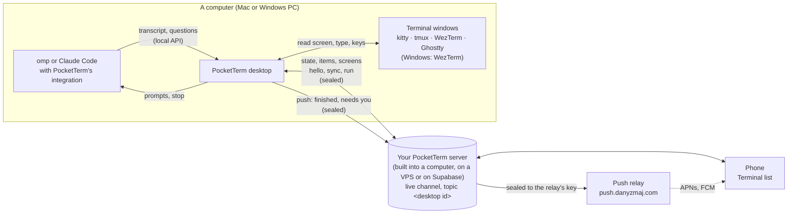

# Architecture

How PocketTerm is put together. For what it does and how to set it up, see the [README](../README.md) and [SELF_HOSTING.md](SELF_HOSTING.md).

One Dart pub workspace (root `pubspec.yaml`): the desktop app for macOS and Windows in `apps/pocketterm-desktop/` (with the PocketTerm server built in, and PocketTerm on Supabase in its `supabase/` folder), the phone app for iPhone and Android in `apps/pocketterm-mobile/`, what both use in `packages/pocketterm_core/`, the PocketTerm server in `packages/pocketterm_server/` with its Docker distribution in `apps/pocketterm-server/`, the end-to-end harness in `tool/e2e/` and the installed-app smoke in `tool/smoke/`. The publisher's push relay (Deno) is in `apps/pocketterm-relay/`. Below, `core/` stands for `packages/pocketterm_core/`, `server/` for `packages/pocketterm_server/`, `desktop/` for `apps/pocketterm-desktop/` and `mobile/` for `apps/pocketterm-mobile/`.



## Layout

| Path | What |
| --- | --- |
| `core/lib/server_client.dart`, `supabase_server.dart` | The PocketTerm server through this device's token (`PocketTermServerClient`): redeeming a setup link or a pairing code, `GET /v1/me`, devices, pairing codes, the computers list, images and files (blobs), push, leaving and erasing, and the live channel's WebSocket; `DeviceTokens`, where a device keeps its sign-in. `SupabaseServerClient`: the same over a Supabase project's function, with the live channel on Supabase Realtime and a setup link for another computer (`POST /v1/setup/new`) |
| `core/lib/session.dart` | The connected server and signing in to it (the server's setup link on a computer, a computer's code on a phone), setup links opened from outside the app (`linkToConfirm`), the phone's pairing link, sign-out, erasing a server this computer runs |
| `core/lib/backend.dart`, `connect.dart` | Which server to use: its URL and kind (a PocketTerm server or a Supabase project), parsing and checking it (`GET /v1/health`: protocol, server version, the clock), setup links and the computer key in them, saving it (shared preferences on the desktop; the native side on phones, so the iPhone's push extension can read it from the App Group) and the confirm-this-link dialog |
| `core/lib/account.dart` | The computer's sign-in page (its server's setup link) and who is signed in (the avatar) |
| `core/lib/desktops.dart` | The server's computers (`GET /v1/desktops`): which ones the phone lists and which it picks |
| `core/lib/agent.dart` | The coding agents (omp, Claude Code): what a new session starts, how a session is named, whether a prompt steers, how an answer becomes keys |
| `core/lib/live.dart` | Terminal from the phone: the protocol (described at the top of the file), routed session keys, transcript items and their seq/epoch log, questions, screen diffs, `chunkJson` |
| `core/lib/e2e.dart` | End-to-end encryption: a computer's channel key, sealing and opening bytes and envelopes (AES-256-GCM with additional data), sealed pushes, the replay guard |
| `core/lib/terminal_channel.dart` | A computer's topic on the server's WebSocket, kept joined on both sides with reconnects and pings (`TerminalChannel`); seals what goes out and opens what comes in (`ChannelSeal`), in order |
| `core/lib/terminal_remote.dart` | Phone: the remote for one computer (with that computer's key; images sealed, then uploaded) and its disk cache |
| `core/lib/live_activity.dart` | Phone: followed sessions (Live Activities on iOS, ongoing notifications on Android) and their push tokens |
| `core/lib/terminal.dart`, `terminals.dart` | The terminal layer: `TerminalHost`, `TermWindow`, `TermCap`, `TermStatus`, keys, process snapshots, `windowOfTerm`, AppleScript; `Terminals`, every installed terminal as one |
| `core/lib/kitty.dart`, `tmux.dart`, `wezterm.dart`, `ghostty.dart`, `ghostty_config.dart` | One `TerminalHost` per terminal; who sets the command Ghostty's new windows run (tmux) |
| `core/lib/ansi.dart`, `chat_images.dart`, `file_types.dart`, `ui.dart`, `theme.dart`, `native.dart`, `timing.dart` | Screen lines with ANSI colors; the images and files a prompt takes (at most 10, files up to 20 MB) and their types; shared UI; the themes (kitty's Catppuccin Mocha, the default, Rosé Pine Dawn, Tokyo Night and Gruvbox Material; kept per device as the preference `theme`, where 0.1.2's `auto` reads as Mocha), read through `C` and applied by `Themed`, which builds the whole app again on a change; the `pocketterm/native` platform channel; debug-only connection timings for the end-to-end run's report |
| `core/lib/speech.dart` | Voice prompts' speech to text: `SpeechSource` (check, listen, stop, fix) and `NativeSpeech`, the phone's recognizer over `pocketterm/native` (`speechCheck`, `speechStop`, `speechFix`) and the `pocketterm/speech` event channel (what's heard so far, the level, how it ended) |
| `core/lib/logo.dart`, `intro.dart`, `app_icon.dart` | The logo in the active theme's colors and corners (`LogoStyle`, as `desktop/tool/make_icon.swift` draws the icons); the launch intro over both apps (the phone springs out of the pocket and stands up, its screen shows the app itself, laid out at full size and drawn scaled and clipped to the screen, and the view zooms in until the screen, taking the display's shape, is the display; the app keeps its place in the tree and gets no taps until the end; a tap skips it, reduced motion makes it a fade; on the desktop it plays when the window first shows); the app icon that goes with the theme (`default`, the app's own, for Mocha) and `followAppIcon`, which hands it to the native side on every change of choice |
| `server/lib/pocketterm_server.dart`, `server/lib/src/` | The PocketTerm server ([PROTOCOL.md](../packages/pocketterm_server/PROTOCOL.md)): `server.dart` (the REST endpoints, blobs and their quotas, the redeem throttle, the minute's housekeeping), `store.dart` (`state.json`, the setup token), `hub.dart` (the live channel), `relay.dart` (sealing pushes to the relay and queuing them), `cli.dart` (`pocketterm-server serve`, `setup-link`, `health`), `secrets.dart` (tokens and codes) |
| `apps/pocketterm-server/` | The server as a program and a container: `bin/pocketterm_server.dart`, `Dockerfile`, `docker-compose.yml` (the server behind Caddy, for a VPS) and `deploy/compose.yaml` (the publisher's test server for the end-to-end runs); [README](../apps/pocketterm-server/README.md) |
| `apps/pocketterm-relay/` | The publisher's push relay (Deno) at `push.danyzmaj.com`: `main.ts`, `src/relay.ts` (opening a sealed request, sending it to APNs or FCM), `src/seal.ts`, `src/fcm.ts`, `src/limits.ts`, `src/metrics.ts`; [README](../apps/pocketterm-relay/README.md), [SECURITY.md](../apps/pocketterm-relay/SECURITY.md) |
| `desktop/supabase/` | PocketTerm on Supabase: `migrations/` (the `pocketterm` schema, its service-role functions, the private bucket, Realtime policies, the pg_cron tick) and `functions/pocketterm/index.ts` (the Edge Function); bundled into the app as assets; [README](../apps/pocketterm-desktop/supabase/README.md) |
| `desktop/lib/main.dart`, `controller.dart`, `main_window.dart` | The desktop app: one window that is the first-run setup, sign-in, the setup checklist or Settings (a status bar over the Phone, Coding agents, Terminals and Account tabs; Account lists the phones signed in, each with **Sign out…**); `AppController` (the server and the built-in one, this computer's id and its place in the computers list, its channel key and **Reset key**, the bridge, sealed pushes, the coding agents found, whether a phone has signed in, Launch at login, off until the person turns it on) |
| `desktop/lib/setup_page.dart` | The first-run setup: **On this computer** (the Tailscale checklist, then Start), **On my own server** (paste a setup link, or set up a VPS with commands to copy and live checks) or **Supabase** (paste a setup link, or set up a project) |
| `desktop/lib/hosting/` | The server built into the app: `built_in_server.dart` (runs it on 127.0.0.1 and has Tailscale publish it), `tailscale.dart` (the Tailscale CLI: status, `tailscale serve`), `hosting_view.dart` (where it stands, and **Add a computer…**), `vps.dart` (a VPS's address, the commands that set it up, the checks that follow them) |
| `desktop/lib/commands.dart` | The installs the setup offers to run once the person confirms (`brew install tmux`, `brew install --cask tailscale-app`, `winget install Tailscale.Tailscale`) |
| `desktop/lib/channel_keys.dart` | This computer's sign-in and its channel key per computer id, in the system's secure storage (`flutter_secure_storage`: the login Keychain on a Mac; on Windows one file in the app's `%APPDATA%` folder, encrypted for the Windows user with DPAPI) |
| `desktop/lib/desktop_host.dart`, `windows_host.dart` | What differs per platform: window, menu-bar or tray item, launch at login, folder picker, idle time, keeping awake, the theme's app icon while running (the Dock's on a Mac; the window's, taskbar's and tray's on Windows, from `assets/icon/`) (`MacHost` over the native channel, `WindowsHost` in Dart) |
| `desktop/lib/update_check.dart` | Windows: the GitHub release check (the Mac uses Sparkle) |
| `desktop/lib/onboarding/` | After the first sign-in, the setup checklist (`get_ready.dart`: coding agents, terminals, project folders, the phone) with its terminals (`terminals_card.dart`: the Mac's, WezTerm's install on Windows), the pairing QR (`pair.dart`), commands shown as typed in a terminal (`commands_view.dart`) and how your data is protected (`data_protection.dart`, also under **Settings → Account**) |
| `desktop/lib/onboarding/supabase_view.dart`, `supabase_admin.dart`, `supabase_setup.dart` | The wizard's Supabase branch; Supabase's Management API with the pasted access token (organizations, projects, SQL, secrets, signing keys, function deploys); putting PocketTerm on a project step by step (migrations, the live channel's signing key, the function, a setup token for this computer) |
| `desktop/lib/terminal_fixes.dart`, `wezterm_setup.dart` | A Mac terminal's one-click fix for Settings and the setup checklist (kitty's lines in kitty.conf, System Settings' Automation page), and which terminals need one; on Windows, WezTerm's own installer, downloaded from its GitHub release, checked against its published SHA-256 and opened |
| `desktop/lib/local_api.dart`, `live_hub.dart` | The 127.0.0.1 API the agents report to, and their live sessions, each with its queue: the phone's prompts waiting for the run to end, handed to the agent one per run end, held after a stopped run until Resume |
| `desktop/lib/test_hooks.dart` | Test builds only (`--dart-define=POCKETTERM_SMOKE=true`): the environment variables that point the app at stand-ins ([SECURITY.md](../SECURITY.md#test-builds)) |
| `desktop/lib/prompt_files.dart` | Files from phone prompts: saved under safe names in a folder per prompt in the temp folder's `pocketterm-files` (deleted once older than a day, when PocketTerm starts or more arrive) and named in the prompt as `@path` |
| `desktop/lib/terminal_bridge.dart` | The phone's way in: sessions and screens out on this computer's topic, its requests in |
| `desktop/lib/integrations.dart` | Finding omp and Claude Code on the computer, and installing and updating the bundled omp extension and Claude Code plugin (**Settings → Coding agents**, the setup checklist, Settings' status bar) |
| `desktop/macos/Runner/` | The Mac's native side: the main window, the menu-bar item, activation policy, launch at login, idle time, the Dock icon, Sparkle |
| `desktop/windows/` | The Windows runner (single instance, `pocketterm://` links handed to the running instance) and `installer.iss` |
| `desktop/integrations/omp/pocketterm-live.ts` | omp extension: the session, live, for the phone, with its model, context use and cost (omp's own tally, `sessionManager.getUsageStatistics().cost`) |
| `desktop/integrations/claude/` | Claude Code marketplace with the `pocketterm` plugin: `hooks/pocketterm.ts` (the session, live), `hooks/items.ts` (Claude's transcript as items, its dialogs as questions), `tests/` |
| `desktop/integration_test/e2e_test.dart` | The desktop half of the end-to-end run |
| `mobile/lib/main.dart`, `mobile.dart`, `links.dart` | Phone app: sign-in by code, the computers' keys (loaded at start from the native side), the home page with the Terminal list (its sort and folded projects kept), a locked computer until its code is scanned, the computer picker, the account sheet, push and link routing; links to the desktop downloads and GitHub |
| `mobile/lib/terminal_view.dart`, `session_view.dart`, `switch_view.dart`, `swipe_action.dart` | The Terminal list (sessions by project, sorted by name or recent activity; a project's heading folds on tap and offers a new session and folding on long press; a session's row reads like its agent's status bar: how it stands, model, context used and cost, over a bar filled to the context), screens, new sessions; a coding session's transcript and composer; switching an agent window that shows only as a screen to the conversation view; a list row's swipe-to-reveal action |
| `mobile/lib/voice.dart` | The composer's microphone (tap, or hold with the finger followed from the platform's raw touches, since the sheet's route cancels it for widgets) and the fullscreen voice sheet (`showFullscreenModal` in `chrome.dart`): live text, level, Stop, then edit, Send, Insert or Cancel; `voiceSource`, which an E2E build points at a scripted speaker |
| `mobile/lib/setup_page.dart`, `onboarding/scan.dart`, `chrome.dart` | Scanning or pasting a computer's code, and **Try the demo**; the per-platform chrome (Cupertino on iPhone, Material 3 on Android) |
| `mobile/lib/push_consent.dart` | After the first sign-in on a server: what notifications go through and who runs the relay, then the person's choice |
| `mobile/lib/coach.dart` | The first-use tips, and the question whether to have them (asked once per phone) |
| `mobile/lib/demo/` | **Try the demo**: the real app on a made-up computer, answered on the phone; nothing goes over the network |
| `mobile/lib/e2e_hooks.dart` | Debug builds for the end-to-end tests only (`--dart-define=POCKETTERM_E2E=true`): the scanner takes a pasted code, the tips start out seen and the question about them answered, and the microphone hears a scripted speaker |
| `mobile/maestro/` | The phone's Maestro flows: `e2e/` (with its `run.sh`) for the end-to-end run, `demo.yaml`, `tips.yaml` and `voice.yaml` |
| `mobile/ios/Runner/AppDelegate.swift`, `Dictation.swift`, `mobile/ios/Shared/` | The iPhone half of `native.dart`: App Group, push registration, notification taps, Live Activities, the theme's alternate app icon (`AppIcon-<Theme>` sets in `Assets.xcassets`; Mocha's is `AppIcon`, the app's own); `speech.dart`'s recognizer (SpeechAnalyzer on iOS 26, SFSpeechRecognizer on the device before) |
| `mobile/ios/PocketTermLive/`, `PocketTermPush/` | The Live Activity (WidgetKit); the notification service extension that decrypts pushes |
| `mobile/android/…/pocketterm/` | The Android half: `MainActivity.kt`, `PushService.kt` (FCM), `SessionActivities.kt` (ongoing notifications), `Notifications.kt`, `PocketTermShared.kt`, `AppIcons.kt` (the theme's launcher icon: one activity-alias per icon, `IconDefault` being Mocha's, switched when the app leaves the screen, in release builds only), `Dictation.kt` (`speech.dart`'s recognizer: on the device from Android 12) |
| `tool/e2e/` | The end-to-end run (`run.sh`, `bin/run.dart`): a server (local, built in over Tailscale, Supabase in Docker, a new project on supabase.com, or one elsewhere), the real desktop app, throwaway kitty, Ghostty and WezTerm windows with a scripted omp (`bin/fake_omp.dart`), and the phone in the Simulator or an Android emulator; `lib/e2e.dart` holds the shared pieces |
| `tool/smoke/` | The installed app as from Finder: a release build copied to a throwaway place with a throwaway home, Keychain and Tailscale stand-in (`fake_tailscale.sh`), driven through accessibility (`ax.swift`, `scenario.sh`) |
| `tool/supabase-local.sh` | PocketTerm on a local Supabase in Docker, for the Supabase tests and end-to-end runs |
| `config/PocketTerm.xcconfig` | Team, bundle id and App Group for every Xcode target (`Local.xcconfig` overrides them) |

## Server

Every owner runs their own PocketTerm server; nothing is shared between owners. It is one Dart program (`server/`) with no database: either built into the desktop app (**On this computer**) or the container on a VPS (**On my own server**). The third choice, **Supabase**, is the same protocol on a Supabase project ([below](#on-supabase)). The protocol is in [PROTOCOL.md](../packages/pocketterm_server/PROTOCOL.md); everything lives under `<url>/v1/`.

- **Store.** Everything but images is one JSON file, `state.json`, in the data directory (`/data` in the container, the app's support folder `pocketterm-server/` for the built-in one): the server's id, devices (with the SHA-256 of each device token, never the token), computers, pairing codes, push tokens and Live Activity tokens. It is rewritten atomically after every change (`state.json.tmp`, then the last good one kept as `state.json.bak`). The setup token sits in its own file, `setup-token`, so `pocketterm-server setup-link --new` can change it while the server runs. A lock on `.lock` keeps a second server off the same directory. A disk that can't be written answers 507 `storage`.
- **Sign-in.** A computer redeems the server's setup link (`pocketterm://setup?url=…&setup=<setup token>`, printed by `pocketterm-server setup-link`; the built-in server signs its own computer in on 127.0.0.1) at `POST /v1/setup/redeem`. A phone redeems a computer's pairing code at `POST /v1/pair/redeem`. Either way the server hands back a **device token** (43 characters, base64url) that every other call carries as `Authorization: Bearer`. A computer keeps it in its secure storage (`desktop/lib/channel_keys.dart`), a phone on its native side (`Native.deviceToken`: the Keychain on iOS, Keystore-wrapped on Android). The server's id (`GET /v1/me`) keys everything a device keeps per server. Both redeem endpoints share a throttle: 10 failures from one address in 10 minutes and it waits.
- **Pairing.** A signed-in computer asks `POST /v1/pair` for a single-use code (28 characters of Crockford base32, valid 10 minutes) and shows it in a QR with its own id and channel key (below). The setup checklist and Settings know a phone has signed in when the server's devices (`GET /v1/devices`) include a phone or a phone says hello on this computer's topic.
- **Devices.** Signing out is `DELETE /v1/devices/me`: the token stops working, the device's push and Live Activity tokens go and its WebSockets close with 4003, which signs the app out. A computer can revoke another device (`DELETE /v1/devices/:id`, **Sign out…** next to a phone in **Settings → Account**), and the computer that runs the built-in server can erase everything on it (`POST /v1/erase`, **Settings → Account**); the setup token and the server's id stay.
- **Computers.** Each computer picks a random 8-character id per server (preference `desktop_id_<server id>`), lists itself with `PUT /v1/desktops/:id` (name, `macos` or `windows`) while its bridge runs and every 60 s, and removes itself on sign-out. The server stamps `seen_at` with its own clock, so a computer's wrong clock can't skew it. The phone lists computers seen in the last 30 days and calls one online when seen in the last 150 s.
- **Live channel.** `GET /v1/ws` upgrades to a WebSocket (`hub.dart`). A client joins topics; a computer's topic is its id. A `send` on a topic reaches every other socket joined to it and is passed on untouched, at most once, in order per sender. Nothing on it is stored, and everything on it is sealed with the computer's key (below). Frames are at most 256 KiB; the server pings every 25 s and closes a socket that misses a pong, and the apps ping too and reconnect after 1 s, 2 s, 4 s … (`core/lib/terminal_channel.dart`). The protocol on top is at the top of `core/lib/live.dart`; its `state` carries, per coding agent found on the computer, whether PocketTerm is installed, out of date or missing in it (`agents`, `AgentIntegration` in `core/lib/agent.dart`), so the phone can say why an agent's window shows only as a screen.
- **Blobs.** Images and files from the phone go through `PUT /v1/blobs/:path` (the phone picks a UUID as the path and seals the bytes first), at most 20 MiB each, 200 MiB waiting per device (else 429) and 1 GiB in all (else 507). The computer downloads each once with `GET`, which deletes it; one nobody downloads is deleted after an hour.
- **Push.** Phones register their APNs or FCM token (`/v1/push/register`; `unregister` turns notifications off). Computers send `notify` and `activity` calls. The server forwards each push in the background to the publisher's relay (`relay.dart`; `PUSH_RELAY_URL`, by default `https://push.danyzmaj.com/v1/push`), one request per phone, its body sealed to the relay's X25519 public key (`PUSH_RELAY_KEY`): an ephemeral X25519 key, HKDF-SHA256 and AES-256-GCM. It retries 5xx and 429 answers and forgets a token the relay answers 410 for. The relay (`apps/pocketterm-relay/`) holds the APNs key and the Firebase service account, stores nothing, refuses any field not listed for each kind of push, and hands the sealed notification to Apple or Google as it is. When a computer stops checking in for 3 minutes, signs out or is revoked, the server ends the Live Activities of its sessions.
- **End-to-end encryption** (`core/lib/e2e.dart`).
  - *Keys.* Each computer has one channel key per server it's signed in to (one per computer id), 32 random bytes made the first time it's needed (`desktop/lib/channel_keys.dart`, under `channel_key_<desktop id>` in the system's secure storage). It never goes to a server. **Reset key** (Settings → Phone) makes a new one and restarts the bridge; every phone must scan again. A phone keeps a map of desktop id to key on its native side (`Native.setChannelKey`, `channelKeys`: the Keychain in the App Group on iPhone, Keystore-backed on Android) where the push extension reads it too, and caches it in Dart (`MobileSession.computerKey`). Sign-out removes every key (`Native.removeAllChannelKeys`).
  - *Pairing.* The computer's QR is `pocketterm://setup?url=…&code=…&d=<desktop id>&k=<base64url key>` (`Backend.linkWithCode`, `Backend.computerKey`). Scanning it signed out signs in and stores the key; signed in (the locked computer's **Scan**, or **Scan a computer's code** in the picker) it only stores the key. A link without `d`/`k` still signs in; that computer stays locked. A link opened from outside the app never stores a key, and one that points a signed-out device at another server waits for the person to confirm it. A computer the phone has no key for gets no remote: nothing joins its topic.
  - *Envelope.* Every live event's payload goes as `{"v":1,"n":"<base64 nonce>","c":"<base64 ciphertext and tag>"}`: AES-256-GCM, 12-byte random nonce, AAD `pocketterm/v1|<topic>|<event>` (the topic is the computer's id), plaintext `{"m": <the original JSON>, "ts", "mid", "ep", "seq"}`: `ts` ms since epoch, `mid` 16 random characters, `ep` the sender's epoch (new each time it starts), `seq` its count from 1 (`ChannelSeal`, `ReplayGuard`). The payload stays whole under `m`, so its own keys of those names (an items catch-up's `seq`) come through. The receiver drops a bad version or tag, a `ts` more than 5 minutes off or older than the receiver's own start, a `mid` seen in the last 10 minutes and a `seq` at or below the last one taken for its `ep`, and logs each kind once. The apps compare their clock with the server's (`GET /v1/health`) and warn past 2 minutes. Sealing and opening are queued so messages keep their order. Item chunks (`chunkJson`) stay under 40 000 bytes of JSON, a full screen under 60 000 and a state under 150 000, so a sealed message fits the server's 256 KiB frame.
  - *Images.* The phone seals each image's bytes (AAD `pocketterm/v1|image|<path>`, raw `nonce ‖ ciphertext ‖ tag`), then uploads them as `application/octet-stream`; the computer downloads, opens and deletes them.
  - *Push.* A computer seals each notification's JSON `{title, body, session, state}` itself with its channel key (AAD `pocketterm/v1|push|<desktop id>`, `sealNotice`) and sends `{tag, enc, collapse?}` to `POST /v1/push/notify`. `tag` is the computer's push tag (`pushTag`: the first 8 bytes of HMAC-SHA256(channel key, `pocketterm/v1|push-tag`), 11 characters) and `collapse` the session's (`sessionTag`: the first 16 bytes of HMAC-SHA256(channel key, `pocketterm/v1|push-session|<routed session key>`), 22 characters), so no computer id or session key leaves the server. The server and the relay pass `enc` on unread; the relay puts it in the push with the tag as `t` (and `collapse` as `apns-collapse-id` or `collapse_key`), and the phone's notification extension (iOS) or FCM service (Android) finds the key whose tag that is among its own and opens it, or shows a generic "PocketTerm" alert when it has none. An Android phone's followed-session updates are sealed the same way (AAD `pocketterm/v1|activity|<desktop id>`, `sealActivity`) and reach it as `{enc, t}`, collapsed by the session's tag (`ref`, which the phone registered with `activity_register`); an end the server sends on its own goes plain as `{ref, state: ended}`, and the phone ends the followed session whose tag is `ref`. An iPhone Live Activity push carries the state only (`{state, since, kind?}`, unencrypted: Apple shows it without the app), at the activity's own push token; a tap opens the session from the activity's local `ActivityAttributes` (`mobile/ios/Shared/SessionActivity.swift`, `link`: `pocketterm://session?key=<routed key>`), set when the phone started it. Session keys in pushes, Live Activities and `pocketterm://session?key=` links are routed: `<desktop id>/<session key>`, so a tap selects that computer ahead of opening the session.
- **Setup wizard** (`desktop/lib/setup_page.dart`, `desktop/lib/hosting/`, `desktop/lib/onboarding/supabase_*.dart`). **On this computer** runs the server built into the app on 127.0.0.1 (port 47900 or the next free one) and has Tailscale publish it to the owner's tailnet with `tailscale serve` at `https://<computer>.<tailnet>.ts.net`, so phones get real HTTPS and nothing outside the tailnet reaches it. Its checklist follows Tailscale as the person sets it up: installed (`desktop/lib/commands.dart` offers the install), running, signed in, HTTPS certificates on, port 443 free; then **Start** signs this computer in. Phones need Tailscale too, on the same account. PocketTerm claims only its own Serve entry (the ports it has and had) and changes Serve only after reading it. **On my own server** takes a server's setup link, or, for a new one, a VPS's address (an IPv4 address becomes its `sslip.io` name), the commands to run there (Docker, `apps/pocketterm-server/docker-compose.yml` of this app's release, start it, print the setup link) and live checks: the name resolves, HTTPS answers, the server is healthy. **Supabase** takes a setup link from another computer on the project, or a personal access token to set a project up (below). Each way the setup checklist (`desktop/lib/onboarding/get_ready.dart`) follows sign-in.

### On Supabase

`desktop/supabase/` is the server as a Supabase project, answering the same REST paths at `https://<ref>.supabase.co/functions/v1/pocketterm` ([PROTOCOL.md](../packages/pocketterm_server/PROTOCOL.md#pocketterm-on-supabase)), so the apps use it through the same client (`SupabaseServerClient` extends `PocketTermServerClient`).

- **Database.** The `pocketterm` schema holds what `state.json` holds on the PocketTerm server (devices, computers, pairing codes, push and Live Activity tokens, blobs, redeem failures), reachable only through `public.pocketterm_*` functions the service role calls. Tokens and codes are stored as hashes. Sealed images and files sit in the private Storage bucket `pocketterm-blobs`.
- **Live channel.** Supabase Realtime broadcast on private topics (each computer's id) instead of `GET /v1/ws`. `POST /v1/live/token` gives a signed-in device an ES256 token for 10 minutes, signed with the key the setup imported as the project's JWT signing key; row level security on `realtime.messages` lets it join only while that device exists. The envelopes are the same sealed ones. Signing a device out broadcasts `pt.left` on every computer's topic, and devices check they're still signed in.
- **Housekeeping.** pg_cron calls the function every minute: it ends Live Activities of computers that went quiet and removes old blobs, pairing codes and redeem failures.
- **Setup.** The desktop's wizard (`supabase_setup.dart`) applies the bundled migrations it hasn't yet, imports the signing key, deploys the function and signs this computer in with a fresh setup token, through Supabase's Management API with the person's access token, which it never stores. **Add a computer…** asks the function for a new setup link (`POST /v1/setup/new`).

## Terminals

Each terminal is a `TerminalHost` (`core/lib/terminal.dart`): list its windows (`TermWindow`: key, title, cwd, foreground program, `app`, `caps`, `via`), read a screen, type, press keys, open a window, close one, and a `TermStatus` (`ready`, `limited`, `setup`, `idle`, `missing`, with a note and a fix) for **Settings → Terminals** and the setup checklist. Capabilities (`TermCap`): `read`, `ansi`, `type`, `line`, `keys`, `close`; the phone shows only what a window can do, and answers questions with keys only where the window can be read and take keys.

| Terminal | How | Window key |
| --- | --- | --- |
| kitty | Remote control over its unix socket (`listen_on unix:/tmp/kitty`); only sockets the current user owns | `kitty-<pid>/<id>` |
| tmux | The `tmux` CLI on every server socket of the user | `tmux:<socket>/<pane n>` |
| WezTerm | `wezterm cli` per GUI socket (`~/.local/share/wezterm/gui-sock-<pid>`; on Windows under `%USERPROFILE%`) | `wezterm:<gui pid>/<pane>` |
| Ghostty | AppleScript | `ghostty:<UUID>` |

`Terminals` (`core/lib/terminals.dart`) puts the installed ones together: all four on macOS, WezTerm only on Windows (Settings and the setup checklist install it there: `desktop/lib/wezterm_setup.dart`). A tmux pane shown in a GUI window is listed once, as the pane. An app that can't both read and press keys (Ghostty) launches a phone-started session inside tmux when tmux is installed. An agent's `hello` carries its terminal environment (`TERM_PROGRAM`, `KITTY_*`, `TMUX`, `WEZTERM_PANE`, …), which `windowOfTerm` turns into its window's key.

**Screen only to conversation.** An agent window no live session claims (its agent started without PocketTerm in it) shows on the phone as a screen, badged **Screen only**. Where the computer says PocketTerm is installed in that agent and the window's terminal can press keys and type, the phone offers to switch it, with two `run` ops (`core/lib/live.dart`) the bridge does with the window's terminal (`desktop/lib/terminal_bridge.dart`):

| Op | The computer | Answer |
| --- | --- | --- |
| `probe {window}` | Reads the screen, waits 2 s, reads it again | `ran {busy}`: the text changed (the agent is at work) |
| `switch {window, agent}` | omp: Esc (stops a run), Ctrl+C (empties its editor; Ctrl+U clears one line only), Ctrl+D (quits on an empty editor), waits until the tty's foreground program isn't omp (up to 8 s; 2 s where the terminal tells no tty), then types `omp -c` and Enter. Claude Code: types `/reload-plugins` and Enter | `ran {}`, or `ran {error}` |

The phone shows "Switching…" until a session reports from that window, then its session page takes the screen's place; after 25 s it says the window didn't come back as a conversation. When the probe said busy, the sheet offers **Restart and continue**, whose session page prompts `continue` once the session is online and at rest (showing **Continue** if that fails), and **Just restart**, whose session page shows **Continue**.

## Local API

On launch the desktop app listens on a random 127.0.0.1 port and writes `{port, token, pid}` to `~/.config/pocketterm/cli.json` (on Windows under `%USERPROFILE%`), or, in a test build (`POCKETTERM_SMOKE`, [SECURITY.md](../SECURITY.md#test-builds)), to the file `POCKETTERM_CLI_JSON` names. The extensions ask `/v1/ping?nonce=<fresh>` without the token and send it only if `proof` is the HMAC-SHA256 of `pocketterm-ping\n<port>\n<nonce>` under the token, so whatever listens on a port a stale `cli.json` names gets neither the token nor any commands.

```
GET   /v1/ping?nonce=N   → {"app": "pocketterm", "proof"}   no token
GET   /v1/ping           → {"app": "pocketterm", "pid"}   with the token: this PocketTerm is up
GET   /v1/live           WebSocket: a coding session reporting itself (omp)
POST  /v1/live/http      {conn?, frames, wait?, close?} → {conn, frames}   the same over HTTP long polls (Claude Code)
Authorization: Bearer <token>   (everything but /v1/ping?nonce=)
```

## Building and testing

See [BUILDING.md](BUILDING.md) and [CONTRIBUTING.md](../CONTRIBUTING.md#pull-requests).
