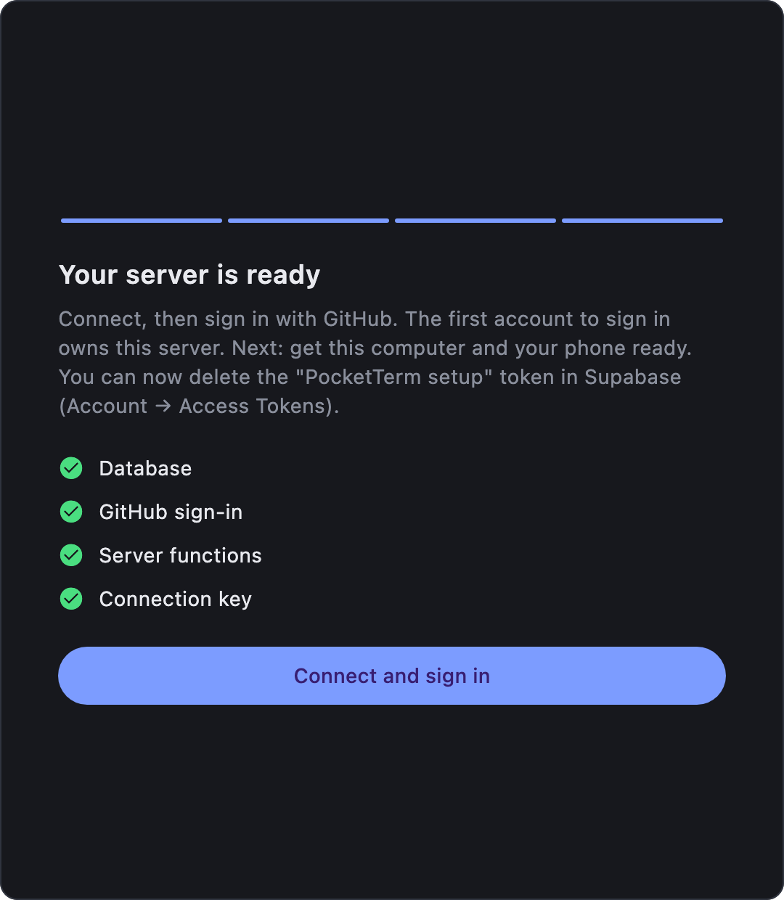
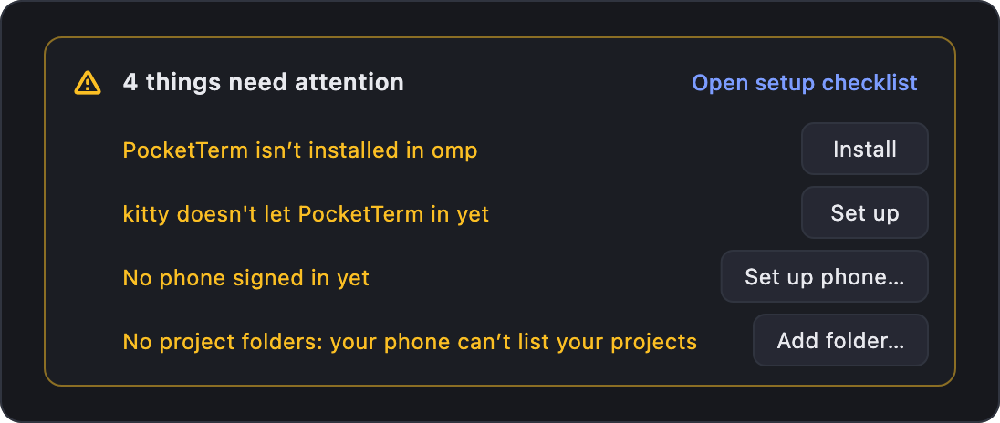

# Self-hosting

PocketTerm has no central server. Your computers and phones meet in a Supabase project that you own: it signs you in, pairs your phones, carries the terminal channel and sends pushes. Setting it up takes a few minutes, once. The free Supabase plan is more than enough for one person.

A PocketTerm server is its own thing: give PocketTerm a Supabase project of its own, not one another app uses.

## The easy way: the desktop app

Install PocketTerm on your Mac or Windows PC and open it. With no server yet, its window is a setup wizard; it sets up the server only, and a checklist after sign-in takes care of the computer and your phone ([After the first sign-in](#after-the-first-sign-in)):

1. **Supabase access token.** Create one at [supabase.com/dashboard/account/tokens](https://supabase.com/dashboard/account/tokens) (`sbp_…`) and paste it. It's used for this setup only and never saved.
2. **Project.** **Create a new project** (region guessed from your time zone), or **Use an existing project**. A project of its own is best: PocketTerm makes sign-in private to your account, so it won't go on a project that already has accounts or tables of the same names, and it says which of the project's settings it would replace. The free plan allows two active projects; pause one you don't use if it's full.
3. **GitHub sign-in.** **Open GitHub: new OAuth app** opens GitHub's form; copy in the application name and callback URL the wizard shows, then paste back the client ID and secret.
4. **Setup.** PocketTerm creates the tables and security rules (**Database**), turns on GitHub sign-in, turns email sign-up off (GitHub is the only way in), makes sign-up private and allows the `pocketterm://` redirect (**GitHub sign-in**), deploys the `pair` and `push` functions (**Server functions**) and fetches the publishable key (**Connection key**). If a step fails, **Retry** resumes from it, and redoes any step whose values you changed after going back.

Then **Connect and sign in** with GitHub. Push notifications need nothing more: each phone registers itself, and your server sends through the publisher's relay, encrypted so only that phone can read them ([Push](#push)).

<p align="center"></p>

### After the first sign-in

The first sign-in on a computer, by the wizard or by **I already have one: connect it**, opens **Get this computer ready**, a checklist whose steps check themselves off:

1. **Your coding agents.** PocketTerm installs itself into every coding agent it finds (omp, Claude Code), says how each went, and offers **Retry** if one failed. An agent that isn't installed is left for later: Settings offers it once it shows up. Agent sessions that started before PocketTerm was in them are listed until you quit them and run `omp -c` (or `claude -c`).
2. **Your terminals.** On a Mac, the terminals it found, with **Set up** for kitty and **Allow…** for those that need Automation permission, and a `brew install tmux` line when tmux is missing. On Windows, PocketTerm works through WezTerm: **Install WezTerm** downloads WezTerm's own installer from its GitHub release, checks it against WezTerm's published checksum and opens it for you to click through, or you type the `winget` line it shows into PowerShell. Both catch up on their own once WezTerm is installed or a permission is given.
3. **Project folders** (optional). The usual folders found in your home folder (`Dev`, `Developer`, `Projects`, `code`, `src`, `repos`; on Windows also `source\repos` and `Documents\GitHub`), one click each, or **Choose folder…**.
4. **Your phone.** The QR code from [Connect the apps](#connect-the-apps), checked off once a phone has signed in.

Every step can be skipped; **Done** goes to Settings and says what's still left. Settings starts with a status card: **All set**, or each thing that needs attention with the button that fixes it, including a coding agent installed later. **Open setup checklist** shows the checklist again.

<p align="center"></p>

Servers are set up from a computer (or the script below), never from a phone: the iPhone and Android apps only pair with a server that exists.

## The script

Same result from a terminal, on macOS or Linux. You need:

- a [Supabase](https://supabase.com) account,
- a GitHub account (PocketTerm signs in with GitHub),
- the [Supabase CLI](https://supabase.com/docs/guides/cli): `brew install supabase/tap/supabase`, then `supabase login`,
- `jq` (part of macOS 15 and later; otherwise `brew install jq`, or your Linux package manager's `jq`),
- this repository: `git clone https://github.com/danyzmaj-apps/pocketterm && cd pocketterm`.

### 1. Create a Supabase project

At [supabase.com/dashboard](https://supabase.com/dashboard), choose **New project**. Pick a region near you and keep the database password somewhere safe; PocketTerm itself never needs it. Note the project ref: it's the `abcdefghijklmnopqrst` in `https://abcdefghijklmnopqrst.supabase.co`.

### 2. Run the setup script

```sh
# in the repo root
apps/pocketterm-desktop/tool/setup-backend.sh <project-ref>
```

Without a ref it lists your projects and asks for one. Then it walks you through the rest:

1. It links the repo to your project.
2. It asks you to **create a GitHub OAuth app** at [github.com/settings/applications/new](https://github.com/settings/applications/new) (name `PocketTerm`, homepage `https://github.com/danyzmaj-apps/pocketterm`, callback URL `https://<project-ref>.supabase.co/auth/v1/callback`) and to paste its client ID and secret. They are stored in `apps/pocketterm-desktop/supabase/.env` (mode 600), which git ignores. A rerun reuses them.
3. It creates the tables, security rules and storage (`supabase db push`).
4. It turns on GitHub sign-in, the `pocketterm://` redirect and private sign-up, and turns email sign-up off (`supabase config push`).
5. It deploys the edge functions `pair` and `push`.

At the end it checks that GitHub sign-in is on and prints a **setup link**: `pocketterm://setup?url=…&key=…`. It holds only your project URL and its publishable key, both of which are safe in an app; row-level security protects the rest. It's for a computer: phones need the computer's code, which adds a sign-in code to the same link.

## Connect the apps

- **Mac or Windows PC**: install PocketTerm from [Releases](https://github.com/danyzmaj-apps/pocketterm/releases/latest) (the phone app's first screen links there too: **Get PocketTerm for Mac or Windows**), then open the setup link (on a Mac the script offers to) or paste it into the wizard's **I already have one: connect it**. Sign in with GitHub. Every computer you sign in on shows up in the phone's list of computers.
- **iPhone and Android**: phones sign in only with a code from a computer, never with GitHub. On the computer, **Settings → Set up phone…** shows a QR code. In the phone app, tap **Scan the code from your computer**. The code carries the server address, its publishable key and a one-time sign-in code, so the phone signs in as you. It works once and expires after 10 minutes; anyone who scans it gets into your account, so only show it to your own phone. No camera? **Paste a code instead** takes the same code as text (the whole `pocketterm://setup?…&code=…` link). A phone that signs out, or whose sign-in ends, is back on that screen and needs a new code.

The first account that signs in **owns the server**. One phone pairing is enough for all your computers: they share the account.

## Reviewer codes

For someone who must try a phone build without getting into your account (for example TestFlight's Beta App Review, if you ever invite external testers). Internal TestFlight and Play internal testing need none. In Settings, press ⌥ Option (Alt on Windows) to show **Reviewer access**; its **Codes…** makes a **reviewer code**: it signs a phone into a separate demo account on your server (`reviewer@<project-ref>.pocketterm.invalid`, made the first time), works as often as needed for 7, 30 or 90 days, and can be revoked there at any time. Give the reviewer its link (**Copy**) or its QR (**Save QR as PNG**); in the phone app it goes into **Paste a code instead**, or the camera reads the QR. The code is shown only when it's made: your server keeps a hash of it.

The demo account sees none of your computers or sessions. Once no code of it works, it is shut out: revoking the last working code signs every phone on it out within 30 seconds, and a code running out does the same within 10 minutes. If a reviewer taps **Delete account**, the demo account is emptied (its phones, followed sessions and computers) but stays, with your reviewer codes, so a code you gave a reviewer keeps working. No email is ever sent to the demo address, and it isn't let in through `allowed_signups`: the `pair` function makes it with the service role.

## Sharing

A PocketTerm server is private. The first account to sign up owns it, and anyone else's sign-in is refused with "This PocketTerm server is private". To let someone in, add their GitHub email in the dashboard's SQL editor:

```sql
insert into public.allowed_signups (email) values ('friend@example.com');
```

Each person sees only their own computers and sessions, but they share your Supabase quota.

## Updating

After pulling a new version of this repo, run the setup script again. It applies new migrations and redeploys the functions, and leaves your GitHub app as it is:

```sh
# in the repo root
git pull && apps/pocketterm-desktop/tool/setup-backend.sh <project-ref>
```

The Mac app updates itself; on Windows, Settings links to a new version when one is out. [CHANGELOG.md](../CHANGELOG.md) says when a new app version needs a backend update.

## Push

Your server pushes coding-session notifications (a run ended, the agent needs you) and the state of the sessions you follow to your phones. Only the app's publisher holds the credentials that reach PocketTerm's installs (the APNs key for iPhones, the Firebase service account for Android), so your server's `push` function hands each notification to the publisher's **relay**, which passes it to Apple's APNs or Google's Firebase Cloud Messaging.

- Each phone makes its own AES-256 key and registers it with your server (`push_devices`, with the device's push token and its `platform`, `ios` or `android`). Your server encrypts every notification with that key; the relay sees the push token, the kind of notification (terminal, a session's state), a collapse id and ciphertext, and stores nothing on disk. iPhone Live Activity updates are the exception: iOS can't decrypt them, so they carry the session's state (working, needs you, finished, ended), since when and, when it needs you, for what (a question, an approval or a plan) in the clear, and no text.
- Android messages are FCM data messages the app decrypts itself; iPhone messages are decrypted by its notification service extension.
- A computer pushes only when nobody has touched it for 60 seconds.
- No setup on your side: the default `PUSH_RELAY_URL` is the publisher's relay.

### Your own app id and relay

A relay only reaches apps signed with the publisher's ids. A fork that ships its own phone app (its own bundle id or Android package) runs its own relay on a Supabase project of its own: an APNs key from its Apple team, a Firebase project with its Android app (its `google-services.json` goes into its Android build) and that project's service account as the relay's `FCM_SERVICE_ACCOUNT` secret. `apps/pocketterm-desktop/tool/deploy-relay.sh` deploys it ([RELEASING.md](RELEASING.md#push-relay-once-and-after-relay-changes)). Then set the relay on each server that serves those apps:

```sh
# in apps/pocketterm-desktop, linked to that server
supabase secrets set PUSH_RELAY_URL=https://<relay-project-ref>.supabase.co/functions/v1/relay
```

## Troubleshooting

| What you see | What to do |
| --- | --- |
| "GitHub sign-in is off on this project" | Run the setup script again, or turn GitHub on under Authentication → Sign In / Providers. |
| The browser shows `redirect_uri is not associated` | The GitHub OAuth app's callback URL must be exactly `https://<ref>.supabase.co/auth/v1/callback`. |
| Sign-in finishes in the browser but the app stays signed out | Authentication → URL Configuration must allow `pocketterm://login-callback` (`supabase config push` sets it). On Windows, start PocketTerm once from the Start menu so it registers the `pocketterm://` link again. |
| "This PocketTerm server is private" | Expected for everyone but the owner; see [Sharing](#sharing). |
| Phone: "That code doesn't work" | It ran out (10 minutes), was used already or was revoked: make a new one (**Settings → Set up phone…**). |
| Phone: "Too many tries" | Ten wrong codes from one place in ten minutes: wait a few minutes, then use a fresh code. |
| Phone: "Your server is older than this app" | Run the setup script again: the server needs the new functions and migrations. |
| Phone: "Your computer isn't reporting to this account" | Sign in on PocketTerm on your computer with the same GitHub account, turn on **Settings → Terminal from phone** and keep it running. |
| Phone: "<computer> isn't answering" | That computer is asleep, off, or PocketTerm isn't running there, or **Settings → Terminal from phone** is off. |
| "The project refused this key" on the setup screen | Use the **publishable** key (Project Settings → API Keys), never a secret one. |
| Terminal: "PocketTerm may not control iTerm2" (or Terminal, Ghostty) | Allow it in System Settings → Privacy & Security → Automation → PocketTerm. |
| Terminal: "kitty isn't listening" | **Settings → Terminals → Set up** next to kitty, then restart kitty. |
| Terminal: Ghostty windows show no screen | Expected: Ghostty's screen can't be read. Install tmux (`brew install tmux`) and start sessions from the phone: they run inside tmux with full control. |
| Terminal: can't answer or press keys in a Terminal (macOS) window | Expected: Terminal takes only whole lines. Same fix: install tmux and start sessions from the phone. |
| Terminal: a Ghostty session isn't matched to its window | Ghostty tells no tty, so PocketTerm matches the session by its folder: keep one Ghostty window per folder. |
| Windows: no windows show up | Only WezTerm windows are listed. Install it with **Install** in **Settings → Terminals** (or `winget install --id wez.wezterm --exact`) and run your agent in WezTerm. |
| Windows: "This computer reads PNG and JPEG images only." | Send PNG or JPEG images; the phone apps send JPEG. |
| Claude Code sessions don't show up | Claude Code needs 2.1.287 or later with mods on. If Settings says mods are off, run `claude /login`, start `claude` once, then restart your sessions. |
| Phone: omp or Claude windows show only as screens, not as conversations | The note above them says why, from what the computer reports: PocketTerm isn't installed in that agent (**Install** in Settings' status card or **Settings → Coding agent**), it's out of date (**Update**), or those sessions started before it was installed: quit the agent there and run `omp -c` (or `claude -c`). |

A local Supabase (`supabase start`) works for development, but it doesn't check API keys, so the setup screen accepts any key there.

## Removing it

Delete your account in the app's Settings to erase your data, or delete the whole Supabase project in its dashboard. Then delete the GitHub OAuth app. If you keep the project, remember that with your account gone the next GitHub sign-in owns the server: delete the OAuth app first, or delete the project.
