# Self-hosting

PocketTerm has no central server. Your computers and phones meet in a **PocketTerm server** that you run: it pairs your phones, keeps the list of your computers, passes the live channel between a computer and its phones and sends pushes. Everything between a computer and a phone is end-to-end encrypted by the apps, so the server only ever passes on ciphertext ([How your data is protected](#how-your-data-is-protected)).

The server runs in one of three places, and the desktop app sets up each:

| | **On this computer** | **On my own server** | **[Supabase](#supabase)** |
| --- | --- | --- | --- |
| Who runs the server | This computer (built into the PocketTerm app) | You, in Docker on a VPS you rent | Supabase, in a region you pick |
| Who holds the metadata | Only you | You and your VPS host | Supabase |
| Reached through | [Tailscale](https://tailscale.com) on this computer and on your phone, signed in to the same account | Your domain (HTTPS); the VPS needs a public IP address and ports 80 and 443 open | supabase.co (HTTPS) |
| Cost | Free | The VPS (a small one is enough) | Free plan (pauses after about a week unused) |
| This computer must be awake | Yes | Yes (your sessions run on it) | Yes (your sessions run on it) |
| Contents end-to-end encrypted | Yes | Yes | Yes |

Your sessions always run on the computer, so it has to be awake in every option. Several computers can share one server in each option.

Tailscale's Personal plan is free (up to 3 users, 100 devices). Sign in with a personal Google, Apple, GitHub or Microsoft account; a work email domain may start a paid business trial instead.

Servers are set up from a computer, never from a phone: the iPhone and Android apps only pair with a server that exists.

## The setup wizard

Install PocketTerm on your Mac or Windows PC ([Releases](https://github.com/danyzmaj-apps/pocketterm/releases/latest)) and open it. With no server yet, its window is a setup wizard that follows your choice. Every screen has **Back**, and the wizard remembers where you were if you close it and come back. **How your data is protected** on its first screen sums up who can see what; **Settings → Account** shows the same again later.

<p align="center">
  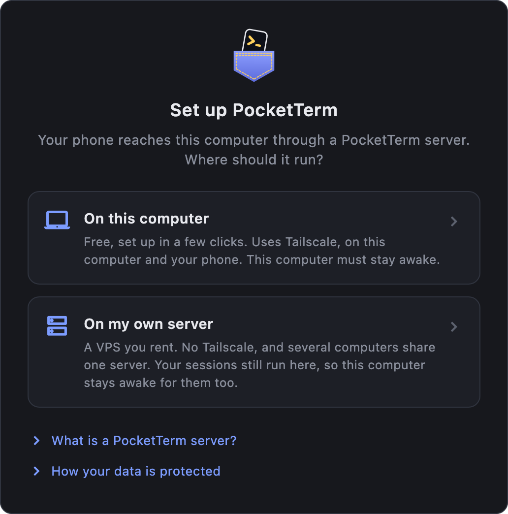
  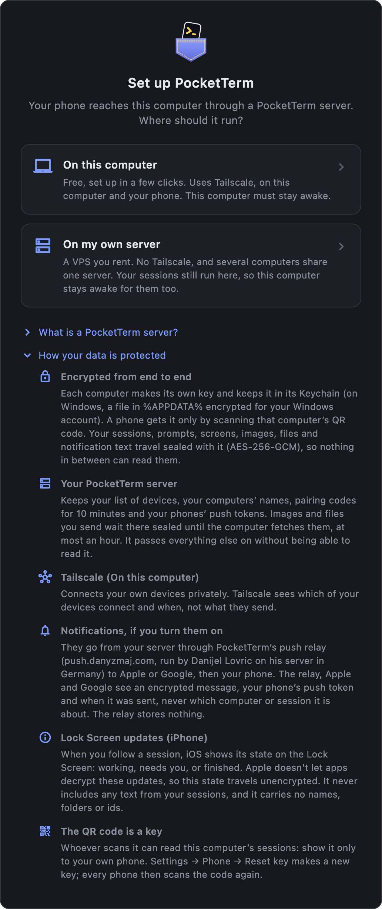
</p>

PocketTerm never runs anything on your computer without asking first. Where it can install something for you (Tailscale or tmux with Homebrew on a Mac, Tailscale with winget on Windows), the button shows the exact command and runs it only after you press **Run**; anything else is a line to copy or a download link.

### On this computer

The server runs inside the PocketTerm app, listening on this computer only. [Tailscale](https://tailscale.com) makes a private network between your own devices and gives this computer an HTTPS address that only they reach (`https://<this computer>.<tailnet>.ts.net`, through `tailscale serve`). Tailscale sees which of your devices connect and when, not what PocketTerm sends.

The wizard shows a checklist that looks again every few seconds and moves on by itself. Each step shows only its own button; finished steps fold to one line:

1. **Install Tailscale.** With Homebrew on a Mac, **Install Tailscale** runs `brew install --cask tailscale-app` once you confirm (macOS asks for your password: Tailscale's installer needs it). On Windows it runs `winget install --id Tailscale.Tailscale --exact --source winget` once you confirm (Windows asks you to allow the installer). **Download instead** opens Tailscale's download page; a Mac without Homebrew gets only that. The App Store and standalone Mac apps both work (PocketTerm uses the app's own command line, `/Applications/Tailscale.app/Contents/MacOS/Tailscale`), and so does the open source `tailscale` command (Homebrew's `tailscale` formula), found on the PATH.
2. **Start Tailscale.** **Open Tailscale** and switch it on.
3. **Sign in to Tailscale.** **Open Tailscale to sign in**, with any account (Google, GitHub, Microsoft, Apple). Use the same one on your phone.
4. **Turn on HTTPS certificates.** **Turn on HTTPS…** opens the page Tailscale names for your tailnet (or the admin console's [DNS page](https://login.tailscale.com/admin/dns)): turn on HTTPS, and MagicDNS if it asks. On a work tailnet only its admin can: ask them, sign this computer and your phone in to a personal Tailscale account instead, or use **Use my own server instead**.
5. **Tailscale's HTTPS port is free.** PocketTerm publishes the server on port 443 of this computer's Tailscale name with `tailscale serve`. If something else is served there already (`tailscale serve status` shows it), PocketTerm leaves it alone and waits: remove it with `tailscale serve --https=443 off`, or move it to another port.
6. **Start** runs the server and signs this computer in to it.

Your phone needs the Tailscale app too, from the App Store or Google Play, signed in to the same Tailscale account. The wizard and the phone step of the checklist both say so.

<p align="center">
  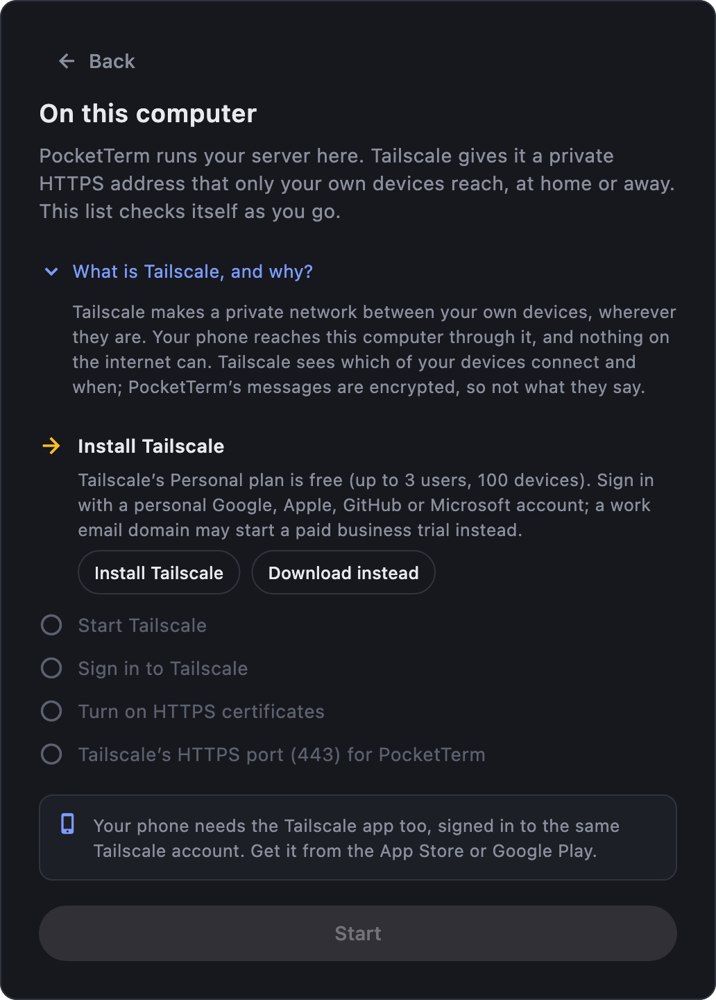
  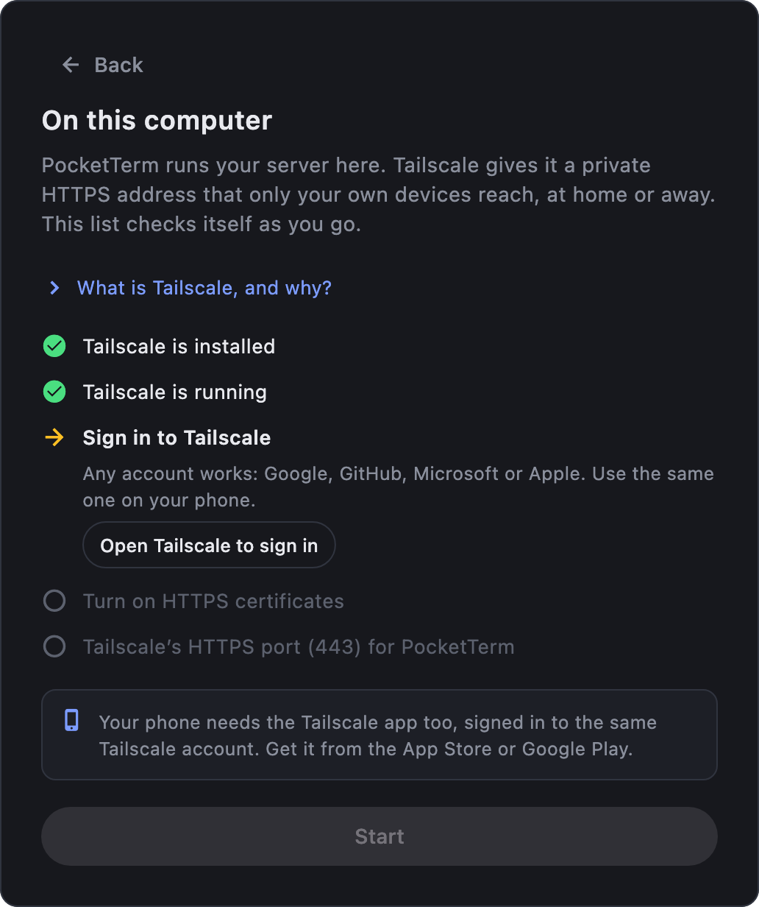
  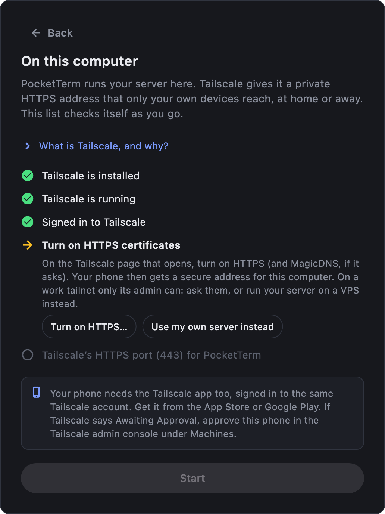
</p>
<p align="center">
  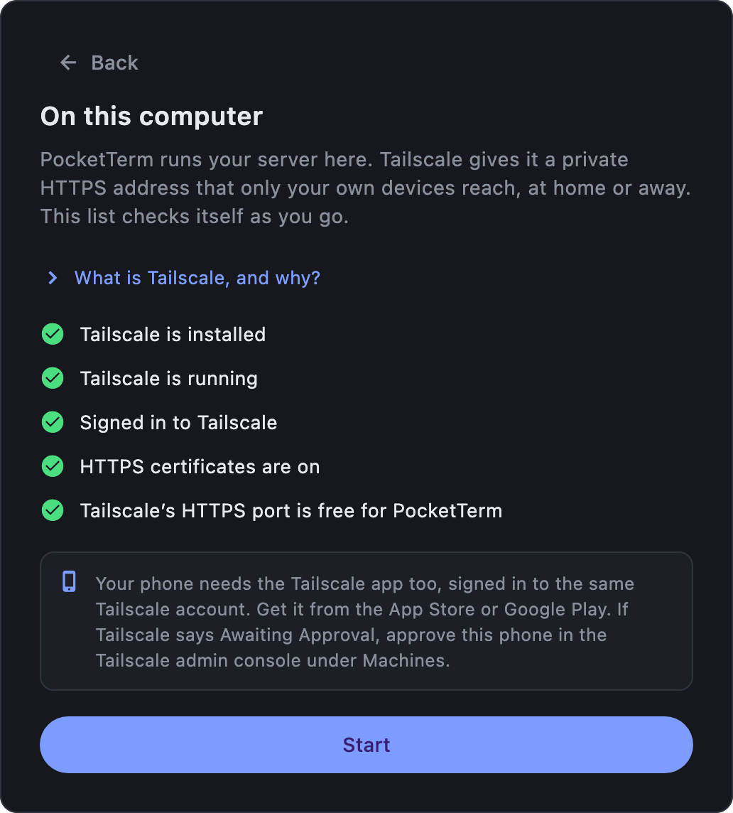
  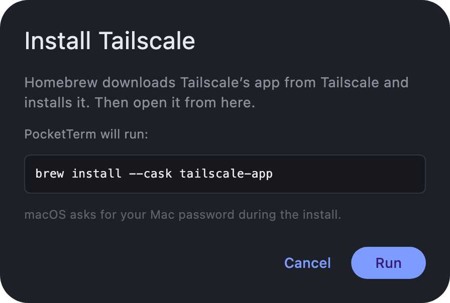
</p>

From now on the server starts with the app. **Settings → Account** shows how Tailscale stands, and Settings' status bar says when phones can't reach the server (Tailscale switched off, signed out, or something else took port 443). Another computer of yours can use this computer's server too: on this one, **Settings → Account → Add a computer…** shows a setup link; on the other one (signed in to Tailscale with the same account), choose **On my own server → Yes** and paste it.

If this computer's Tailscale name changes (you renamed the computer, or signed Tailscale in to another account), its address changes with it: the QR code and **Add a computer…** use the new one, and **Settings → Account** says so until you press **Got it**. Phones set up with the old address scan this computer's code again; other computers paste a new link.

### On my own server

Already run your own servers? See [what the PocketTerm server needs](../apps/pocketterm-server/README.md#what-it-needs).

The wizard first asks: **Do you already have a PocketTerm server?**

<p align="center">
  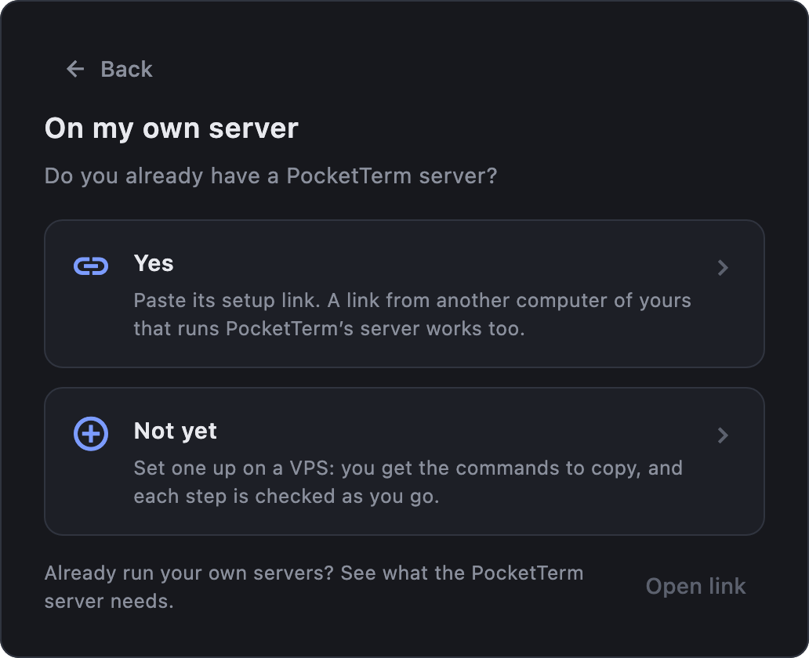
  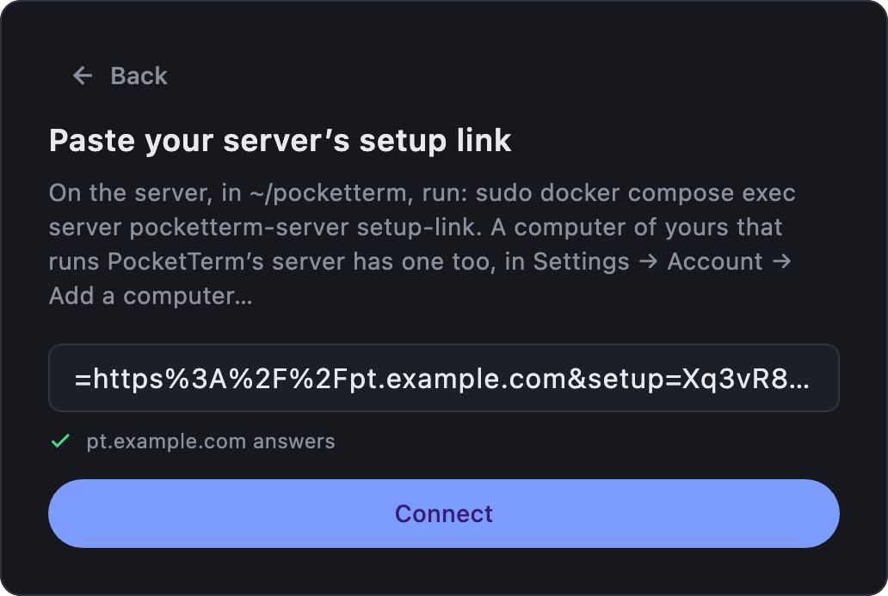
</p>

**Yes:** paste its setup link (`pocketterm://setup?url=…&setup=…`). The wizard checks it as you paste: that it's a setup link at all, that it's a computer's link and not a phone's, and that its server answers. **Connect** signs this computer in. To see the link again, run on the server:

```sh
cd ~/pocketterm && sudo docker compose exec server pocketterm-server setup-link
```

**Not yet:** the wizard asks for the server's address, an IPv4 address (`203.0.113.7`) or a domain (`pocketterm.example.com`), and shows the commands for it, each with a copy button. A pasted `https://…/` URL or an `ssh user@host` line works too. A domain is used as it is (point its DNS A record at the server first). An IP address becomes its [sslip.io](https://sslip.io) name, `203-0-113-7.sslip.io`, a name that resolves to that address, so the server can get an HTTPS certificate without a domain of your own. IPv6-only servers aren't supported: Docker gets the server image from GitHub's registry (`ghcr.io`), which has no IPv6, and many phone networks reach only IPv4. Most providers add an IPv4 address for a small fee.

Rent a small Linux VPS (1 GB of memory is plenty), open **ports 80 and 443** to the internet in your provider's firewall, and open a terminal on it with SSH: the wizard shows the line (`ssh root@203.0.113.7`) to type in Terminal on a Mac or PowerShell on Windows. The commands below run on the VPS, whatever your computer is. Then run, in order (signed in as root, you can leave out `sudo`):

1. Install Docker:

   ```sh
   curl -fsSL https://get.docker.com | sudo sh
   ```

2. Get the server (the compose file of the release your app is, here 0.1.0; the wizard fills in yours):

   ```sh
   mkdir -p ~/pocketterm && cd ~/pocketterm && curl -fsSLO https://raw.githubusercontent.com/danyzmaj-apps/pocketterm/v0.1.0/apps/pocketterm-server/docker-compose.yml
   ```

3. Start it, with your server's name (here the sslip.io name of `203.0.113.7`):

   ```sh
   cd ~/pocketterm && echo "DOMAIN=203-0-113-7.sslip.io" > .env && sudo docker compose up -d
   ```

4. Print its setup link:

   ```sh
   cd ~/pocketterm && sudo docker compose exec server pocketterm-server setup-link
   ```

Docker runs the PocketTerm server in a container, so nothing else on the VPS changes. [Caddy](https://caddyserver.com) runs next to it: it answers on ports 80 and 443 and gets a free HTTPS certificate from Let's Encrypt (which checks port 80), renewing it on its own.

While you work, the wizard checks the address and turns each line green: **the name resolves**, **HTTPS answers** (Caddy has its certificate, usually a minute after step 3), **the PocketTerm server answers** (`/v1/health`). Then it shows the box for the setup link step 4 printed.

<p align="center">
  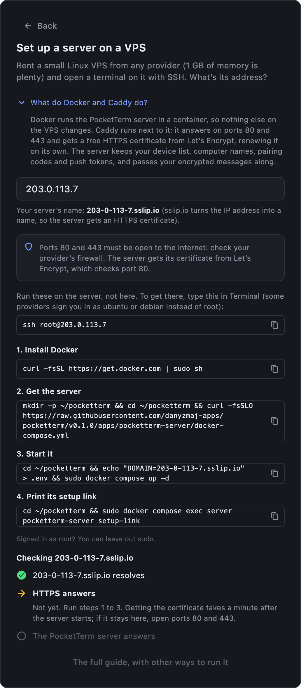
  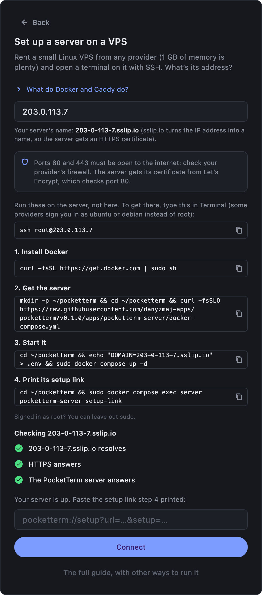
</p>

The setup link signs a computer in to your server: keep it private. If it leaks, replace it (computers already signed in stay signed in):

```sh
cd ~/pocketterm && sudo docker compose exec server pocketterm-server setup-link --new
```

Everything the server keeps is in the `pocketterm-data` Docker volume; back it up to keep your devices signed in after moving machines. Other ways to run it (behind nginx, Traefik, Cloudflare or a Cloudflare Tunnel, without Docker) and its options: [apps/pocketterm-server/README.md](../apps/pocketterm-server/README.md).

### Supabase

PocketTerm puts its server on a free [Supabase](https://supabase.com) project in your Supabase organization, in a region you pick. Nothing runs on a machine of yours, and no Tailscale is needed. It's the same server as the other options (same sign-in, same end-to-end encryption), built from Supabase parts: a database, one Edge Function named `pocketterm`, a private Storage bucket for sealed images and files, and Supabase Realtime for the live channel. How it's built: [apps/pocketterm-desktop/supabase/README.md](../apps/pocketterm-desktop/supabase/README.md).

The wizard first asks: **Is PocketTerm already on a Supabase project of yours?** **Paste a setup link** is for a project another computer of yours already uses ([More computers](#more-computers-on-supabase) below). **Set up a project** makes a new one:

1. **A personal access token.** The wizard first says what Supabase holds and what stays private. Make a token at [supabase.com/dashboard/account/tokens](https://supabase.com/dashboard/account/tokens) (**Create a token** opens the page) and paste it. It covers your whole Supabase organization (every project in it). PocketTerm uses it only during setup and never stores it. Best: a Supabase organization of its own for PocketTerm, and deleting the token once setup is done.
2. **Organization and region.** Pick the organization and the region the project lives in. Supabase holds your server's metadata there. **Create the project** makes a project named PocketTerm; if the organization already has a project with PocketTerm on it, the wizard offers **Update that project** instead. Your other projects are never offered or touched.
3. **The setup runs.** A checklist follows each step: **Starting the project**, **Database**, **Live channel key**, **Server function**, **Signing this computer in**. Supabase may hold the live channel key step for several minutes; the wizard says so and waits. Every step can run again: the database keeps what it has, and the function is deployed anew.

Then the computer is signed in, as with a pasted setup link, and **Get this computer ready** opens.

Good to know:

- **Free projects pause** after about a week without use. Phones and computers can't connect until you restore it at [supabase.com/dashboard](https://supabase.com/dashboard). The free plan allows 2 active projects per account.
- **A signing key.** The setup imports a key PocketTerm made into the project as its JWT signing key, and the function keeps it as a secret to sign 10-minute live channel tokens. Anyone with access to the project (members of the organization, Supabase) could use it: the same trust as the project itself.
- **Revoking** a phone or computer tells it at once over the live channel; at worst its live connection lasts until its 10-minute token runs out (messages stay sealed).
- <a id="more-computers-on-supabase"></a>**More computers** don't need a token: on a computer already signed in, **Settings → Account → Add a computer…** shows a new setup link (the one before stops working; nobody is signed out); paste it in the other computer's wizard (**Supabase → Paste a setup link**).

## After the first sign-in

The first sign-in on a computer opens **Get this computer ready**, a checklist whose steps check themselves off:

1. **Your coding agents.** Each coding agent found (omp, Claude Code), with whether PocketTerm is in it. Opening the checklist installs nothing: **Install** (or **Update**) first says why PocketTerm needs to be in that agent, what it changes there and how to take it out, and installs only once you confirm; it then says how it went and offers **Retry** if it failed. An agent that isn't installed is left for later: Settings offers it once it shows up. **Sessions that were already open** don't have PocketTerm's add-on yet (an agent loads add-ons when it starts), so the phone sees only their screen. They're listed, each with what to do once, with a copy button: in Claude Code type `/reload-plugins` (nothing restarts); in omp quit it and run `omp -c` (same conversation). New sessions don't need it.
2. **Your terminals.** On a Mac, the terminals it found (kitty, Ghostty, WezTerm), with **Set up** for kitty (it turns on kitty's remote control in `kitty.conf`; restart kitty after) and **Allow…** for one that needs Automation permission. Ghostty doesn't let other apps read or type into its windows, so PocketTerm runs Ghostty sessions in tmux: when tmux is missing, **Install tmux** runs `brew install tmux` once you confirm (or copy the line); with MacPorts and no Homebrew, it shows `sudo port install tmux` to type; with neither, **Get Homebrew** opens [brew.sh](https://brew.sh) and the button shows up once Homebrew is there. **Start new windows in tmux** adds two lines to Ghostty's config so each new Ghostty window opens in tmux (**Settings → Terminals → Remove** takes them out). On Windows, PocketTerm works through WezTerm only (no kitty, Ghostty or tmux there, and no Automation permission to give): **Install WezTerm** downloads WezTerm's own installer from its GitHub release, checks it against WezTerm's published checksum and opens it for you to click through, or you type the `winget` line it shows into PowerShell.
3. **Project folders** (optional). The usual folders found in your home folder (`Dev`, `Developer`, `Projects`, `code`, `src`, `repos`, `git`; on Windows also `source\repos` and `Documents\GitHub`, also in OneDrive's Documents when OneDrive backs it up), one click each, or **Choose folder…**.
4. **Your phone.** The QR code from [Connect the apps](#connect-the-apps), checked off once a phone has signed in. Through Tailscale, it reminds you that the phone needs the Tailscale app, signed in to the same account.

<p align="center">
  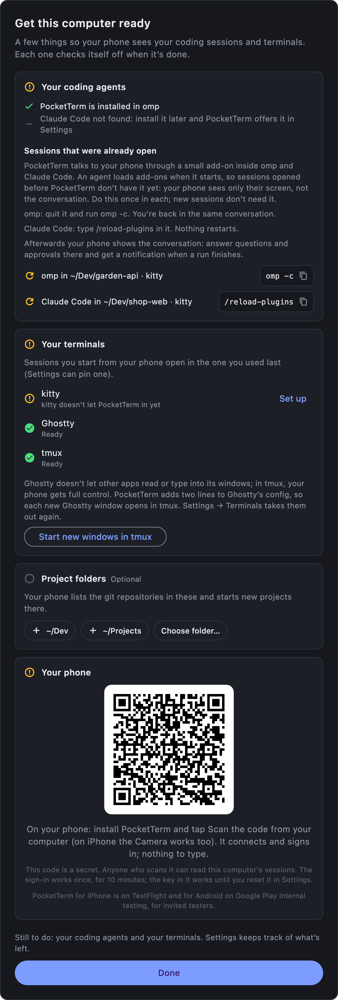
</p>

**Done** goes to Settings and says what's still left. Settings starts with a status bar: **All set**, or how many things need attention; **Show** lists them with the button that fixes each, including a coding agent installed later, and a dot marks the tab they're on. **Open setup checklist** shows the checklist again. On Windows, a bar under it links to a new version when one is out. Below it are four tabs: **Phone** (Terminal from phone, **Add a phone…**, **Reset key**, project folders), **Coding agents** (PocketTerm in each agent with **Install** or **Update**, sessions to reopen, **Make default**), **Terminals** (where new sessions open, each terminal with its fix) and **Account** (**Sign out**; your server and the phones signed in to it, each with **Sign out…**, Tailscale when this computer runs it, **Add a computer…**; **Launch at login**, off until you turn it on; **Erase this server's data** on a computer that runs the server; **How your data is protected**; the version and **Quit PocketTerm**). When macOS holds a login item back, **Launch at login** says to allow PocketTerm in System Settings → General → Login Items.

<p align="center">
  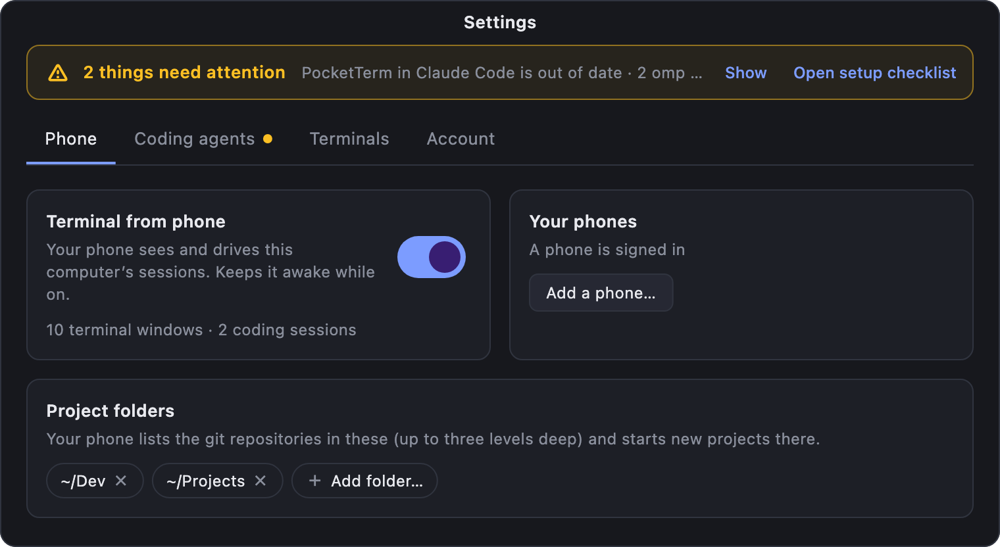
  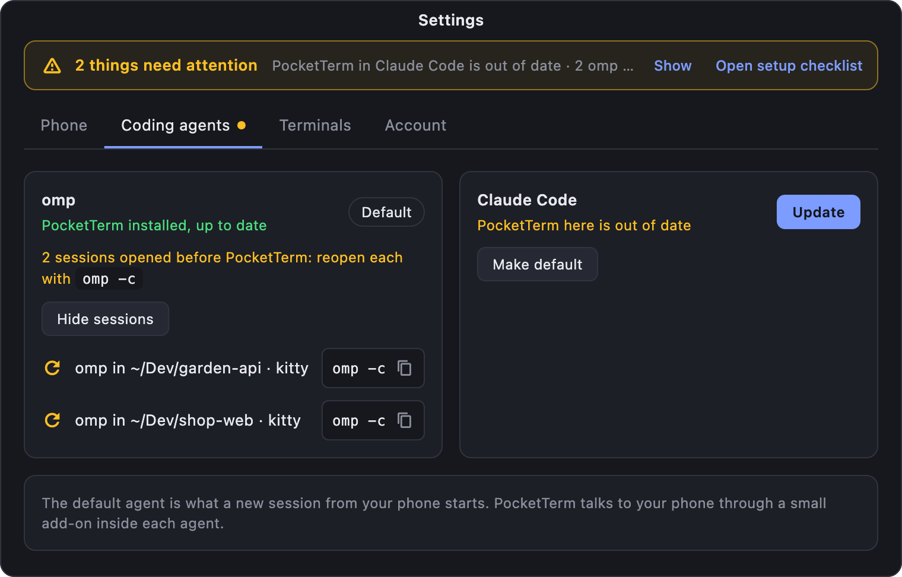
  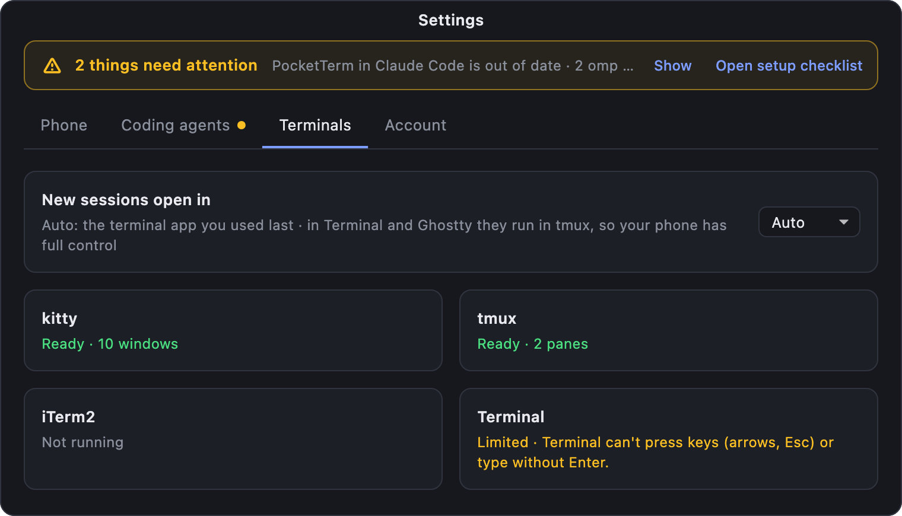
  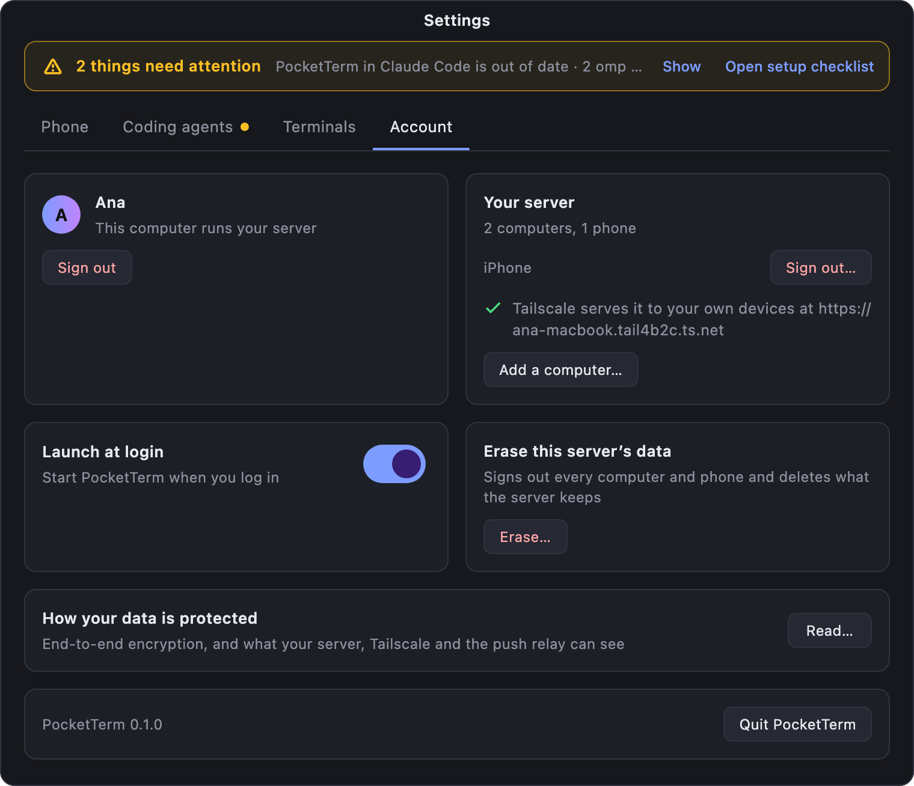
</p>

## Connect the apps

- **More computers**: install PocketTerm and paste the setup link in the wizard (**On my own server → Yes**): the VPS's from `setup-link`, or, for a server built into another computer, the link from that computer's **Settings → Account → Add a computer…**. On Supabase, paste the link from **Add a computer…** under **Supabase → Paste a setup link** instead ([Supabase](#supabase)). Every computer you sign in on shows up in the phone's list of computers.
- **iPhone and Android**: phones sign in only with a code from a computer. On the computer, **Settings → Phone → Add a phone…** shows a QR code. In the phone app, tap **Scan the code from your computer**. The code carries the server address, a one-time sign-in code and that computer's encryption key, so the phone signs in and can read that computer's sessions. The sign-in code works once and expires after 10 minutes; the key works until you **Reset key** (**Settings → Phone**). Anyone who scans the code can read that computer's sessions, so only show it to your own phone. No camera? **Paste a code instead** takes the same code as text (the whole `pocketterm://setup?…&code=…` link).

One phone sign-in covers all your computers, but each computer encrypts its sessions with its own key: scan each computer's code once. A computer the phone can't read yet shows as locked with a **Scan** button (or **Scan a computer's code** in the computer picker). After **Reset key**, every phone scans that computer's code again.

## How your data is protected

- **Encrypted from end to end.** Each computer makes its own 32-byte key and keeps it in the system's secure storage (the Keychain on a Mac; on Windows, a file in `%APPDATA%` encrypted for your Windows user with DPAPI). It never goes to any server: a phone gets it only by scanning that computer's QR code. Sessions, prompts, screens, images, files and notification text are sealed with it (AES-256-GCM), and every live message carries a timestamp, a random id and a sequence number so it can't be replayed.
- **Your PocketTerm server** keeps your list of devices, your computers' names, pairing codes (10 minutes) and your phones' push tokens. Images and files wait there sealed until the computer fetches them, at most an hour. It passes everything else on without being able to read it.
- **Tailscale** (On this computer) sees which of your devices connect and when, not what they send.
- **Supabase** (Supabase option), the company and the region you pick, holds the metadata the server holds: the device list (names, platforms, when created and last seen), computer names, push tokens, pairing codes for 10 minutes (hashed), device tokens (hashed), and the timing of messages and pushes. It sees connection IP addresses. The function and Realtime pass on ciphertext only.
- **Push notifications**, if you turn them on in the phone app, go from your server through PocketTerm's push relay (`push.danyzmaj.com`, run by Danijel Lovric on his server in Germany) to Apple or Google. What the relay and Apple or Google see is an encrypted message, the phone's push token and when it was sent, with no computer or session ids; the relay stores nothing ([apps/pocketterm-relay/SECURITY.md](../apps/pocketterm-relay/SECURITY.md)).
- **Lock Screen updates (iPhone).** When you follow a session, iOS shows its state on the Lock Screen: working, needs you, or finished. Apple doesn't let apps decrypt these updates, so this state travels unencrypted. It never includes any text from your sessions, and it carries no names, folders or ids.
- **What you trust on a VPS.** The commands run Docker's install script (`get.docker.com`) and the compose file as root. The compose file comes from the release tag matching your app (`v<version>`, not a moving branch) and runs the server image of that same version; Docker's script is Docker's own, fetched over HTTPS. Read either before you run it if you prefer, or install Docker from your distribution's packages instead. Your VPS provider sees encrypted traffic and, with access to the machine, what the server stores, but never what a computer seals.

The full model: [SECURITY.md](../SECURITY.md).

## Push

A computer pushes coding-session notifications (a run ended, the agent needs you) and the state of the sessions you follow to your phones, only when nobody has touched it for 60 seconds. Only the app's publisher holds the credentials that reach PocketTerm's installs (the APNs key for iPhones, the Firebase service account for Android), so your server hands each notification to the publisher's **relay**, which passes it to Apple's APNs or Google's Firebase Cloud Messaging. Each phone asks before it registers for notifications. A phone without a computer's key shows a plain "PocketTerm" alert for it. No setup on your side: your server seals each request to the relay's key, so nothing in between can read it.

### Your own app id and relay

A relay only reaches apps signed with the publisher's ids. A fork that ships its own phone app (its own bundle id or Android package) runs its own relay ([apps/pocketterm-relay](../apps/pocketterm-relay/README.md), a container): an APNs key from its Apple team, a Firebase project with its Android app (its `google-services.json` goes into its Android build), that project's service account, and an X25519 key pair of its own. Then point each server that serves those apps at it, in the VPS's `~/pocketterm/.env` next to `DOMAIN`:

```sh
PUSH_RELAY_URL=https://<relay host>/v1/push
PUSH_RELAY_KEY=<the relay's public key, base64; the relay logs it at start>
```

## Updating

- **On this computer**: the server is part of the app and updates with it. The Mac app updates itself; on Windows, Settings links to a new version when one is out.
- **On Supabase**: the project runs the server function and database of the app that set it up. When a newer app needs a newer one, it says so: set PocketTerm up on Supabase again from a computer (**Supabase → Set up a project**, the same organization, **Update that project**). Applied migrations stay as they are and the function is deployed anew; devices stay signed in.
- **On my own server**: the compose file runs the server version it came with. To move to another one, on the VPS run (with that version for `<version>`)

  ```sh
  cd ~/pocketterm && echo "POCKETTERM_VERSION=<version>" >> .env && sudo docker compose pull && sudo docker compose up -d
  ```

[CHANGELOG.md](../CHANGELOG.md) says when a new app version needs a server update. Your data survives `docker compose pull && docker compose up -d`; to back it up or restore it, see [Back up and restore](../apps/pocketterm-server/README.md#back-up-and-restore).

## Troubleshooting

| What you see | What to do |
| --- | --- |
| Setup: **Install Tailscale** says it didn't work | Use **Download instead**. If macOS blocked Tailscale's system extension, allow it in System Settings → Privacy & Security, then try again. |
| Setup: **Turn on HTTPS certificates** stays | On the page that opened (or [login.tailscale.com/admin/dns](https://login.tailscale.com/admin/dns)), turn on MagicDNS and HTTPS Certificates. The checklist sees it within a few seconds. On a work tailnet only an admin can: ask them, use a personal Tailscale account on this computer and your phone, or choose **Use my own server instead**. |
| Setup: **Free Tailscale's HTTPS port (443)** | Something else is published with `tailscale serve` on port 443 of this computer (`tailscale serve status` shows what). PocketTerm never replaces it. Remove it (`tailscale serve --https=443 off`) or move it to another port, and the checklist moves on. |
| Settings: "Tailscale didn't let PocketTerm change its Serve settings" | With the open source `tailscale` command (not the app), only its operator may change Serve: run `sudo tailscale set --operator=$USER` once. |
| Settings: "Phones can't reach your server" | Tailscale on this computer is switched off or signed out, or something else holds its port 443. **Settings → Account** says which, with **Open Tailscale** or **Check again**. |
| Settings: "This computer's Tailscale address changed" | The computer was renamed or Tailscale signed in to another account. Each phone scans this computer's code again (**Add a phone…**); each other computer pastes a new link (**Add a computer…**). Rename it back and the old address works again. |
| Setup or Settings: "This device's clock is N minutes behind/ahead of the server's" | Every message between your computers and phones carries its time, and one more than 5 minutes off is dropped (so an old one can't be replayed). Turn on setting the time automatically (macOS: System Settings → General → Date & Time; Windows: Settings → Time & language → Date & time), on the phone too. |
| Setup: "That isn't a setup link" | Copy the whole line `setup-link` printed, starting with `pocketterm://setup?url=`. |
| Setup: "That link signs in a phone, not a computer" | That's a phone's code. Use the server's setup link (`setup-link` on the server, or **Add a computer…** on a computer that runs the server or is signed in to your Supabase project). |
| Setup: "Couldn't reach …" | Check the address, that the server runs (`cd ~/pocketterm && sudo docker compose ps`) and that ports 80 and 443 are open. For a server built into another computer, this computer must be signed in to the same Tailscale account. |
| Setup: "PocketTerm can't use your keychain (it may be locked or missing)" | macOS didn't let PocketTerm keep its sign-in in the login Keychain. Unlock the login keychain in Keychain Access (or allow PocketTerm when macOS asks), then **Try again**. |
| Setup, Supabase: "Supabase refused that access token" | The token was mistyped, deleted or expired: make a new one at [supabase.com/dashboard/account/tokens](https://supabase.com/dashboard/account/tokens) and paste it. |
| Setup, Supabase: "Supabase is still starting the project" or "Supabase lets a project change its signing key only every few minutes" | Supabase is still working on the project. Wait, then retry: every step can run again. |
| Setup or phone: "Your Supabase project runs PocketTerm X; this app needs Y or newer" | Set PocketTerm up on Supabase again from a computer (**Supabase → Set up a project**, **Update that project**), then retry. |
| Nothing connects to a Supabase project that worked before | Free projects pause after about a week without use: restore it at [supabase.com/dashboard](https://supabase.com/dashboard). |
| Setup: "Couldn't make a secure connection to <host>: its HTTPS certificate isn't valid or isn't there yet" | Caddy hasn't got a certificate. `cd ~/pocketterm && sudo docker compose logs caddy` says why: ports 80 and 443 closed in the provider's firewall, the name not pointing at the VPS, or Let's Encrypt's limit (5 certificates per name a week; sslip.io names share one big weekly quota that sometimes runs out: wait, or use a domain of your own). Add an AAAA record only if the VPS answers on IPv6. |
| Setup: "<host> answers, but the PocketTerm server behind it doesn't (502)" | The server container is stopped or failing: `sudo docker compose ps` and `sudo docker compose logs server`. |
| Setup: "Your server runs PocketTerm server X; this app needs Y or newer" | `cd ~/pocketterm && sudo docker compose pull && sudo docker compose up -d` (built into a computer: update PocketTerm there). "Your server is newer than this app": update PocketTerm. |
| "The server couldn't save this" | The VPS's disk is full or its data folder isn't writable: `df -h`, then free some space. Nothing saved before is lost. |
| Server log, or the setup on this computer: "Can't write to the data folder", "Another PocketTerm server is using …", "state.json doesn't read" | See [When something is wrong](../apps/pocketterm-server/README.md#when-something-is-wrong): the folder's owner (65532 in Docker), one server per data folder, restoring from a backup. |
| Pushes stop arriving | `sudo docker compose logs server \| grep relay`: the push relay is unreachable or refused them. The server retries for 2 minutes, then drops them. |
| Setup: "That setup link doesn't work: it was replaced by a newer one" | It was replaced with `setup-link --new`. Run `setup-link` on the server for the current one, or use **Add a computer…** on the computer that hosts it. Computers already signed in stay signed in. |
| Setup: the name doesn't resolve | For a domain, add a DNS A record with the server's IP address and wait a few minutes. For an sslip.io name, check this computer's internet connection. |
| Setup: **HTTPS answers** stays | Open ports 80 and 443 in the provider's firewall; Caddy says why in `cd ~/pocketterm && sudo docker compose logs caddy`. |
| Setup: "Leave out the port" or "private address" | Type the server's public IPv4 address or its domain only, as your VPS provider shows it. |
| Setup: "An IPv6-only server doesn't work" | Add an IPv4 address to the server (most providers sell one), or use a domain with an A record. Docker can't fetch the server from `ghcr.io` over IPv6, and many phone networks are IPv4 only. |
| Setup: the name resolves to the wrong server, or **HTTPS answers** but **The PocketTerm server answers** doesn't | An old DNS record is still cached: wait for its TTL, or check with `dig +short A <name>` that it shows the VPS's address. |
| Setup: "Cloudflare answers for <host> but can't reach your server (52x)" | Turn the orange cloud off for that name (DNS only), or set Cloudflare's SSL/TLS mode to **Full (strict)**. WebSockets pass through Cloudflare as they are. |
| Setup: "<host> keeps redirecting to itself" | Cloudflare in Flexible mode sends requests to port 80, where Caddy redirects them to HTTPS: set SSL/TLS to **Full (strict)**. |
| A server behind nginx, Traefik or another reverse proxy | Point it at port 47900 with WebSockets passed through: [apps/pocketterm-server/README.md](../apps/pocketterm-server/README.md#behind-another-reverse-proxy-or-a-cloudflare-tunnel). |
| Phone can't reach a computer that runs the server | Install the Tailscale app on the phone, sign in to the same Tailscale account and turn it on. If it's on and still can't, check **Use Tailscale DNS** in the phone's Tailscale settings (ts.net names need MagicDNS), that your tailnet's access rules let the phone reach this computer, and, with Tailnet Lock on, that the phone is signed (`tailscale lock sign`). |
| Phone: Tailscale says **Awaiting Approval** | Your tailnet has device approval on: approve the phone in the [Tailscale admin console](https://login.tailscale.com/admin/machines) under **Machines**. Signing in with an email on a custom domain (a work address) starts Tailscale's business trial, which turns device approval on; the free Personal plan needs a personal Apple, Google, GitHub or Microsoft sign-in. |
| Phone: "That code doesn't work" | It ran out (10 minutes) or was used already: make a new one (**Settings → Phone → Add a phone…**). |
| Phone: "Too many tries from this network. Wait N minutes" | Ten wrong codes from one address (an IPv6 /64 counts as one) in 10 minutes. Wait, or restart the server (`sudo docker compose restart server`) to clear it. |
| Phone: "Notifications are off on this phone: turn them on to follow a session" | Following a session needs notifications: **Account → Notifications**. |
| Phone: "<computer> isn't answering" | That computer is asleep, off, or PocketTerm isn't running there, or **Terminal from phone** (**Settings → Phone**) is off. |
| Phone: "Can't reach <name>.ts.net. It's on your tailnet…" | The server is built into a computer and reached through Tailscale. Install Tailscale on the phone, sign in to the same account and connect. If that computer was renamed in Tailscale, its address changed: on the phone, **Account → Leave this server**, then scan its new code. |
| Phone: "Can't reach <host>. Check your connection." | The phone has no route to the server (offline, captive Wi-Fi not signed in, server down). PocketTerm tries again by itself; coming back to the app retries at once. |
| Phone: "This phone's clock and <computer>'s differ by …" | Set the time automatically on the phone (iPhone: Settings → General → Date & Time → Set Automatically; Android: Date & time → Set automatically) and on the computer. |
| Phone: Notifications says "On, but notifications are off for PocketTerm in this phone's Settings" | They were turned off in the phone's Settings after you said yes. Tap **Open Settings** and allow them. |
| Phone: "Notifications are off for PocketTerm in this phone's Settings" when turning them on | Tap **Settings** on the message and allow notifications for PocketTerm, then turn them on again. |
| Phone: "This phone couldn't get a notification address from Apple or Google" | Notifications are allowed, but Apple or Google didn't answer the phone. Check its internet connection, then turn notifications on again. |
| Phone: "Your iPhone shows only a few Live Activities at once" | iOS limits Live Activities per app and in all. Stop following another session (or end one on the Lock Screen), then follow again. |
| Phone: "That code is for a computer on <host>, and this phone is on …" | A phone uses one server at a time. **Account → Leave this server**, then scan the code again. |
| Phone: the camera needs permission, or there is no camera | Tap **Open Settings** and allow Camera. A phone or iPad without a camera can't scan a code: use one that has one (the demo works without). |
| Android: notifications late or missing | Some Android makers stop apps in the background. Let PocketTerm run unrestricted (Settings → Apps → PocketTerm → Battery → Unrestricted). |
| Phone: signed out while offline | The phone forgets its keys and sign-in at once; the server lists it until you sign it out on a computer (**Settings → Account**, **Sign out…** next to the phone). |
| Terminal: "PocketTerm may not control Ghostty" | Allow it in System Settings → Privacy & Security → Automation → PocketTerm. |
| Terminal: kitty windows don't show | **Settings → Terminals → Set up**, then restart kitty. |
| Terminal: Ghostty shows no screen, or the phone can't answer | Install tmux (`brew install tmux`, or `sudo port install tmux` with MacPorts): sessions the phone starts in Ghostty run in tmux. For windows you open yourself, **Settings → Terminals → Start new windows in tmux**. |
| Terminal: no windows on Windows | Only WezTerm windows are listed; install it from **Settings → Terminals**. |
| Terminal: a Ghostty session isn't matched to its window | Ghostty tells no tty, so PocketTerm matches the session by its folder and, when several Ghostty windows share it, by the window title omp sets (the session's title, or the folder's name until it has one) and by which windows other sessions already run in. Give a session a title, or keep one Ghostty window per folder. |
| Terminal: a Ghostty window in tmux is listed twice (the tmux pane, and a Ghostty row titled 👻) | Ghostty tells no tty, so PocketTerm ties a window to the tmux in it by the title tmux gives it, which **Start new windows in tmux** turns on (`~ (tmux 3)`: the pane's title and the session), or when it's the only window left to tie. A line an earlier PocketTerm wrote (no `set-titles` in it) is brought up to date by itself, and the Ghostty card says so; windows opened before keep their old command, so several of them open when PocketTerm starts stay apart until you open new ones. |
| Windows: "This computer reads PNG and JPEG images only." | Send PNG or JPEG images; the phone apps send JPEG. |
| Windows: "Windows protected your PC" when installing | The installer isn't code-signed yet: **More info → Run anyway**. It installs for you only, in `%LOCALAPPDATA%\Programs\PocketTerm`, with no admin prompt. |
| Windows: WezTerm "too old for PocketTerm" | PocketTerm needs WezTerm 20230326 or later: `winget upgrade wez.wezterm`, or **Settings → Terminals**. |
| Windows: `claude` or `omp` not found in a session PocketTerm opened | PocketTerm hands WezTerm the PATH a fresh sign-in has, but a WezTerm started earlier keeps its own: close every WezTerm window once. "Running scripts is disabled" in PowerShell: use Claude Code's native installer (`claude.exe`), or `Set-ExecutionPolicy -Scope CurrentUser RemoteSigned`. |
| Windows: a project in WSL (`\\wsl.localhost\…`) doesn't open | WezTerm's default shell (cmd) can't start in a `\\` path: set WezTerm's `default_prog` to `pwsh`, or `default_domain = 'WSL:Ubuntu'`. |
| Windows: a firewall prompt | None is expected: the built-in server and PocketTerm's local API listen on 127.0.0.1 only, and phones come in through Tailscale. **Cancel** is safe. |
| Windows: very long project paths | PocketTerm handles paths over 260 characters; turn on `LongPathsEnabled` for git and other tools too. |
| Claude Code sessions don't show up | Claude Code needs 2.1.287 or later with mods on. If Settings says mods are off, run `claude /login`, start `claude` once, then type `/reload-plugins` in your sessions. |
| Phone: omp or Claude windows show only as screens (**Screen only**), not as conversations | Where PocketTerm is installed in that agent, open the window on the phone and tap **Switch to conversation**: omp restarts on the same conversation (`omp -c`; if it was working, **Restart and continue** has it carry on), Claude Code reloads its plugins (nothing restarts). Otherwise the note above them says why: PocketTerm isn't installed in that agent (**Install** in Settings' status bar or **Settings → Coding agents**), it's out of date (**Update**), or the window's terminal can't press keys and type. Then, once per session: in Claude Code type `/reload-plugins`; in omp quit it and run `omp -c`. If the switch says "It didn't come back as a conversation", look at the window on the computer: omp may still be asking something or the shell may not have run `omp -c`. |

### Known limits

- **The computer must be awake** in every option: your sessions run on it. While **Terminal from phone** is on, PocketTerm keeps it from idle sleep; a lid closed or a sleep you start still stops it. With the server on this computer, phones can't reach the server either while it sleeps; when it wakes, Tailscale reconnects and Settings shows the server as ready again within a minute. Turn on **Launch at login** so PocketTerm is back after a restart.
- **One PocketTerm per computer.** A second copy doesn't start (Windows) or isn't offered (macOS opens the running one). Starting a second one by force (`open -n`) isn't supported: both would want the same Tailscale port.
- **Port 47900** on 127.0.0.1 is the built-in server's; when another app has it, the server takes the next free one and remembers it. Only Tailscale's port 443 faces your devices.
- **Tailscale Funnel isn't used.** The built-in server is reachable from your own tailnet only, never from the internet.
- **IPv6-only VPS**: not supported (above).

## Removing it

**Settings → Account → Sign out** on each computer. On a computer that runs the server, **Erase this server's data** first signs every computer and phone out and deletes what it keeps. On a VPS, `cd ~/pocketterm && sudo docker compose down -v` stops the server and deletes its data; then delete the VPS. On Supabase, delete the PocketTerm project at [supabase.com/dashboard](https://supabase.com/dashboard), and the access token if you kept it.

Uninstalling PocketTerm on Windows keeps its data: `%APPDATA%\Danijel Lovric\PocketTerm` (settings, the encrypted sign-in and keys, the built-in server's data) and `%USERPROFILE%\.config\pocketterm`. Delete both for a clean slate. PocketTerm's add-ons stay in omp (`~/.omp`) and Claude Code until you remove them there.
