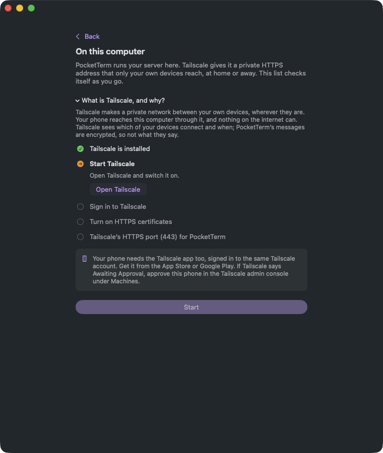
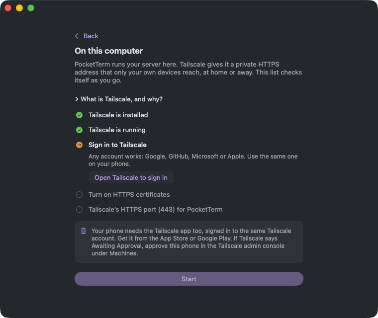
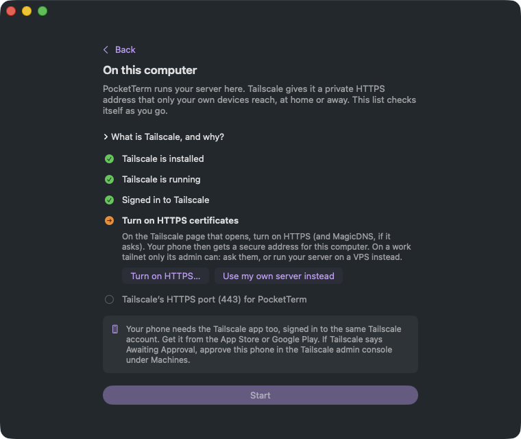
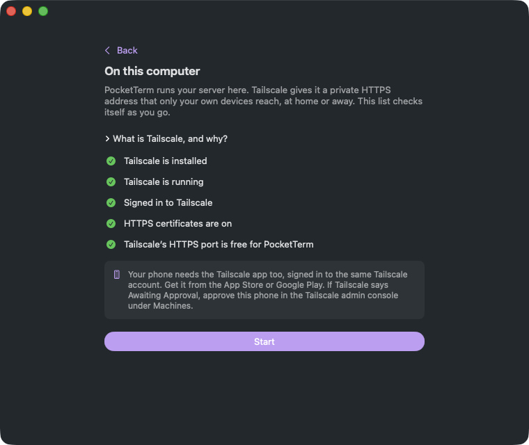
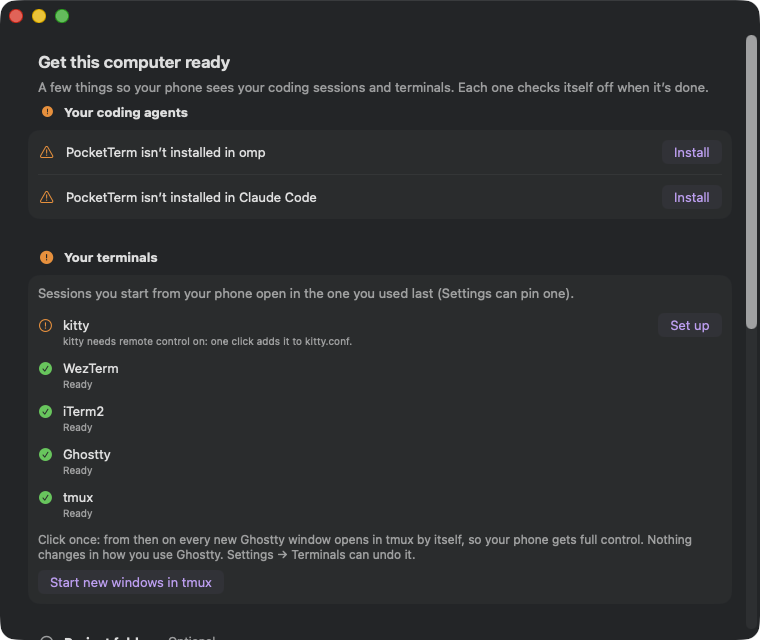
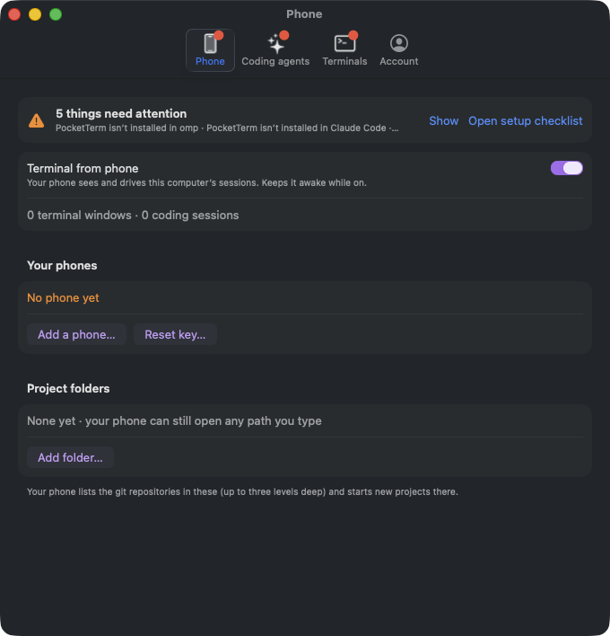
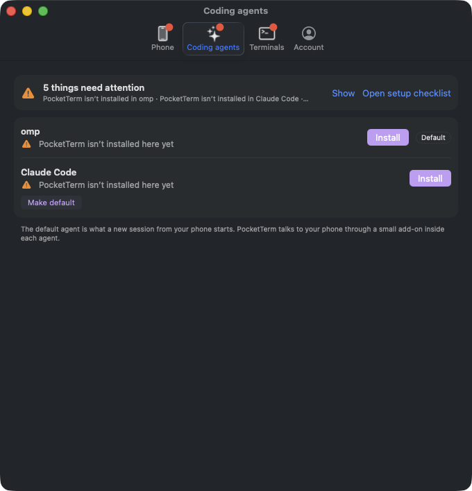
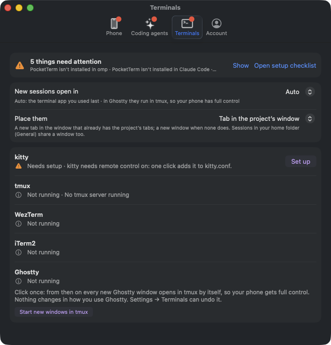
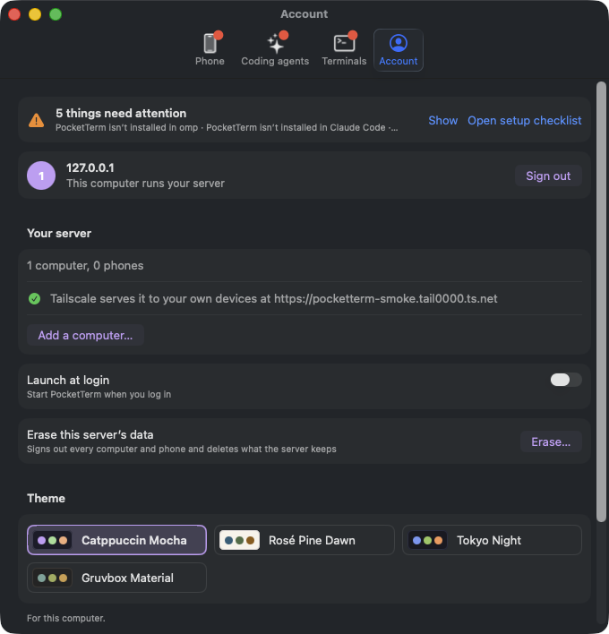

# Setting up PocketTerm

PocketTerm has no central server. Your computers and phones meet in a **PocketTerm server** built into the PocketTerm desktop app on one of your computers: it pairs your phones, keeps the list of your computers, passes the live channel between a computer and its phones and sends pushes. Everything between a computer and a phone is end-to-end encrypted by the apps, so the server only ever passes on ciphertext ([How your data is protected](#how-your-data-is-protected)).

The server listens on that computer only. [Tailscale](https://tailscale.com) makes a private network between your own devices and gives the computer an HTTPS address that only they reach (`https://<this computer>.<tailnet>.ts.net`, through `tailscale serve`). Tailscale sees which of your devices connect and when, not what PocketTerm sends.

| | |
| --- | --- |
| Who runs the server | One of your computers (built into the PocketTerm app) |
| Who holds the metadata | Only you |
| Reached through | Tailscale on your computers and phones, signed in to the same account |
| Cost | Free |
| The computer must be awake | Yes (your sessions and the server run on it) |
| Contents end-to-end encrypted | Yes |

Tailscale's Personal plan is free (up to 3 users, 100 devices). Sign in with a personal Google, Apple, GitHub or Microsoft account; a work email domain may start a paid business trial instead.

The server is set up from a computer, never from a phone: the iPhone and Android apps only pair with a computer that is set up.

## The setup wizard

Install PocketTerm on your Mac or Windows PC ([Releases](https://github.com/danyzmaj-apps/pocketterm/releases/latest)) and open it. With no server yet, its window is a setup wizard. **How your data is protected** sums up who can see what; **Settings → Account** shows the same again later.

PocketTerm never runs anything on your computer without asking first. Where it can install something for you (Tailscale or tmux with Homebrew on a Mac, Tailscale with winget on Windows), the button shows the exact command and runs it only after you press **Run**; anything else is a line to copy or a download link.

The wizard shows a checklist that looks again every few seconds and moves on by itself. Each step shows only its own button; finished steps fold to one line:

1. **Install Tailscale.** With Homebrew on a Mac, **Install Tailscale** runs `brew install --cask tailscale-app` once you confirm (macOS asks for your password: Tailscale's installer needs it). On Windows it runs `winget install --id Tailscale.Tailscale --exact --source winget` once you confirm (Windows asks you to allow the installer). **Download instead** opens Tailscale's download page; a Mac without Homebrew gets only that. The App Store and standalone Mac apps both work (PocketTerm uses the app's own command line, `/Applications/Tailscale.app/Contents/MacOS/Tailscale`), and so does the open source `tailscale` command (Homebrew's `tailscale` formula), found on the PATH.
2. **Start Tailscale.** **Open Tailscale** and switch it on.
3. **Sign in to Tailscale.** **Open Tailscale to sign in**, with any account (Google, GitHub, Microsoft, Apple). Use the same one on your phone.
4. **Turn on HTTPS certificates.** **Turn on HTTPS…** opens the page Tailscale names for your tailnet (or the admin console's [DNS page](https://login.tailscale.com/admin/dns)): turn on HTTPS, and MagicDNS if it asks. On a work tailnet only its admin can: ask them, or sign this computer and your phone in to a personal Tailscale account instead.
5. **Tailscale's HTTPS port is free.** PocketTerm publishes the server on port 443 of this computer's Tailscale name with `tailscale serve`. If something else is served there already (`tailscale serve status` shows it), PocketTerm leaves it alone and waits: remove it with `tailscale serve --https=443 off`, or move it to another port.
6. **Start** runs the server and signs this computer in to it.

Your phone needs the Tailscale app too, from the App Store or Google Play, signed in to the same Tailscale account. The wizard and the phone step of the checklist both say so.

  
  
  

  

From now on the server starts with the app. **Settings → Account** shows how Tailscale stands, and Settings' status bar says when phones can't reach the server (Tailscale switched off, signed out, or something else took port 443).

If this computer's Tailscale name changes (you renamed the computer, or signed Tailscale in to another account), its address changes with it: the QR code and **Add a computer…** use the new one, and **Settings → Account** says so until you press **Got it**. Phones set up with the old address scan this computer's code again; other computers paste a new link.

### More computers

Your other computers use the server of the first one; they don't run their own.

1. On the computer that runs the server, **Settings → Account → Add a computer…** shows a setup link (`pocketterm://setup?url=https://<computer>.<tailnet>.ts.net&setup=…`). It signs a computer in to your server: keep it private.
2. On the other computer, sign Tailscale in to the same account, install PocketTerm and, in its setup, choose **Join another computer's PocketTerm…** and paste the link. The wizard checks it as you paste: that it's a computer's setup link, that its server is a PocketTerm on Tailscale (`….ts.net`), and that it answers. **Connect** signs this computer in.

The computer that runs the server has to be awake for the others to reach it.

### Moving from Supabase or your own server

Earlier versions could also put the server on Supabase or on a server you ran yourself. PocketTerm no longer supports either. A computer that was set up that way signs itself out when the new version starts, and its setup opens with the note "PocketTerm now runs its server on this computer, over Tailscale. Set it up below; then scan the new code with your phone." A phone that was on Supabase signs out with "Your computer's PocketTerm now runs its own server. Scan its new code." Set one computer up as above, join your other computers to it, and scan each computer's code with your phones once. Then delete the old Supabase project or server: PocketTerm doesn't use it any more.

## After the first sign-in

The first sign-in on a computer opens **Get this computer ready**, a checklist whose steps check themselves off:

1. **Your coding agents.** Each coding agent found (omp, Claude Code), with whether PocketTerm is in it. Opening the checklist installs nothing: **Install** (or **Update**) first says why PocketTerm needs to be in that agent, what it changes there and how to take it out, and installs only once you confirm; it then says how it went and offers **Retry** if it failed. An agent that isn't installed is left for later: Settings offers it once it shows up. **Sessions that were already open** don't have PocketTerm's add-on yet (an agent loads add-ons when it starts), so the phone sees only their screen. They're listed, each with what to do once, with a copy button: in Claude Code type `/reload-plugins` (nothing restarts); in omp quit it and run `omp -c` (same conversation). New sessions don't need it.
2. **Your terminals.** On a Mac, the terminals it found (kitty, Ghostty, WezTerm), with **Set up** for kitty (it turns on kitty's remote control in `kitty.conf`; restart kitty after) and **Allow…** for one that needs Automation permission. Ghostty doesn't let other apps read or type into its windows, so PocketTerm runs Ghostty sessions in tmux: when tmux is missing, **Install tmux** runs `brew install tmux` once you confirm (or copy the line); with MacPorts and no Homebrew, it shows `sudo port install tmux` to type; with neither, **Get Homebrew** opens [brew.sh](https://brew.sh) and the button shows up once Homebrew is there. **Start new windows in tmux** adds two lines to Ghostty's config so each new Ghostty window opens in tmux (**Settings → Terminals → Remove** takes them out). On Windows, PocketTerm works through WezTerm only (no kitty, Ghostty or tmux there, and no Automation permission to give): **Install WezTerm** downloads WezTerm's own installer from its GitHub release, checks it against WezTerm's published checksum and opens it for you to click through, or you type the `winget` line it shows into PowerShell.
3. **Project folders** (optional). The usual folders found in your home folder (`Dev`, `Developer`, `Projects`, `code`, `src`, `repos`, `git`; on Windows also `source\repos` and `Documents\GitHub`, also in OneDrive's Documents when OneDrive backs it up), one click each, or **Choose folder…**.
4. **Your phone.** The QR code from [Connect the apps](#connect-the-apps), checked off once a phone has signed in. It reminds you that the phone needs the Tailscale app, signed in to the same account.

  

**Done** goes to Settings and says what's still left. Settings starts with a status bar: **All set**, or how many things need attention; **Show** lists them with the button that fixes each, including a coding agent installed later, and a dot marks the tab they're on. **Open setup checklist** shows the checklist again. On Windows, a bar under it links to a new version when one is out. Below it are four tabs: **Phone** (Terminal from phone, **Add a phone…**, **Reset key**, project folders), **Coding agents** (PocketTerm in each agent with **Install** or **Update**, sessions to reopen, **Make default**), **Terminals** (where new sessions open, each terminal with its fix) and **Account** (**Sign out**; your server and the phones signed in to it, each with **Sign out…**, Tailscale when this computer runs it, **Add a computer…**; **Launch at login**, off until you turn it on; **Erase this server's data** on a computer that runs the server; **How your data is protected**; the version and **Quit PocketTerm**). When macOS holds a login item back, **Launch at login** says to allow PocketTerm in System Settings → General → Login Items.

  
  
  
  

## Connect the apps

- **More computers**: see [More computers](#more-computers). Every computer you sign in on shows up in the phone's list of computers.
- **iPhone and Android**: phones sign in only with a code from a computer. On the computer, **Settings → Phone → Add a phone…** shows a QR code. In the phone app, tap **Scan the code from your computer**. The code carries the server address, a one-time sign-in code and that computer's encryption key, so the phone signs in and can read that computer's sessions. The sign-in code works once and expires after 10 minutes; the key works until you **Reset key** (**Settings → Phone**). Anyone who scans the code can read that computer's sessions, so only show it to your own phone. No camera? **Paste a code instead** takes the same code as text (the whole `pocketterm://setup?…&code=…` link).

One phone sign-in covers all your computers, but each computer encrypts its sessions with its own key: scan each computer's code once. A computer the phone can't read yet shows as locked with a **Scan** button (or **Scan a computer's code** in the computer picker). After **Reset key**, every phone scans that computer's code again.

## How your data is protected

- **Encrypted from end to end.** Each computer makes its own 32-byte key and keeps it in the system's secure storage (the Keychain on a Mac; on Windows, a file in `%APPDATA%` encrypted for your Windows user with DPAPI). It never goes to any server: a phone gets it only by scanning that computer's QR code. Sessions, prompts, screens, images, files and notification text are sealed with it (AES-256-GCM), and every live message carries a timestamp, a random id and a sequence number so it can't be replayed.
- **The PocketTerm server** (built into the computer that runs it) keeps your list of devices, your computers' names, pairing codes (10 minutes) and your phones' push tokens. Images and files wait there sealed until the computer fetches them, at most an hour. It passes everything else on without being able to read it.
- **Tailscale** sees which of your devices connect and when, not what they send.
- **Push notifications**, if you turn them on in the phone app, go from your server through PocketTerm's push relay (`push.danyzmaj.com`, run by Danijel Lovric on his server in Germany) to Apple or Google. What the relay and Apple or Google see is an encrypted message, the phone's push token and when it was sent, with no computer or session ids; the relay stores nothing ([apps/pocketterm-relay/SECURITY.md](../apps/pocketterm-relay/SECURITY.md)).
- **Lock Screen updates (iPhone).** When you follow a session, iOS shows its state on the Lock Screen: working, needs you, or finished. Apple doesn't let apps decrypt these updates, so this state travels unencrypted. It never includes any text from your sessions, and it carries no names, folders or ids.
The full model: [SECURITY.md](../SECURITY.md).

## Push

A computer pushes coding-session notifications (a run ended, the agent needs you) and the state of the sessions you follow to your phones, only when nobody has touched it for 60 seconds. Only the app's publisher holds the credentials that reach PocketTerm's installs (the APNs key for iPhones, the Firebase service account for Android), so the server hands each notification to the publisher's **relay**, which passes it to Apple's APNs or Google's Firebase Cloud Messaging. Each phone asks before it registers for notifications. A phone without a computer's key shows a plain "PocketTerm" alert for it. No setup on your side: the server seals each request to the relay's key, so nothing in between can read it.

### Your own app id and relay

A relay only reaches apps signed with the publisher's ids. A fork that ships its own phone app (its own bundle id or Android package) runs its own relay ([apps/pocketterm-relay](../apps/pocketterm-relay/README.md), a container): an APNs key from its Apple team, a Firebase project with its Android app (its `google-services.json` goes into its Android build), that project's service account, and an X25519 key pair of its own. Then build its desktop apps with that relay as the built-in server's default: `defaultRelay` and `defaultRelayKey` (the relay's public key, base64; the relay logs it at start) in `packages/pocketterm_server/lib/src/relay.dart`. The server also reads `PUSH_RELAY_URL` and `PUSH_RELAY_KEY` from the environment it starts in.

## Updating

The server is part of the desktop app and updates with it. The Mac app updates itself; on Windows, Settings links to a new version when one is out. Computers joined to another computer's server need a version that server's app understands: update them together. [CHANGELOG.md](../CHANGELOG.md) says when.

## Troubleshooting

| What you see | What to do |
| --- | --- |
| Setup, Join another computer's PocketTerm: "This link isn't for a PocketTerm on Tailscale." | Copy the link from **Settings → Account → Add a computer…** on the computer that runs the server: its address ends in `.ts.net`. A phone's code (`…&code=…`) doesn't work here either. |
| Setup, Join another computer's PocketTerm: "Couldn't reach …" | This computer must be signed in to the same Tailscale account as the one that runs the server, and that computer must be awake with PocketTerm running. |
| Setup: "That setup link doesn't work: it was replaced by a newer one" | Press **Add a computer…** again on the computer that runs the server and use the new link. Computers already signed in stay signed in. |
| Setup: "Another PocketTerm server is using …" or "state.json doesn't read" | See [When something is wrong](../apps/pocketterm-server/README.md#when-something-is-wrong). |
| Phone: "Too many tries from this network. Wait N minutes" | Ten wrong codes from one address in 10 minutes. Wait, or quit and reopen PocketTerm on the computer that runs the server to clear it. |
| Setup: "PocketTerm now runs its server on this computer, over Tailscale" | This computer used PocketTerm on Supabase or on a server of your own, which PocketTerm no longer supports. Set it up on this computer (above), then scan its new code with each phone. |
| Phone: "Your computer's PocketTerm now runs its own server. Scan its new code." | The phone was on PocketTerm on Supabase. Once the computer is set up again, scan its code (**Settings → Phone → Add a phone…**). |
| Setup: **Install Tailscale** says it didn't work | Use **Download instead**. If macOS blocked Tailscale's system extension, allow it in System Settings → Privacy & Security, then try again. |
| Setup: **Turn on HTTPS certificates** stays | On the page that opened (or [login.tailscale.com/admin/dns](https://login.tailscale.com/admin/dns)), turn on MagicDNS and HTTPS Certificates. The checklist sees it within a few seconds. On a work tailnet only an admin can: ask them, or use a personal Tailscale account on this computer and your phone. |
| Setup: **Free Tailscale's HTTPS port (443)** | Something else is published with `tailscale serve` on port 443 of this computer (`tailscale serve status` shows what). PocketTerm never replaces it. Remove it (`tailscale serve --https=443 off`) or move it to another port, and the checklist moves on. |
| Settings: "Tailscale didn't let PocketTerm change its Serve settings" | With the open source `tailscale` command (not the app), only its operator may change Serve: run `sudo tailscale set --operator=$USER` once. |
| Settings: "Phones can't reach your server" | Tailscale on this computer is switched off or signed out, or something else holds its port 443. **Settings → Account** says which, with **Open Tailscale** or **Check again**. |
| Settings: "This computer's Tailscale address changed" | The computer was renamed or Tailscale signed in to another account. Each phone scans this computer's code again (**Add a phone…**); each other computer pastes a new link (**Add a computer…**). Rename it back and the old address works again. |
| Setup or Settings: "This device's clock is N minutes behind/ahead of the server's" | Every message between your computers and phones carries its time, and one more than 5 minutes off is dropped (so an old one can't be replayed). Turn on setting the time automatically (macOS: System Settings → General → Date & Time; Windows: Settings → Time & language → Date & time), on the phone too. |
| Setup: "PocketTerm can't use your keychain (it may be locked or missing)" | macOS didn't let PocketTerm keep its sign-in in the login Keychain. Unlock the login keychain in Keychain Access (or allow PocketTerm when macOS asks), then **Try again**. |
| Phone can't reach a computer that runs the server | Install the Tailscale app on the phone, sign in to the same Tailscale account and turn it on. If it's on and still can't, check **Use Tailscale DNS** in the phone's Tailscale settings (ts.net names need MagicDNS), that your tailnet's access rules let the phone reach this computer, and, with Tailnet Lock on, that the phone is signed (`tailscale lock sign`). |
| Phone: Tailscale says **Awaiting Approval** | Your tailnet has device approval on: approve the phone in the [Tailscale admin console](https://login.tailscale.com/admin/machines) under **Machines**. Signing in with an email on a custom domain (a work address) starts Tailscale's business trial, which turns device approval on; the free Personal plan needs a personal Apple, Google, GitHub or Microsoft sign-in. |
| Phone: "That code doesn't work" | It ran out (10 minutes) or was used already: make a new one (**Settings → Phone → Add a phone…**). |
| Phone: "Notifications are off on this phone: turn them on to follow a session" | Following a session needs notifications: **Account → Notifications**. |
| Phone: "<computer> isn't answering" | That computer is asleep, off, or PocketTerm isn't running there, or **Terminal from phone** (**Settings → Phone**) is off. |
| Phone: "Can't reach <name>.ts.net. It's on your tailnet…" | The server is built into a computer and reached through Tailscale. Install Tailscale on the phone, sign in to the same account and connect. If that computer was renamed in Tailscale, its address changed: on the phone, **Account → Leave this server**, then scan its new code. |
| Phone: "Can't reach <host>. Check your connection." | The phone has no route to the server (offline, captive Wi-Fi not signed in, server down). PocketTerm tries again by itself; coming back to the app retries at once. |
| Phone: "This phone's clock and <computer>'s differ by …" | Set the time automatically on the phone (iPhone: Settings → General → Date & Time → Set Automatically; Android: Date & time → Set automatically) and on the computer. |
| Phone: Notifications says "On, but notifications are off for PocketTerm in this phone's Settings" | They were turned off in the phone's Settings after you said yes. Tap **Open Settings** and allow them. |
| Phone: "Notifications are off for PocketTerm in this phone's Settings" when turning them on | Tap **Settings** on the message and allow notifications for PocketTerm, then turn them on again. |
| Phone: "This phone couldn't get a notification address from Apple or Google" | Notifications are allowed, but Apple or Google didn't answer the phone. Check its internet connection, then turn notifications on again. |
| Phone: "Your iPhone shows only a few Live Activities at once" | iOS limits Live Activities per app and in all. Stop following another session (or end one on the Lock Screen), then follow again. |
| Phone: "That code is for a computer on <host>, and this phone is on …" | A phone uses one server at a time. **Account → Leave this server**, then scan the code again. |
| Phone: the camera needs permission, or there is no camera | Tap **Open Settings** and allow Camera. A phone or iPad without a camera can't scan a code: use one that has one (the demo works without). |
| Android: notifications late or missing | Some Android makers stop apps in the background. Let PocketTerm run unrestricted (Settings → Apps → PocketTerm → Battery → Unrestricted). |
| Phone: signed out while offline | The phone forgets its keys and sign-in at once; the server lists it until you sign it out on a computer (**Settings → Account**, **Sign out…** next to the phone). |
| Terminal: "PocketTerm may not control Ghostty" | Allow it in System Settings → Privacy & Security → Automation → PocketTerm. |
| Terminal: kitty windows don't show | **Settings → Terminals → Set up**, then restart kitty. |
| Terminal: Ghostty shows no screen, or the phone can't answer | Install tmux (`brew install tmux`, or `sudo port install tmux` with MacPorts): sessions the phone starts in Ghostty run in tmux. For windows you open yourself, **Settings → Terminals → Start new windows in tmux**. |
| Terminal: no windows on Windows | Only WezTerm windows are listed; install it from **Settings → Terminals**. |
| Terminal: a Ghostty session isn't matched to its window | Ghostty tells no tty, so PocketTerm matches the session by its folder and, when several Ghostty windows share it, by the window title omp sets (the session's title, or the folder's name until it has one) and by which windows other sessions already run in. Give a session a title, or keep one Ghostty window per folder. |
| Terminal: a Ghostty window in tmux is listed twice (the tmux pane, and a Ghostty row titled 👻) | Ghostty tells no tty, so PocketTerm ties a window to the tmux in it by the title tmux gives it, which **Start new windows in tmux** turns on (`~ (tmux 3)`: the pane's title and the session), or when it's the only window left to tie. A line an earlier PocketTerm wrote (no `set-titles` in it) is brought up to date by itself, and the Ghostty card says so; windows opened before keep their old command, so several of them open when PocketTerm starts stay apart until you open new ones. |
| Windows: "This computer reads PNG and JPEG images only." | Send PNG or JPEG images; the phone apps send JPEG. |
| Windows: "Windows protected your PC" when installing | The installer isn't code-signed yet: **More info → Run anyway**. It installs for you only, in `%LOCALAPPDATA%\Programs\PocketTerm`, with no admin prompt. |
| Windows: WezTerm "too old for PocketTerm" | PocketTerm needs WezTerm 20230326 or later: `winget upgrade wez.wezterm`, or **Settings → Terminals**. |
| Windows: `claude` or `omp` not found in a session PocketTerm opened | PocketTerm hands WezTerm the PATH a fresh sign-in has, but a WezTerm started earlier keeps its own: close every WezTerm window once. "Running scripts is disabled" in PowerShell: use Claude Code's native installer (`claude.exe`), or `Set-ExecutionPolicy -Scope CurrentUser RemoteSigned`. |
| Windows: a project in WSL (`\\wsl.localhost\…`) doesn't open | WezTerm's default shell (cmd) can't start in a `\\` path: set WezTerm's `default_prog` to `pwsh`, or `default_domain = 'WSL:Ubuntu'`. |
| Windows: a firewall prompt | None is expected: the built-in server and PocketTerm's local API listen on 127.0.0.1 only, and phones come in through Tailscale. **Cancel** is safe. |
| Windows: very long project paths | PocketTerm handles paths over 260 characters; turn on `LongPathsEnabled` for git and other tools too. |
| Claude Code sessions don't show up | Claude Code needs 2.1.287 or later with mods on. If Settings says mods are off, run `claude /login`, start `claude` once, then type `/reload-plugins` in your sessions. |
| Phone: omp or Claude windows show only as screens (**Screen only**), not as conversations | Where PocketTerm is installed in that agent, open the window on the phone and tap **Switch to conversation**: omp restarts on the same conversation (`omp -c`; if it was working, **Restart and continue** has it carry on), Claude Code reloads its plugins (nothing restarts). Otherwise the note above them says why: PocketTerm isn't installed in that agent (**Install** in Settings' status bar or **Settings → Coding agents**), it's out of date (**Update**), or the window's terminal can't press keys and type. Then, once per session: in Claude Code type `/reload-plugins`; in omp quit it and run `omp -c`. If the switch says "It didn't come back as a conversation", look at the window on the computer: omp may still be asking something or the shell may not have run `omp -c`. |

### Known limits

- **The computer must be awake**: your sessions run on it, and so does the server. While **Terminal from phone** is on, PocketTerm keeps it from idle sleep; a lid closed or a sleep you start still stops it. Phones can't reach the server either while it sleeps; when it wakes, Tailscale reconnects and Settings shows the server as ready again within a minute. Turn on **Launch at login** so PocketTerm is back after a restart.
- **One PocketTerm per computer.** A second copy doesn't start (Windows) or isn't offered (macOS opens the running one). Starting a second one by force (`open -n`) isn't supported: both would want the same Tailscale port.
- **Port 47900** on 127.0.0.1 is the built-in server's; when another app has it, the server takes the next free one and remembers it. Only Tailscale's port 443 faces your devices.
- **Tailscale Funnel isn't used.** The built-in server is reachable from your own tailnet only, never from the internet.

## Removing it

**Settings → Account → Sign out** on each computer. On the computer that runs the server, **Erase this server's data** first signs every computer and phone out and deletes what it keeps. **Settings → Account** also stops publishing the server: `tailscale serve status` shows nothing of PocketTerm afterwards.

Uninstalling PocketTerm on Windows keeps its data: `%APPDATA%\Danijel Lovric\PocketTerm` (settings, the encrypted sign-in and keys, the built-in server's data) and `%USERPROFILE%\.config\pocketterm`. Delete both for a clean slate. On a Mac the built-in server keeps its data in `~/Library/Application Support/` under PocketTerm's folder (`pocketterm-server`). PocketTerm's add-ons stay in omp (`~/.omp`) and Claude Code until you remove them there.
